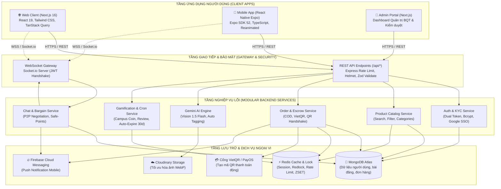
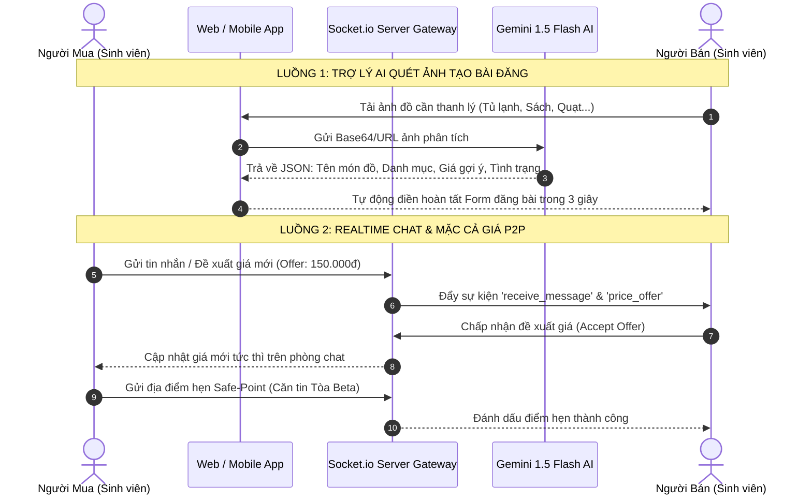

# 🎓 BÁO CÁO TỔNG KẾT ĐỒ ÁN DỰ ÁN: WEB & MOBILE APPLICATION

## ĐỀ TÀI: CAMPUS MARKETPLACE - SÀN THƯƠNG MẠI ĐIỆN TỬ & TRAO ĐỔI ĐỒ CŨ SINH VIÊN ĐẠI HỌC FPT

> **Hệ thống đa nền tảng (Web & Mobile App) tích hợp Trí tuệ nhân tạo Gemini AI, Chat Realtime, Thanh toán Escrow VietQR/COD và Gamification Campus Coin**

---

### 📌 THÔNG TIN CHUNG DỰ ÁN

* **Tên dự án:** Campus Marketplace (FU Market)
* **Quy mô dự án:** Hệ thống Fullstack đa nền tảng (**Web Portal**, **Mobile App Android/iOS**, **Backend RESTful API & WebSocket Gateway**)
* **Mô hình hoạt động:** Sàn P2P nội bộ trường học (Student-to-Student Marketplace)
* **Số lượng thành viên:** **02 Lập trình viên (Nhóm 2 người)**
* **Tỉ lệ đóng góp công việc:** **50% - 50%** (Cân đối khối lượng công việc kỹ thuật chuyên sâu)

|     STT     | Thành viên                                                     | Vai trò phụ trách chính                                                                                                                                            | Phân hệ đảm nhiệm                                                                                                                                                     |
| :---------: | :--------------------------------------------------------------- | :--------------------------------------------------------------------------------------------------------------------------------------------------------------------- | :------------------------------------------------------------------------------------------------------------------------------------------------------------------------- |
| **1** | **Thành viên 1** *(Fullstack Web & Backend Core Lead)* | • Thiết kế Kiến trúc Backend & Database Schema• Phát triển Web App & Admin Portal (Next.js 16)• Tích hợp AI Gemini Vision & Escrow Payment Gateway          | • Backend Core (Node.js/Express, Prisma, Redis)• Web Frontend (Next.js, Tailwind CSS, TanStack Query)• Xác thực KYC Thẻ Sinh Viên & Module Quản trị Admin         |
| **2** | **Thành viên 2** *(Mobile Lead & Realtime Services)*   | • Thiết kế & Phát triển Mobile App (React Native Expo)• Hạ tầng Realtime Chat & Mặc cả giá P2P• Thông báo đẩy Firebase FCM & UX/UI Mobile Optimization | • Mobile Frontend (React Native, Expo SDK 52, Reanimated)• Realtime WebSocket Client/Server (Socket.io)• Luồng Giao dịch QR Handshake & Đồng bộ tính năng Parity |

---

## 📑 MỤC LỤC BÁO CÁO

1. [Lý do chọn đề tài &amp; Bài toán thực tế](#1-lý-do-chọn-đề-tài--bài-toán-thực-tế)
2. [Bảng phân chia công việc chi tiết cho 2 thành viên (Work Breakdown Structure)](#2-bảng-phân-chia-công-việc-chi-tiết-cho-2-thành-viên)
3. [Kiến trúc hệ thống tổng thể &amp; Ngăn xếp công nghệ (Tech Stack)](#3-kiến-trúc-hệ-thống-tổng-thể--ngăn-xếp-công-nghệ)
4. [Mô hình dữ liệu &amp; Thiết kế cơ sở dữ liệu (Database Design)](#4-mô-hình-dữ-liệu--thiết-kế-cơ-sở-dữ-liệu)
5. [Đặc tả các phân hệ chức năng cốt lõi trên Web &amp; Mobile](#5-đặc-tả-các-phân-hệ-chức-năng-cốt-lõi-trên-web--mobile)
6. [Hạ tầng Realtime, Gemini AI &amp; Thông báo đa kênh](#6-hạ-tầng-realtime-gemini-ai--thông-báo-đa-kênh)
7. [Quy trình Giao dịch An toàn, Thanh toán Escrow &amp; Gamification](#7-quy-trình-giao-dịch-an-toàn-thanh-toán-escrow--gamification)
8. [Đảm bảo chất lượng phần mềm, Tối ưu hiệu năng &amp; Bảo mật (QA &amp; Security)](#8-đảm-bảo-chất-lượng-phần-mềm-tối-ưu-hiệu-năng--bảo-mật)
9. [Hướng dẫn cài đặt &amp; Khởi chạy hệ thống](#9-hướng-dẫn-cài-đặt--khởi-chạy-hệ-thống)
10. [Đánh giá kết quả &amp; Định hướng phát triển tương lai](#10-đánh-giá-kết-quả--định-hướng-phát-triển-tương-lai)

---

## 1. LÝ DO CHỌN ĐỀ TÀI & BÀI TOÁN THỰC TẾ

### 1.1. Bối cảnh thực tế tại các Campus Đại học FPT

* Hàng kỳ, sinh viên tại các cơ sở (Hòa Lạc, TP.HCM, Đà Nẵng, Cần Thơ, Quy Nhơn) có nhu cầu luân chuyển, thanh lý và mua sắm đồ cũ rất lớn: đồ gia dụng phòng trọ/KTX (tủ lạnh mini, quạt điện, bếp từ, đệm, bàn học), giáo trình chuyên ngành, đồ công nghệ và xe cộ di chuyển.
* **Những bất cập của các kênh truyền thống (Facebook Group, Chợ Tốt):**
  1. **Nạn lừa đảo đặt cọc (Scam cọc):** Người mua chuyển khoản trước rồi bị chặn liên lạc.
  2. **Hàng lỗi giấu nguồn gốc:** Không có cơ chế cam kết bảo hành, bao test, khó giải quyết tranh chấp.
  3. **Tin rác, tin ảo:** Bài viết đã bán từ lâu nhưng không được gỡ bỏ, gây nhiễu loạn thông tin.
  4. **Thiếu sự an toàn về địa điểm:** Không có điểm giao dịch an toàn (Safe-Point) trong khuôn viên trường.

### 1.2. Mục tiêu và Giải pháp của Hệ thống

Campus Marketplace được xây dựng nhằm giải quyết triệt để các bài toán trên thông qua:

1. **Định danh sinh viên chính chủ:** Xác thực tài khoản qua Email FPT (`@fpt.edu.vn`) và Thẻ sinh viên (KYC thẻ SV kèm MSSV).
2. **Trợ lý AI thông minh (Google Gemini 1.5 Flash):** Hỗ trợ chụp ảnh đồ dùng và tự động trích xuất tên sản phẩm, danh mục, gợi ý giá bán thanh lý chuẩn chỉ trong 3 giây.
3. **Mô hình Giao dịch Kép linh hoạt:**
   - *Gặp mặt trực tiếp:* Xác thực giao dịch bằng mã **QR Handshake HMAC-SHA256** tại các điểm hẹn an toàn (Safe-Points) trong trường.
   - *Giao hàng Ship COD:* Tích hợp Webhook đối soát vận chuyển, người mua nhận hàng đồng kiểm tra rồi mới thanh toán.
4. **Cơ chế Bao test 24h - 48h & Trọng tài BQT:** Tiền cọc được giữ an toàn (Escrow) cho đến khi người mua xác nhận hoặc hết thời hạn bảo đảm.
5. **Hệ thống Gamification & Campus Coin:** Tặng Xu sinh viên khi hoàn tất đánh giá, dùng Xu để đổi Voucher căn tin, đẩy tin bài (Bump/Pin).
6. **Tự động dọn rác (Auto-Expire 30 ngày):** Cron Job tự động quét và ẩn các tin đăng quá hạn để giữ sàn luôn tươi mới.

---

## 2. BẢNG PHÂN CHIA CÔNG VIỆC CHI TIẾT CHO 2 THÀNH VIÊN

Để dự án đạt độ hoàn thiện cao và tiến độ chuẩn mực, khối lượng công việc được phân chia cân đối 50% - 50% theo nguyên tắc **Chuyên môn hóa & Phối hợp tích hợp chặt chẽ**:

```text
┌────────────────────────────────────────────────────────────────────────────────────────┐
│                        PHÂN CHIA TRÁCH NHIỆM DỰ ÁN (2 THÀNH VIÊN)                      │
├───────────────────────────────────────────┬────────────────────────────────────────────┤
│ 👨‍💻 THÀNH VIÊN 1: FULLSTACK WEB & BACKEND   │ 📱 THÀNH VIÊN 2: MOBILE & REALTIME LEAD    │
│ (Trọng tâm: Nền tảng, Dữ liệu, Web, AI)    │ (Trọng tâm: Di động, WebSocket, Push FCM)  │
├───────────────────────────────────────────┼────────────────────────────────────────────┤
│ • Thiết kế kiến trúc Modular Monolith     │ • Xây dựng Mobile App React Native Expo    │
│ • Thiết kế Prisma Schemas & MongoDB/Redis │ • Kiến trúc State Mobile (Zustand + Cache) │
│ • Dual Token JWT Auth & Google SSO OAuth  │ • Triển khai Socket.io Client & Gateway    │
│ • Module Bài đăng, Lọc Meilisearch/Filter │ • UI/UX Thumb Zone, Safe Area & Reanimated │
│ • Tích hợp Google Gemini 1.5 Flash Vision │ • Luồng Chat P2P & Mặc cả giá thời gian thực│
│ • Hệ thống Thanh toán VietQR & PayOS      │ • Cơ chế Quét/Tạo mã QR Handshake OTP      │
│ • Xây dựng Web App & Admin Portal Next.js │ • Tích hợp Firebase Cloud Messaging (FCM)  │
│ • Module Phê duyệt KYC & Trọng tài BQT    │ • Tối ưu React Doctor 100/100 & Parity Sync│
└───────────────────────────────────────────┴────────────────────────────────────────────┘
```

### 2.1. Ma trận phân công chi tiết theo Module & Feature

| Module hệ thống                           | Hạng mục công việc kỹ thuật                                                               |      Phụ trách chính      |    Phụ trách phối hợp    |
| :------------------------------------------ | :---------------------------------------------------------------------------------------------- | :--------------------------: | :--------------------------: |
| **Hạ tầng Cơ sở dữ liệu**       | Thiết kế Prisma Schema, MongoDB Atlas indexes, Redis cache key convention                     |   **Thành viên 1**   |        Thành viên 2        |
| **Bảo mật & Xác thực**            | JWT Access/Refresh Token, mã hóa bcryptjs, Rate limiter, Google OAuth                         |   **Thành viên 1**   |        Thành viên 2        |
| **Xác thực Thẻ SV (KYC)**          | Upload ảnh Cloudinary, OCR bóc tách MSSV, Luồng duyệt KYC Admin                            |   **Thành viên 1**   |        Thành viên 2        |
| **Ứng dụng Web (Frontend)**         | Next.js 16 App Router, Tailwind CSS, TanStack Query, Responsive UI                              |   **Thành viên 1**   |              —              |
| **Cổng Quản trị (Admin Web)**      | Dashboard thống kê, Duyệt thẻ SV, Quản lý báo cáo vi phạm & Tranh chấp                |   **Thành viên 1**   |              —              |
| **Trí tuệ nhân tạo (AI)**         | Tích hợp Google Gemini 1.5 Flash Vision (Scan ảnh) & Chatbot Function Calling                |   **Thành viên 1**   |        Thành viên 2        |
| **Thanh toán & Đơn hàng**         | API Quản lý Order, Tạo VietQR Napas, Webhook đối soát vận chuyển COD                    |   **Thành viên 1**   |        Thành viên 2        |
| **Ứng dụng Di động (Mobile)**     | React Native Expo SDK 52, TypeScript, Navigation Native Stack & Bottom Tabs                     |   **Thành viên 2**   |              —              |
| **Giao diện & Trải nghiệm Mobile** | Thiết kế Thumb Zone, Safe Area Insets, Dynamic Tabs,`@gorhom/bottom-sheet`                  |   **Thành viên 2**   |              —              |
| **Hạ tầng Realtime Chat**           | Socket.io Server Gateway, Room management, Chat 1-1, Gửi điểm hẹn Safe-Point                |   **Thành viên 2**   |        Thành viên 1        |
| **Mặc cả giá P2P**                 | Luồng tạo đề xuất giá mới, Người bán Chấp nhận/Từ chối, Cập nhật giá tức thì |   **Thành viên 2**   |        Thành viên 1        |
| **QR Handshake & Giao dịch**         | Tạo mã QR động kèm mã hóa HMAC-SHA256, Quét camera xác thực giao dịch nhận hàng    |   **Thành viên 2**   |        Thành viên 1        |
| **Thông báo đa kênh**             | Cấu hình Firebase Cloud Messaging (FCM Mobile) & Email thông báo Nodemailer                 |   **Thành viên 2**   |        Thành viên 1        |
| **Đồng bộ Web-Mobile Parity**      | Đồng bộ Modal Hủy đơn, Rút đơn khiếu nại, Đẩy tin Bump/Pin, Từ khóa Redis ZSET   |   **Thành viên 2**   |        Thành viên 1        |
| **Kiểm thử & Tối ưu hiệu năng** | Audit React Doctor 100/100, Fix Type safety`tsc`, Distributed Lock Redlock                    | **Cả 2 thành viên** | **Cả 2 thành viên** |

---

## 3. KIẾN TRÚC HỆ THỐNG TỔNG THỂ & NGĂN XẾP CÔNG NGHỆ

### 3.1. Sơ đồ kiến trúc tổng thể (System Architecture Diagram)



### 3.2. Ngăn xếp công nghệ chi tiết (Full Tech Stack)

#### A. Frontend Web & Admin Portal

* **Framework:** Next.js 16 (App Router, Turbopack, React 19).
* **Ngôn ngữ:** TypeScript (Chế độ `strict: true`).
* **Styling & Icons:** Tailwind CSS, Lucide React Icons.
* **Quản trị dữ liệu & Cache:** TanStack Query v5 (React Query) với tính năng Prefetching, Optimistic Updates.
* **Quản lý trạng thái:** Zustand (Auth Store, Cart Store, Filter Store).
* **Giao tiếp thời gian thực:** `socket.io-client`.

#### B. Mobile Application (iOS & Android)

* **Framework:** React Native, Expo SDK 57 (Managed Workflow).
* **Ngôn ngữ:** TypeScript (Type-safe 100%, không sử dụng `any`).
* **Điều hướng:** React Navigation v7 (Native Stack Navigator & Bottom Tabs Navigator).
* **Hiệu năng & Trải nghiệm:**
  - `@gorhom/bottom-sheet` v4 (Modal trượt chuẩn native).
  - `expo-image` (Bộ nhớ đệm ảnh đa tầng, chống giật lag).
  - `react-native-reanimated` v3 (Hiệu ứng chuyển cảnh mượt mà 60fps).
* **Bảo mật lưu trữ:** `@react-native-async-storage/async-storage` kết hợp Expo SecureStore.
* **Push Notification & SSO:** Firebase Cloud Messaging (FCM) & `@react-native-google-signin/google-signin`.

#### C. Backend Server & Dịch vụ Nền tảng

* **Nền tảng:** Node.js v20 LTS, Express.js (Kiến trúc Modular Monolith).
* **ORM & Cơ sở dữ liệu:** Prisma ORM kết nối cơ sở dữ liệu MongoDB Atlas.
* **Bộ nhớ đệm & Phân tán:** Redis (Cache danh mục, Rate limiting, Redis ZSET bảng từ khóa hot, Distributed Lock Redlock).
* **Trí tuệ nhân tạo (AI):** `@google/generative-ai` (Google Gemini 1.5 Flash).
* **Thời gian thực:** Socket.io Server v4 gắn trực tiếp HTTP Server.
* **Lập lịch tác vụ (Cron Job):** `node-cron` quét định kỳ 00:00 mỗi ngày để xử lý tin đăng quá hạn 30 ngày.
* **Lưu trữ & Xử lý media:** Cloudinary SDK (Tự động nén ảnh sang định dạng WebP).

---

## 4. MÔ HÌNH DỮ LIỆU & THIẾT KẾ CƠ SỞ DỮ LIỆU

Hệ thống được thiết kế theo mô hình thực thể quan hệ linh hoạt trên MongoDB Atlas thông qua Prisma Schema:

```text
┌──────────────┐         1:1         ┌───────────────────┐
│     User     │ ─────────────────── │      Profile      │
│  (Auth/Role) │                     │ (KYC/Coins/Score) │
└──────┬───────┘                     └───────────────────┘
       │ 1:N
       ├────────────────────────┬────────────────────────┐
       ▼                        ▼                        ▼
┌──────────────┐         ┌──────────────┐         ┌──────────────┐
│   Product    │         │    Order     │         │ Conversation │
│ (Post/Price) │         │ (Escrow/COD) │         │(Chat/Members)│
└──────┬───────┘         └──────┬───────┘         └──────┬───────┘
       │                        │                        │
       ▼ 1:N                    ▼ 1:N                    ▼ 1:N
┌──────────────┐         ┌──────────────┐         ┌──────────────┐
│ ProductImage │         │ OrderReview  │         │   Message    │
│  (Cloudinary)│         │(Blind Review)│         │ (Text/Bargain)│
└──────────────┘         └──────────────┘         └──────────────┘
```

### Các bảng dữ liệu trọng yếu:

1. **User & Profile:** Lưu trữ thông tin đăng nhập, vai trò (`BUYER`, `SELLER`, `ADMIN`), trạng thái KYC sinh viên (`studentId`, `cardImageUrl`, `kycStatus: PENDING | APPROVED`), số dư **Campus Coins** và điểm uy tín **Reputation Score**.
2. **Product:** Lưu tiêu đề, mô tả, giá, danh mục (`DORM_ITEM`, `BOOKS`, `ELECTRONICS`, `VEHICLE`, `CLOTHING`, `OTHER`), tình trạng đồ (`NEW_100`, `LIKE_NEW_99`, `USED_GOOD`, `USED_FAIR`), cơ sở Campus (`HOL`, `HCM`, `DAD`, `CT`, `QN`), trạng thái bài (`AVAILABLE`, `RESERVED`, `SOLD`, `EXPIRED`).
3. **Order:** Quản lý giao dịch, hình thức (`DIRECT_MEET` hoặc `SHIP_COD`), địa điểm hẹn Safe-Point, mã đối soát QR Handshake, thời hạn bao test (24h - 48h), trạng thái (`PENDING`, `ESCROW_PAID`, `DELIVERED`, `COMPLETED`, `DISPUTED`, `CANCELLED`).
4. **Conversation & Message:** Lưu cuộc trò chuyện giữa người mua và người bán, các tin nhắn đặc biệt: đề xuất mặc cả (`OFFER`), xác nhận điểm hẹn (`SAFE_POINT`).
5. **Review:** Lưu trữ đánh giá 2 chiều minh bạch (Blind Review Pattern) kèm số sao và nhận xét đồ dùng.

---

## 5. ĐẶC TẢ CÁC PHÂN HỆ CHỨC NĂNG CỐT LÕI TRÊN WEB & MOBILE

Dự án đạt chuẩn **Đồng bộ tính năng (Cross-Platform Parity)**, giúp người dùng có trải nghiệm liền mạch trên cả trình duyệt máy tính và điện thoại:

|     STT     | Phân hệ chức năng                         | Chức năng trên Web (Next.js)                                                                                                                                                       | Chức năng trên Mobile (React Native)                                                                                                                                                                     |
| :---------: | :-------------------------------------------- | :------------------------------------------------------------------------------------------------------------------------------------------------------------------------------------ | :---------------------------------------------------------------------------------------------------------------------------------------------------------------------------------------------------------- |
| **1** | **Xác thực & KYC Sinh viên**         | • Đăng ký nhận OTP qua Email FPT.• Google SSO OAuth 2.0.• Upload thẻ SV xem preview trực tiếp.• Huy hiệu Tích xanh sinh viên.                                           | • Đăng ký nhận OTP Email FPT kèm Captcha.• Google Sign-In Native.• Chụp ảnh thẻ SV trực tiếp bằng Camera.• Nhận diện Campus theo sinh viên.                                               |
| **2** | **Đăng tin & AI Vision**              | • Đăng tin 5 bước chi tiết.• Kéo thả nhiều ảnh cùng lúc.• Nút "Tạo tin bằng AI Gemini 1.5": Tải ảnh lên và tự điền form trong 3s.                             | • Bottom-sheet Đăng nhanh tiện lợi.• Chọn ảnh từ thư viện hoặc chụp camera.• Nút "AI Scan Đồ Vật": Phân tích ảnh trực tiếp qua Gemini API trên máy.                                |
| **3** | **Khám phá & Bộ lọc sản phẩm**    | • Thanh tìm kiếm Header với gợi ý trực tiếp.• Bộ lọc đa chiều: Campus, Danh mục, Khoảng giá, Tình trạng đồ.• Bảng từ khóa Hot Trending Redis ZSET.            | • Dải chip cuộn ngang từ khóa Hot Trends.• Bộ lọc Drawer trượt nhanh theo Campus.• Danh sách cuộn vô tận tối ưu FlatList memoization.                                                      |
| **4** | **Quản lý Tin & Đẩy bài (Seller)** | • Quản lý danh sách bài đang bán, đã bán.• Modal Đẩy tin Bump (100 Xu), Ghim VIP (300 Xu), Gia hạn 30 ngày (0 Xu).                                                     | • Màn hình ManageListingsScreen mượt mà.• Modal BoostProductModal tích hợp trừ Xu tự động và liên kết nạp VietQR.                                                                          |
| **5** | **Giao dịch & Đơn hàng (Order)**    | • Giỏ hàng & Thanh toán Checkout.• Tạo mã VietQR động để thanh toán cọc Escrow.• Hiển thị mã QR Handshake kèm OTP 4 số.• Modal Hủy đơn hoàn tiền tự động. | • Màn hình CheckoutScreen tính phí linh hoạt.• Hiển thị mã QR Handshake kèm bộ đếm ngược.• Camera quét mã QR người bán khi nhận hàng.• Modal OrderCancelModal phân theo vai trò. |
| **6** | **Tranh chấp & Khiếu nại (Dispute)** | • Mở khiếu nại trong thời hạn bao test 48h.• BQT Admin can thiệp đóng băng tiền cọc.• Rút đơn khiếu nại nếu 2 bên hòa giải.                                    | • Cảnh báo trực quan đơn hàng đang tranh chấp.• Modal WithdrawDisputeModal cho phép người mua rút đơn nhanh khi đã được đền bù.                                                     |
| **7** | **Trung tâm Cá nhân & Báo cáo**    | • Quản lý hồ sơ cá nhân, đổi mật khẩu.• Lịch sử các đơn tố cáo vi phạm.• Ví Campus Coin & Nạp tiền qua Napas.                                                 | • Màn hình ProfileScreen chuẩn Thumb Zone.• Modal MyReportsModal theo dõi trạng thái xử lý tố cáo từ Admin (Chờ / Đã xử lý).                                                              |

---

## 6. HẠ TẦNG REALTIME, GEMINI AI & THÔNG BÁO ĐA KÊNH



### 6.1. Hạ tầng Chat thời gian thực & Mặc cả giá (Socket.io Gateway)

* **Kết nối bảo mật:** Xác thực Token JWT ngay tại bước bắt tay (Handshake).
* **Quản lý phòng chat:** Mỗi giao dịch là một Room `conversation_${id}`, tự động lưu tin nhắn vào MongoDB và cập nhật trạng thái "Đã xem" (Seen status).
* **Cơ chế Mặc cả giá P2P (Bargain System):**
  - Người mua có thể bấm nút **"Mặc cả giá"**, nhập mức giá đề xuất thấp hơn giá gốc.
  - Người bán nhận được thông báo tương tác với 2 lựa chọn: **Đồng ý** hoặc **Từ chối**.
  - Nếu người bán đồng ý, hệ thống tự động cập nhật giá mới của phiên giao dịch và gửi nút **"Đặt hàng với giá ưu đãi"** cho người mua.
* **Gợi ý điểm hẹn Safe-Point:** Tích hợp sẵn danh sách các điểm an toàn tại trường (Sảnh Tòa Alpha, Căn tin Tòa Beta, Thư viện, Cổng số 1 KTX) giúp hai bên không phải tốn thời gian trao đổi địa chỉ.

### 6.2. Ứng dụng Trí tuệ nhân tạo (Google Gemini 1.5 Flash)

* Tận dụng khả năng xử lý đa phương thức (Multimodal Vision) của mô hình **Gemini 1.5 Flash**:
  - Trích xuất nhãn đồ dùng học tập, đồ phòng trọ từ ảnh chụp.
  - Đưa ra khoảng giá thị trường hợp lý cho đồ cũ sinh viên (ví dụ: Giáo trình K17 giá bìa 120k $\rightarrow$ gợi ý thanh lý 40k - 50k).
  - Tự động điền các trường `Title`, `Category`, `Condition`, `Description` giúp người bán đăng bài chỉ với 1 cú chạm.

### 6.3. Động cơ Thông báo Đa kênh (Multi-Channel Notification)

* **Mobile Push Notification (Firebase Cloud Messaging - FCM):** Gửi thông báo đẩy về máy người dùng khi có tin nhắn mới, có người đặt mua hàng, đơn hàng được giao thành công hoặc tin đăng được duyệt.
* **Email giao dịch (Nodemailer SMTP):** Gửi mã xác thực OTP đăng ký tài khoản, biên lai thanh toán và cảnh báo bài đăng sắp hết hạn sau 27 ngày.

---

## 7. QUY TRÌNH GIAO DỊCH AN TOÀN, THANH TOÁN ESCROW & GAMIFICATION

### 7.1. Giao dịch Trực tiếp tại Trường (QR Handshake)

1. **Đặt đơn & Giữ cọc:** Người mua bấm mua hàng, chọn điểm hẹn Safe-Point. Tiền cọc được hệ thống tạm giữ an toàn trong tài khoản trung gian (Escrow).
2. **Gặp mặt kiểm tra:** Hai bên gặp nhau tại điểm hẹn đã chọn trong trường, người mua kiểm tra ngoại quan đồ dùng.
3. **Quét mã QR Handshake:**
   - Ứng dụng người bán hiển thị **mã QR động** (được mã hóa bằng thuật toán `HMAC-SHA256` kèm mã bí mật OTP 4 số).
   - Người mua dùng camera trên ứng dụng quét mã QR.
   - Hệ thống xác nhận hai bên đã gặp mặt thực tế $\rightarrow$ Giải phóng tiền hàng cho người bán.

### 7.2. Giao dịch Giao hàng (Ship COD & Bao test 24h - 48h)

* Cho phép sinh viên giao hàng giữa các khu trọ xa trường.
* Người mua nhận hàng, kiểm tra cùng Shipper rồi thanh toán tiền mặt/chuyển khoản cho Shipper.
* **Chính sách Bao test 24h - 48h:**
  - Đối với đồ điện tử, đồ gia dụng, người mua có quyền dùng thử trong 24h đến 48h.
  - Nếu phát hiện hàng hỏng, hàng không đúng cam kết: Người mua nhấn nút **"Khiếu nại tranh chấp"** $\rightarrow$ Hệ thống tạm khóa giao dịch và chuyển bằng chứng cho BQT Admin xử lý hoàn tiền.
  - Nếu sản phẩm tốt: Người mua nhấn **"Xác nhận hài lòng"** hoặc hệ thống tự động hoàn tất sau 48h.

### 7.3. Gamification: Campus Coin & Đánh giá 2 chiều (Blind Review)

* **Đánh giá ẩn 2 chiều (Blind Review Pattern):** Cả người mua và người bán chỉ nhìn thấy đánh giá của đối phương sau khi cả hai bên đều đã hoàn tất gửi đánh giá (tránh tình trạng trả đũa đánh giá xấu).
* **Tặng Xu thưởng (Campus Coin):** Mỗi lượt hoàn tất đơn hàng và gửi đánh giá tặng ngay **50 - 100 Xu**.
* **Tiện ích của Campus Coin:**
  - Dùng Xu để **Đẩy bài lên đầu trang chủ (Bump)** hoặc **Ghim tin VIP (Pin)**.
  - Dùng Xu đổi lấy **Voucher giảm giá** tại Căn tin trường, quán cà phê sinh viên liên kết.

---

## 8. ĐẢM BẢO CHẤT LƯỢNG PHẦN MỀM, TỐI ƯU HIỆU NĂNG & BẢO MẬT

### 8.1. Kiểm định chất lượng mã nguồn Mobile (React Doctor Audit: 100/100)

Toàn bộ mã nguồn ứng dụng Mobile đã được rà soát và kiểm định nghiêm ngặt:

* **TypeScript Type Safety:** Đạt kết quả **0 lỗi** (`npx tsc --noEmit` đạt Exit Code 0).
* **React Doctor Audit:** Đạt điểm tuyệt đối **100 / 100 Great** (`0 issues`, `0 warnings`).
* **Kỹ thuật tối ưu hóa áp dụng trên Mobile:**
  - Khử hoàn toàn các hàm ẩn danh inline props trong `React.memo`.
  - Phân rã triệt để các màn hình phức tạp thành các Sub-components độc lập.
  - Sử dụng `useCallback` cho `renderItem` và `keyExtractor` trong FlatList giúp cuộn danh sách đạt 60fps mượt mà.
  - Bố cục giao diện tuân thủ nguyên tắc **Thumb Zone** (các nút thao tác chính nằm trong vùng ngón tay cái dễ bấm) và Safe Area Insets (tránh tai thỏ, thanh điều hướng).

### 8.2. Bảo mật hệ thống & Chống Race Condition

* **Distributed Lock với Redis (Redlock):** Đảm bảo tại một thời điểm chỉ có 1 người mua duy nhất có thể đặt mua một món đồ độc bản, loại bỏ hoàn toàn nguy cơ Race Condition khi nhiều người cùng bấm mua đồng thời.
* **Bảo vệ chống Brute-force:** Áp dụng Express Rate Limit trên các đầu API nhạy cảm (`/api/auth/login`, `/api/auth/register`), tự động khóa tạm thời 15 phút nếu nhập sai mật khẩu 5 lần liên tiếp.
* **Bảo mật kép Dual Token:** Access Token (15 phút) lưu trong bộ nhớ máy, Refresh Token (30 ngày) được lưu trữ an toàn trong `HttpOnly Secure Cookie` (Web) và `SecureStore` (Mobile).

---

## 9. HƯỚNG DẪN CÀI ĐẶT & KHỞI CHẠY HỆ THỐNG

### 9.1. Khởi chạy Backend Server

```bash
# Di chuyển vào thư mục backend và cài đặt dependencies
cd backend
npm install

# Khởi chạy Prisma & nạp dữ liệu mẫu
npx prisma generate
npx prisma db seed

# Chạy Backend ở chế độ Development (Port 5001)
npm run dev
```

### 9.2. Khởi chạy Ứng dụng Web (Frontend)

```bash
# Di chuyển vào thư mục frontend và cài đặt dependencies
cd frontend
npm install

# Khởi chạy Next.js Development Server (Port 3000)
npm run dev
```

### 9.3. Khởi chạy Ứng dụng Di động (Mobile App)

```bash
# Di chuyển vào thư mục mobile và cài đặt dependencies
cd mobile
npm install

# Khởi chạy Expo Metro Bundler
npm start
# Quét mã QR bằng ứng dụng Expo Go trên điện thoại Android/iOS
```

### 9.4. Bảng tài khoản thử nghiệm có sẵn trong hệ thống (Test Accounts)

| Vai trò                           | Email đăng nhập     | Mật khẩu            | Quyền hạn & Trạng thái                                          |
| :--------------------------------- | :--------------------- | :-------------------- | :------------------------------------------------------------------ |
| **Người bán (Seller)**    | `seller@fpt.edu.vn`  | `Password123@`      | ✅ Đã duyệt KYC thẻ SV, Huy hiệu TOP_SELLER, Có sẵn 1.000 Xu |
| **Người mua (Buyer)**      | `buyer@fpt.edu.vn`   | `Password123@`      | ✅ Đã duyệt KYC thẻ SV, Có sẵn 500 Xu                         |
| **Sinh viên Demo K17**      | `namntk17@fe.edu.vn` | `Password123@`      | ✅ Đã duyệt KYC thẻ SV (MSSV: SE172819)                         |
| **Quản trị viên (Admin)** | `admin@fpt.edu.vn`   | `AdminPassword123@` | 👑 Toàn quyền BQT hệ thống, duyệt KYC và xử lý tranh chấp  |

---

## 10. ĐÁNH GIÁ KẾT QUẢ & ĐỊNH HƯỚNG PHÁT TRIỂN TƯƠNG LAI

### 10.1. Kết quả đạt được

1. **Hoàn thành 100% mục tiêu đồ án:** Xây dựng thành công hệ sinh thái hoàn chỉnh gồm **Web App**, **Mobile App** và **Backend Server**.
2. **Giải quyết triệt để bài toán thực tế:** Cung cấp sân chơi mua bán đồ cũ an toàn, văn minh cho sinh viên Đại học FPT với cơ chế định danh thẻ SV và bảo đảm tiền cọc Escrow.
3. **Ứng dụng công nghệ hiện đại:** Tích hợp thành công **Trí tuệ nhân tạo Gemini 1.5 Flash**, Realtime WebSocket, Redis distributed caching và đạt điểm kiểm định mã nguồn React Doctor tuyệt đối **100/100**.
4. **Phối hợp nhóm 2 người hiệu quả:** Phân chia công việc cân đối, độc lập về mặt phát triển nhưng đồng bộ cao về mặt tích hợp API và chuẩn dữ liệu.

### 10.2. Định hướng phát triển tương lai

* **Mở rộng AI Chatbot:** Tích hợp RAG (Retrieval-Augmented Generation) để chatbot tự động tư vấn, so sánh cấu hình máy tính cũ, giá thuê phòng trọ quanh các campus.
* **Mở rộng liên kết thanh toán:** Tích hợp thêm ví điện tử Apple Pay, Google Pay và VNPay.
* **Nhân rộng mô hình:** Mở rộng áp dụng cho toàn bộ khối giáo dục FPT Education (FPT Polytechnic, Swinburne Vietnam, Greenwich Vietnam).

---

*Báo cáo được hoàn thành vào tháng 10 năm 2026 bởi Nhóm phát triển Campus Marketplace.*
