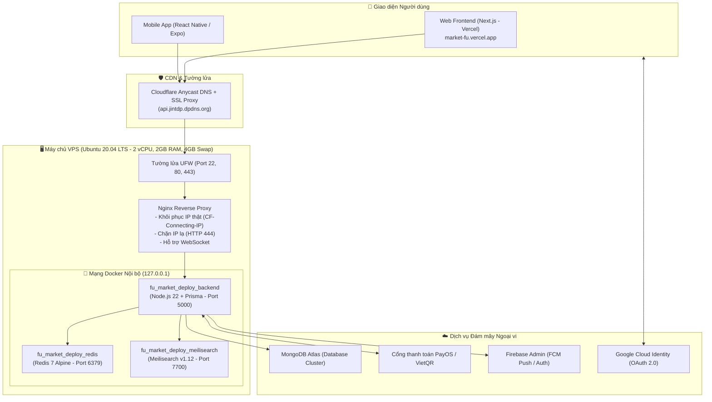

# 📘 CẨM NANG VẬN HÀNH & KINH NGHIỆM TRIỂN KHAI PRODUCTION
> **Dự án:** FU Student Second-hand Market (Chợ Đồ Cũ Sinh Viên FU)  
> **Tác giả:** Đội ngũ Kỹ thuật & Vận hành  
> **Cập nhật lần cuối:** 21/10/2026  

---

## 🏗️ 1. TỔNG QUAN KIẾN TRÚC HỆ THỐNG



---

## 🛠️ 2. SỔ TAY CÂU LỆNH DEVOPS THƯỜNG DÙNG TRÊN VPS

### 2.1. Quản lý Container Docker
```bash
# Xem các container đang chạy và trạng thái sức khỏe
docker compose -f docker-compose.deploy.yml ps

# Xem log thời gian thực của backend (như npm run dev ở local)
docker logs -f fu_market_deploy_backend

# Xem 100 dòng log gần nhất
docker logs --tail 100 fu_market_deploy_backend

# Khởi động lại toàn bộ hệ thống sau khi sửa .env
docker compose -f docker-compose.deploy.yml up -d --force-recreate

# Dọn dẹp rác Docker (image cũ, build cache) để giải phóng ổ cứng
docker system prune -af --volumes
```

### 2.2. Kiểm tra Tài nguyên & Bảo mật VPS
```bash
# Kiểm tra dung lượng RAM thật và Swap
free -h

# Kiểm tra dung lượng ổ cứng còn trống
df -h

# Theo dõi CPU và RAM các tiến trình theo thời gian thực
htop

# Kiểm tra trạng thái tường lửa UFW
ufw status verbose

# Kiểm tra log Nginx
tail -f /var/log/nginx/access.log
tail -f /var/log/nginx/error.log
```

---

## 💥 3. TOP 7 SỰ CỐ KINH ĐIỂN ĐÃ GẶP & CÁCH XỬ LÝ TẬN GỐC

### 1. Lỗi Docker Mount: `EISDIR: illegal operation on a directory, read` (Firebase)
* **Nguyên nhân:** Khi mount file `./firebase-service-account.json` từ host vào container mà file này **chưa có trên host**, Docker Linux sẽ tự động tạo một **thư mục (directory)** rỗng. Lệnh `fs.readFileSync` của Node.js không thể đọc thư mục -> crash.
* **Cách xử lý:**
  ```bash
  docker compose -f docker-compose.deploy.yml down
  rm -rf firebase-service-account.json   # Xóa thư mục rỗng
  nano firebase-service-account.json     # Tạo file JSON thật
  chmod 644 firebase-service-account.json
  docker compose -f docker-compose.deploy.yml up -d
  ```

### 2. Cạn kiệt RAM trên VPS 2GB: Out-Of-Memory (OOM Killer)
* **Nguyên nhân:** Node.js + Redis + Meilisearch khi build Docker hoặc chịu tải sẽ vượt quá 2GB RAM vật lý, bị Linux tự động tắt tiến trình.
* **Cách xử lý:** Tạo 4GB bộ nhớ ảo SWAP trên ổ cứng NVMe và chỉnh độ nhạy:
  ```bash
  fallocate -l 4G /swapfile
  chmod 600 /swapfile
  mkswap /swapfile
  swapon /swapfile
  echo '/swapfile none swap sw 0 0' >> /etc/fstab
  sysctl vm.swappiness=10
  echo 'vm.swappiness=10' >> /etc/sysctl.conf
  ```

### 3. Lỗ hổng Docker UFW Bypass
* **Nguyên nhân:** Cấu hình port dạng `"5000:5000"` trong Docker sẽ ghi đè iptables, bỏ qua tường lửa UFW -> người ngoài truy cập thẳng vào port 5000 mà không qua Cloudflare/Nginx.
* **Cách xử lý:** Bắt buộc bind cổng vào `127.0.0.1` trong `docker-compose.deploy.yml`:
  ```yaml
  ports:
    - "127.0.0.1:5000:5000"
    - "127.0.0.1:6379:6379"
    - "127.0.0.1:7700:7700"
  ```

### 4. Lỗi Webhook 401 Unauthorized (PayOS & Shipping Webhook)
* **Nguyên nhân:** 
  - Sai khóa bí mật HMAC (`PAYOS_CHECKSUM_KEY` hoặc `SHIPPING_WEBHOOK_SECRET`).
  - Mất chuỗi raw body: Body-parser mặc định của Express parse JSON làm thay đổi thứ tự key, khiến việc hash kiểm tra chữ ký bị sai.
* **Cách xử lý:** Dùng middleware lưu `req.rawBody` nguyên bản:
  ```typescript
  express.json({
    verify: (req: any, _res, buf) => {
      if (req.originalUrl && req.originalUrl.startsWith('/api/webhooks')) {
        req.rawBody = buf;
      }
    }
  });
  ```

### 5. Lỗi 400 Google OAuth 2.0 (`origin_mismatch`)
* **Nguyên nhân:** Google Cloud Console chỉ cho phép domain đã đăng ký. Khi chạy trên Vercel thật, Google chặn vì thiếu URL production.
* **Cách xử lý:** Trong Google Cloud Console -> **Client ID for Web Application**:
  - **Authorized JavaScript origins:** Thêm `https://market-fu.vercel.app` *(Tuyệt đối không có dấu `/` ở cuối)*.
  - **Allowed redirect URIs:** Thêm:
    - `https://market-fu.vercel.app/api/auth/callback/google`
    - `https://market-fu.vercel.app`
    - `https://market-fu.vercel.app/login`
  - Đợi 3 - 5 phút để Google đồng bộ toàn cầu.

### 6. Cạm bẫy Trailing Slash (`/`) & Cơ chế Bake biến Vercel
* **Nguyên nhân:** 
  - Cấu hình `CLIENT_URL=https://market-fu.vercel.app/` khiến các link ghép bị lỗi thành `//checkout/success`.
  - Next.js bake các biến `NEXT_PUBLIC_*` vào file tĩnh lúc build. Sửa biến trên Dashboard Vercel nhưng không bấm **Redeploy** thì web vẫn chạy code cũ.
* **Cách xử lý:** Luôn xóa dấu gạch chéo cuối URL biến môi trường và luôn bấm **Redeploy** trên Vercel sau khi sửa env.

### 7. Phân biệt Docker Daemon (`-d`) vs Dev foreground (`npm run dev`)
* **Bản chất:** Container trên production chạy dưới dạng Daemon ngầm. Lệnh `docker logs` thông thường chỉ đọc lịch sử log rồi thoát chứ không đứng chờ. Muốn xem log liên tục như local phải dùng `docker logs -f <container_name>`.

---

## 💳 4. CẨM NANG THANH TOÁN & TEST WEBHOOK

### 4.1. Luồng Thanh toán PayOS Escrow
1. **Khách bấm Mua**: Frontend/Mobile gọi `POST /api/orders` với `paymentMethod: 'PAYOS_WEB'`.
2. **Backend**: Tạo đơn `PENDING`, gọi PayOS API sinh `checkoutUrl`.
3. **Mở thanh toán**:
   - Web: Chuyển hướng `window.location.href = payosCheckoutUrl`.
   - Mobile: Mở In-app browser an toàn `WebBrowser.openBrowserAsync(payosCheckoutUrl)`.
4. **Khách chuyển khoản**:
   - PayOS gọi Webhook về VPS: `POST https://api.jintdp.dpdns.org/api/webhooks/payments`.
   - Backend xác thực HMAC, chuyển đơn sang `PAID` (tiền vào ví Escrow sàn giữ hộ).
   - Backend bắn Socket.io `order_paid`.
5. **Cập nhật giao diện**: Web & Mobile có Polling fallback (3 - 4s) + Socket listener -> Màn hình tự động nhảy tick xanh "Đã thanh toán thành công".

### 4.2. Công cụ Giả lập Webhook Vận chuyển (`mock-shipping-webhook.js`)
File script vị trí tại: `backend/scripts/mock-shipping-webhook.js`

#### Chạy tương tác qua Terminal:
```bash
node backend/scripts/mock-shipping-webhook.js
```
*(Hệ thống sẽ hỏi mã đơn hàng và cho chọn kịch bản 1 hoặc 2)*.

#### Chạy trực tiếp 1 câu lệnh:
```bash
# Kịch bản 1: Bưu tá giao thành công (Kích hoạt 48h bao test Escrow + Đổi sản phẩm sang SOLD)
node backend/scripts/mock-shipping-webhook.js ORD-XXXXXX-XXXX delivered

# Kịch bản 2: Bưu tá hủy đơn / hoàn hàng về người bán
node backend/scripts/mock-shipping-webhook.js ORD-XXXXXX-XXXX cancelled

# Nếu test ở máy local (localhost:5000), thêm cờ --local ở cuối:
node backend/scripts/mock-shipping-webhook.js ORD-XXXXXX-XXXX delivered --local
```

---

## 📋 5. BẢNG CHECKLIST BIẾN MÔI TRƯỜNG PRODUCTION

### 🖥️ Trên VPS (`~/app/backend/.env`)
```ini
NODE_ENV=production
PORT=5000
DATABASE_URL=mongodb+srv://<user>:<pass>@<cluster>.mongodb.net/campus_market_prod?retryWrites=true&w=majority
CLIENT_URL=https://market-fu.vercel.app
ALLOWED_ORIGINS=https://market-fu.vercel.app

# Cổng thanh toán PayOS (Lấy từ Dashboard payos.vn)
PAYOS_CLIENT_ID=xxxxxxxx-xxxx-xxxx-xxxx-xxxxxxxxxxxx
PAYOS_API_KEY=xxxxxxxx-xxxx-xxxx-xxxx-xxxxxxxxxxxx
PAYOS_CHECKSUM_KEY=xxxxxxxxxxxxxxxxxxxxxxxxxxxxxxxxxxxxxxxxxxxxxxxxxxxxxxxxxxxxxxxx

# Chữ ký Webhook Vận chuyển
SHIPPING_WEBHOOK_SECRET=your_hmac_secret_key_for_shipping_webhook

# Google OAuth xác thực ID Token
GOOGLE_CLIENT_ID=1093899519891-c9r9jv1imm3s104crlhels37fl71stuo.apps.googleusercontent.com
```

### 🌐 Trên Vercel (Project Settings -> Environment Variables)
```ini
NEXT_PUBLIC_API_URL=https://api.jintdp.dpdns.org/api
NEXT_PUBLIC_SOCKET_URL=https://api.jintdp.dpdns.org
NEXT_PUBLIC_GOOGLE_CLIENT_ID=1093899519891-c9r9jv1imm3s104crlhels37fl71stuo.apps.googleusercontent.com
```
*(⚠️ Sau khi cập nhật, bắt buộc vào Deployments -> Bấm 3 chấm -> Redeploy)*.

### 📱 Trên Mobile (`mobile/.env` hoặc EAS Secret)
```ini
EXPO_PUBLIC_API_URL=https://api.jintdp.dpdns.org/api
EXPO_PUBLIC_SOCKET_URL=https://api.jintdp.dpdns.org
```

---

## 🚀 6. QUY TRÌNH CI/CD GITHUB ACTIONS
Khi đẩy code mới lên nhánh `main`:
1. **Job 1 (test-and-build)**: Chạy lint, unit test và kiểm tra biên dịch TypeScript.
2. **Job 2 (docker-build-and-scan)**: Build image Docker và quét lỗ hổng bảo mật bằng Trivy.
3. **Job 3 (deploy-to-vps)**: Dùng khóa SSH bí mật kết nối tới VPS:
   - `git fetch origin main && git reset --hard FETCH_HEAD`
   - `docker compose -f docker-compose.deploy.yml up -d --build`
   - `docker image prune -f` (tự động dọn dẹp các image cũ để không đầy ổ cứng VPS).
