# 🗺️ TỔNG HỢP CÁC FLOWS NGHIỆP VỤ HỆ THỐNG MARKETFU

### Hệ thống Sàn Thương Mại Điện Tử & Trao Đổi Đồ Cũ Sinh Viên Đại Học FPT (Web, Mobile & Backend Realtime)

> **Tài liệu đặc tả toàn diện luồng nghiệp vụ (Business Flows)**: Mô tả chi tiết tương tác giữa **Web Portal (Next.js)**, **Mobile App (React Native Expo)**, **Backend Gateway (Node.js/Express, Prisma, MongoDB Atlas)**, **Realtime Gateway (Socket.IO)**, **Hệ thống AI (Gemini 1.5 Flash)** và **Hạ tầng Thanh toán / Safe-Point**.

---

## 📑 MỤC LỤC TỔNG QUAN CÁC FLOWS

1. [Tổng quan Kiến trúc &amp; Các Tác nhân (Actors)](#1-tổng-quan-kiến-trúc--các-tác-nhân-actors)
2. [Flow 1: Xác thực, Phân quyền &amp; Định danh KYC Sinh viên (Auth &amp; KYC Flow)](#flow-1-xác-thực-phân-quyền--định-danh-kyc-sinh-viên)
3. [Flow 2: Đăng tin, AI Scan &amp; Quy trình Phê duyệt BQT (Post Creation &amp; Admin Moderation)](#flow-2-đăng-tin-ai-scan--quy-trình-phê-duyệt-bqt)
4. [Flow 3: Đồng bộ Sản phẩm Realtime 2 chiều Web ⮂ Mobile (Two-Way Realtime Sync)](#flow-3-đồng-bộ-sản-phẩm-realtime-2-chiều-web--mobile)
5. [Flow 4: Tìm kiếm Thông minh &amp; Bộ lọc Đa Campus (Search &amp; Multi-Campus Filtering)](#flow-4-tìm-kiếm-thông-minh--bộ-lọc-đa-campus)
6. [Flow 5: Trò chuyện P2P, Mặc cả Trả giá &amp; Hẹn điểm Safe-Point (Chat &amp; Negotiation)](#flow-5-trò-chuyện-p2p-mặc-cả-trả-giá--hẹn-điểm-safe-point)
7. [Flow 6: Giao dịch An toàn, Bảo chứng Escrow &amp; Bàn giao Hàng hóa (Escrow &amp; Handshake)](#flow-6-giao-dịch-an-toàn-bảo-chứng-escrow--bàn-giao-hàng-hóa)
8. [Flow 7: Khiếu nại, Tranh chấp &amp; Trọng tài BQT (Dispute &amp; Arbitration)](#flow-7-khiếu-nại-tranh-chấp--trọng-tài-bqt)
9. [Flow 8: Đánh giá Hai chiều &amp; Cơ chế Blind Review (Review &amp; Reputation Flow)](#flow-8-đánh-giá-hai-chiều--cơ-chế-blind-review)
10. [Flow 9: Gamification, Ví FPT Coin &amp; Đổi Voucher (Coin, Rewards &amp; Vouchers)](#flow-9-gamification-ví-fpt-coin--đổi-voucher)
11. [Flow 10: Báo cáo Vi phạm &amp; Xử lý Kỷ luật (Report &amp; Enforcement Flow)](#flow-10-báo-cáo-vi-phạm--xử-lý-kỷ-luật)
12. [Bảng Ma Trận Tổng Hợp Sự Kiện Socket.IO &amp; API Endpoints](#12-bảng-ma-trận-tổng-hợp-sự-kiện-socketio--api-endpoints)

---

## 1. TỔNG QUAN KIẾN TRÚC & CÁC TÁC NHÂN (ACTORS)

### 1.1. Các tác nhân chính trong hệ thống

* **Khách vãng lai (Guest):** Người dùng chưa đăng nhập; có quyền xem bài đăng, tìm kiếm, xem trang chi tiết.
* **Sinh viên Người Mua (Buyer):** Tài khoản sinh viên FPT đã xác thực email (`@fpt.edu.vn`); có quyền chat, trả giá, đặt mua hàng, mở khiếu nại, đánh giá.
* **Sinh viên Người Bán (Seller):** Sinh viên đã hoàn tất xác thực KYC Thẻ sinh viên (được duyệt); có quyền đăng bán đồ dùng, nhận yêu cầu mua, chấp thuận trả giá, bàn giao hàng.
* **Quản trị viên (Admin / Moderator):** Ban Quản Trị phụ trách duyệt bài đăng mới, duyệt KYC thẻ SV, xử lý khiếu nại tranh chấp, khóa tài khoản vi phạm.
* **Trợ lý AI (Google Gemini 1.5 Flash):** Hỗ trợ scan hình ảnh đồ cũ, nhận diện danh mục, phát hiện từ cấm/hàng cấm học đường, tư vấn tự động.
* **Cổng Thanh toán (VietQR / PayOS):** Xử lý giao dịch thanh toán chuyển khoản Napas247, giữ tiền đảm bảo (Escrow).
* **Cổng Realtime Gateway (Socket.IO & Firebase FCM):** Đồng bộ dữ liệu tức thời giữa Web và Mobile, bắn thông báo đẩy Push Notification.

### 1.2. Sơ đồ tương tác tổng quan

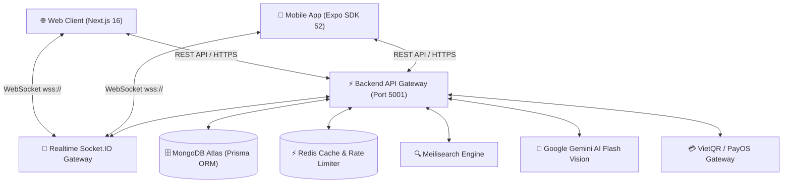

---

## FLOW 1: XÁC THỰC, PHÂN QUYỀN & ĐỊNH DANH KYC SINH VIÊN

### 1.1. Luồng Đăng ký & Xác thực OTP Email FPT

Hệ thống chỉ chấp nhận định danh sinh viên FPT thông qua email trường `@fpt.edu.vn` hoặc `@fe.edu.vn`.

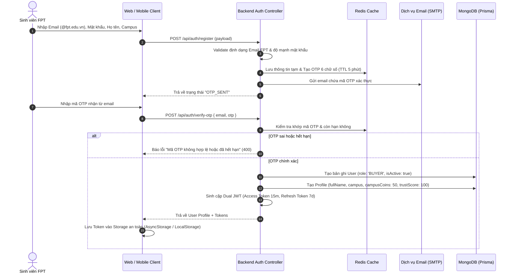

### 1.2. Luồng Nâng cấp Tài khoản Người Bán (KYC Thẻ Sinh Viên)

Sinh viên thông thường chỉ có quyền mua (`BUYER`). Để đăng bán, sinh viên cần xác minh Thẻ Sinh viên để BQT duyệt thành `SELLER`.

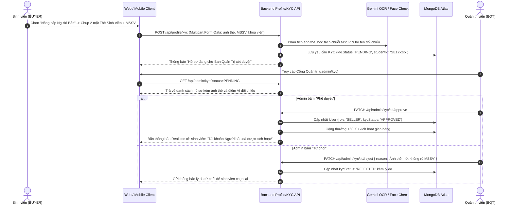

---

## FLOW 2: ĐĂNG TIN, AI SCAN & QUY TRÌNH PHÊ DUYỆT BQT

### 2.1. Đăng tin mới & Kiểm duyệt an toàn trường học

Mọi tin đăng trên sàn đều phải tuân thủ nghiêm ngặt quy chế an toàn: cấm vũ khí, chất cấm, thiết bị gian lận thi cử, cảnh báo nguy cơ cháy nổ PCCC (bếp gas mini, ấm siêu tốc cũ trong KTX).

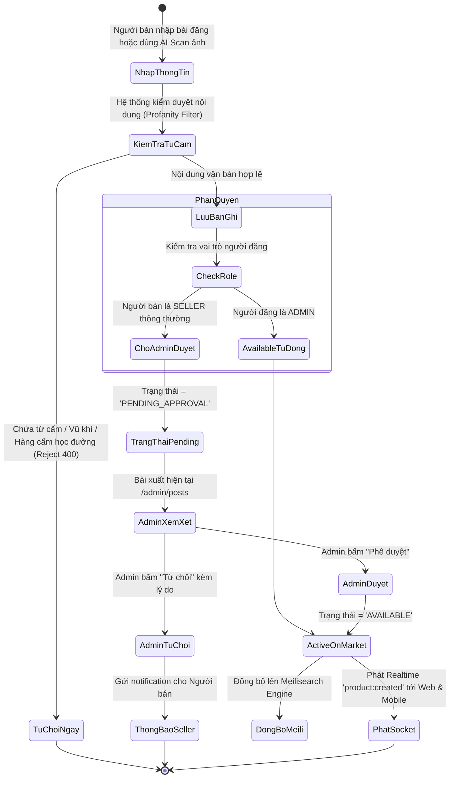

### 2.2. Trình tự thực thi kỹ thuật khi Duyệt bài

1. **Khởi tạo bài đăng:** `POST /api/products` (Hỗ trợ tối đa 6 ảnh và 1 video review).
2. **AI Gemini Vision:** Tự động điền nhanh danh mục và nhận diện giá hợp lý:
   ```json
   {
     "suggestedTitle": "Màn hình Dell UltraSharp 24 inch U2419H",
     "category": "ELECTRONICS",
     "suggestedPrice": 2400000,
     "condition": "LIKE_NEW_99",
     "safetyTags": ["SAFE_TESTABLE"]
   }
   ```
3. **Phê duyệt BQT:** Admin duyệt tại `/admin/posts` qua endpoint `PATCH /api/products/admin/:id/approve`.
4. **Phát sóng Realtime:** Backend phát sự kiện `broadcastEvent('product:created', product)` tới kênh công khai `public_feed`.

---

## FLOW 3: ĐỒNG BỘ SẢN PHẨM REALTIME 2 CHIỀU WEB ⮂ MOBILE

### 3.1. Mô hình Đồng bộ Sự kiện Realtime (Two-Way Sync Architecture)

Mục tiêu: Đảm bảo khi có sản phẩm được đăng hoặc duyệt ở Web thì trên Mobile xuất hiện ngay lập tức, và ngược lại.

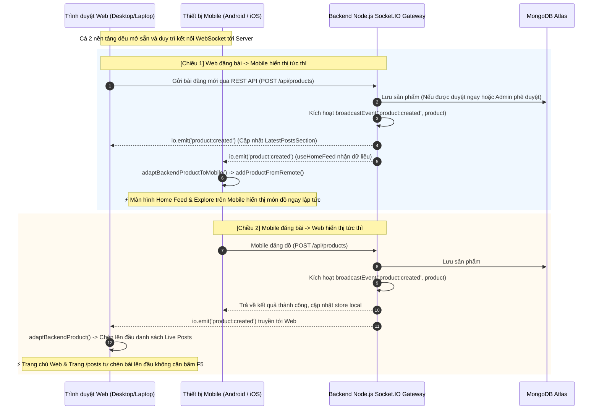

### 3.2. Bảng xử lý State giữa các nền tảng

| Sự kiện Socket    | Xử lý trên Web (React / Zustand)                                                      | Xử lý trên Mobile (React Native / Zustand)                             |
| :------------------ | :--------------------------------------------------------------------------------------- | :------------------------------------------------------------------------ |
| `product:created` | Chèn bài mới vào`setLiveProducts([new, ...prev])` và cập nhật `productStore`. | Gọi`addProductFromRemote(adapted)` chèn vào đầu `storeProducts`. |
| `product:updated` | Tìm`id` và cập nhật partial fields (giá, trạng thái, đã bán).                | Gọi`updateProduct(id, partial)` đồng bộ hiển thị.                 |
| `product:deleted` | Loại bỏ item khỏi danh sách hiển thị bằng filter`id !== deletedId`.             | Gọi`deleteProduct(id)` xóa khỏi local list.                          |

## FLOW 4: TÌM KIẾM THÔNG MINH & BỘ LỌC ĐA CAMPUS (SEARCH & FILTER PIPELINE)

Hệ thống tìm kiếm trên MarketFU được thiết kế theo kiến trúc **đa tầng (Multi-tier Search Pipeline)**: kết hợp công nghệ tìm kiếm siêu tốc Meilisearch (chịu lỗi chính tả, không dấu tiếng Việt), bộ lọc đa cơ sở (Multi-Campus) và cơ chế tự động Fallback về cơ sở dữ liệu MongoDB Atlas.

### 4.1. Sơ đồ Tuần tự Pipeline Tìm kiếm (Search Sequence Flow)

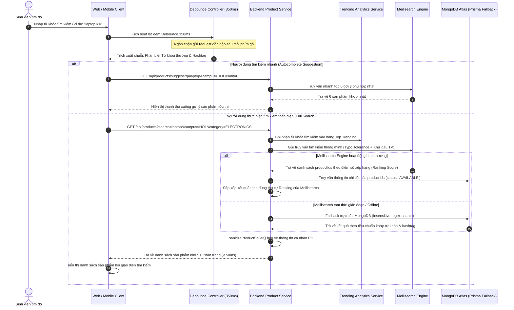

### 4.2. Bộ lọc 5 Cơ sở Campus & Trật tự Ưu tiên
Hệ thống sàn được phân chia theo 5 cơ sở đại học FPT trên toàn quốc:

| Mã Campus | Tên Cơ sở | Quy tắc Lọc dữ liệu |
| :---: | :--- | :--- |
| `HOL` | **Đại học FPT Hà Nội (Hòa Lạc)** | Lọc chính xác các bài đăng tại khuôn viên Hòa Lạc & KTX Dom A-H. |
| `HCM` | **Đại học FPT TP. Hồ Chí Minh** | Lọc các bài đăng tại cơ sở Quận 9, Khu Công nghệ cao & KTX. |
| `DAD` | **Đại học FPT Đà Nẵng** | Lọc các bài đăng tại Campus Ngũ Hành Sơn. |
| `QN` | **Đại học FPT Quy Nhơn** | Lọc các bài đăng tại Campus Trí tuệ Nhân tạo Quy Nhơn. |
| `CT` | **Đại học FPT Cần Thơ** | Lọc các bài đăng tại Campus Cần Thơ. |
| `ALL` / `TẤT CẢ` | **Toàn hệ thống (Toàn quốc)** | Không giới hạn cơ sở, ưu tiên bài có hỗ trợ Ship liên tỉnh hoặc hỗ trợ Ship COD. |

### 4.3. Các Tính năng Nổi bật của Phân hệ Tìm kiếm
1. **Chịu lỗi chính tả (Typo Tolerance):** Sinh viên gõ nhầm `"man hinh"` thành `"nam hinh"`, hoặc `"ipone"` thay vì `"iphone"`, hệ thống vẫn nhận diện chính xác sản phẩm cần tìm.
2. **Tìm kiếm Tiếng Việt không dấu:** Hệ thống tự động chuẩn hóa chữ có dấu và không dấu (VD: `"sach giao trinh"` tương đương `"sách giáo trình"`).
3. **Hashtags Học đường chuyên biệt:** Hỗ trợ tìm kiếm theo ngữ cảnh sinh hoạt sinh viên: `#ktx`, `#passdo`, `#vovinam`, `#k18`, `#cuoiky`.
4. **Phân tích Xu hướng Tìm kiếm (Hot Trending Keywords):** Tự động tổng hợp các từ khóa được tìm nhiều nhất trong 24 giờ qua để gợi ý trên thanh tìm kiếm Trang chủ.

---

## FLOW 5: TRÒ CHUYỆN P2P, MẶC CẢ TRẢ GIÁ & HẸN ĐIỂM SAFE-POINT

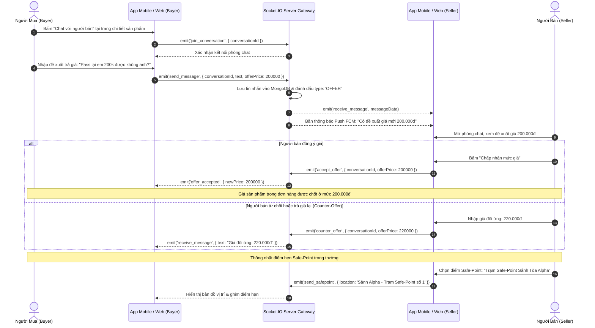

---

## FLOW 6: GIAO DỊCH AN TOÀN, BẢO CHỨNG ESCROW & BÀN GIAO HÀNG HÓA

Hệ thống hỗ trợ 2 hình thức giao dịch độc quyền cho sinh viên FPT:

1. **Giao dịch Gặp mặt trực tiếp (Meetup Handshake) tại Safe-Point:** Dùng mã OTP 4 số ngẫu nhiên.
2. **Giao dịch Giao hàng KTX / Ship COD:** Giữ tiền đảm bảo Escrow, bao test 24h - 48h.

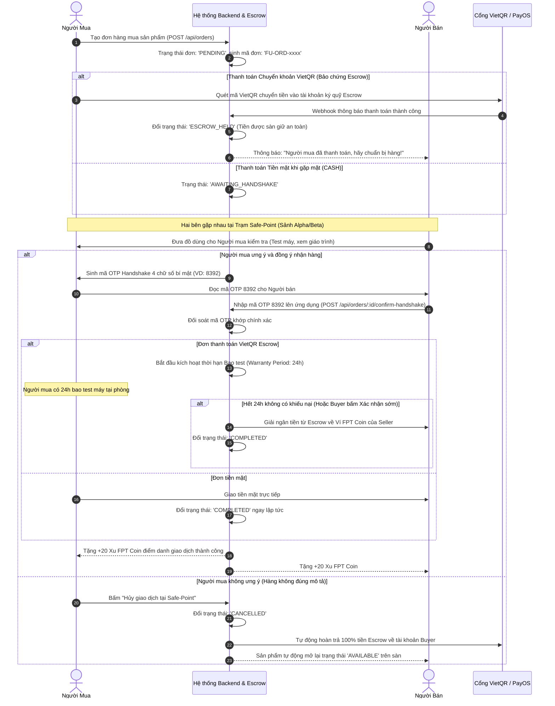

---

## FLOW 7: KHIẾU NẠI, TRANH CHẤP & TRỌNG TÀI BQT

Khi mua hàng có bao test (Escrow 24h - 48h), nếu phát hiện sản phẩm bị lỗi ẩn hoặc gian dối, người mua có quyền mở tranh chấp.

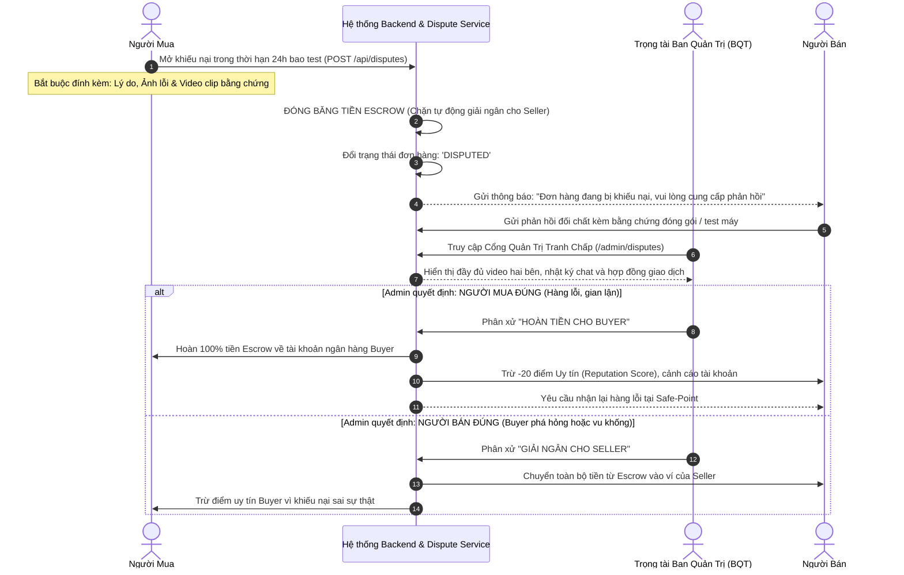

---

## FLOW 8: ĐÁNH GIÁ HAI CHIỀU & CƠ CHẾ BLIND REVIEW

Để ngăn chặn tình trạng "trả thù đánh giá" (Retaliatory Reviews), MarketFU triển khai cơ chế **Blind Review (Đánh giá ẩn danh hai chiều)**:

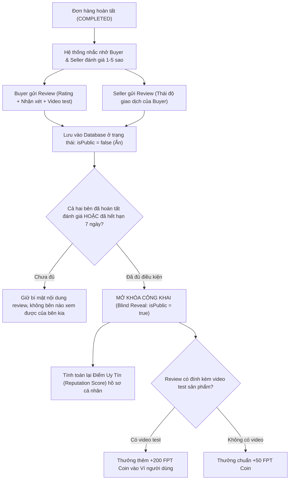

---

## FLOW 9: GAMIFICATION, VÍ FPT COIN & ĐỔI VOUCHER

```mermaid
graph LR
    subgraph KiemXu ["🪙 CÁC KÊNH KIẾM FPT COIN"]
        A1["Điểm danh mỗi ngày: +10 Xu"]
        A2["Hoàn thành đơn hàng: +20 Xu"]
        A3["Review kèm video test: +200 Xu"]
        A4["Hoàn tất KYC Thẻ SV: +50 Xu"]
    end

    subgraph ViXu ["💰 VÍ CAMPUS COIN (Profile)"]
        B1["Số dư FPT Coin Khả dụng"]
    end

    subgraph TieuXu ["🎁 SỬ DỤNG FPT COIN"]
        C1["Đổi Voucher Căn tin FPT (5k, 10k, 20k)"]
        C2["Giảm giá trực tiếp khi thanh toán đơn hàng"]
        C3["Đẩy tin đăng lên đầu trang (Bump Post)"]
        C4["Ghim bài VIP lên mục Nổi bật 7 ngày (Pin Post)"]
        C5["Rút tiền mặt về Ngân hàng (1000 Xu = 10.000 VNĐ)"]
    end

    KiemXu --> B1
    B1 --> TieuXu
```

---

## FLOW 10: BÁO CÁO VI PHẠM & XỬ LÝ KỶ LUẬT

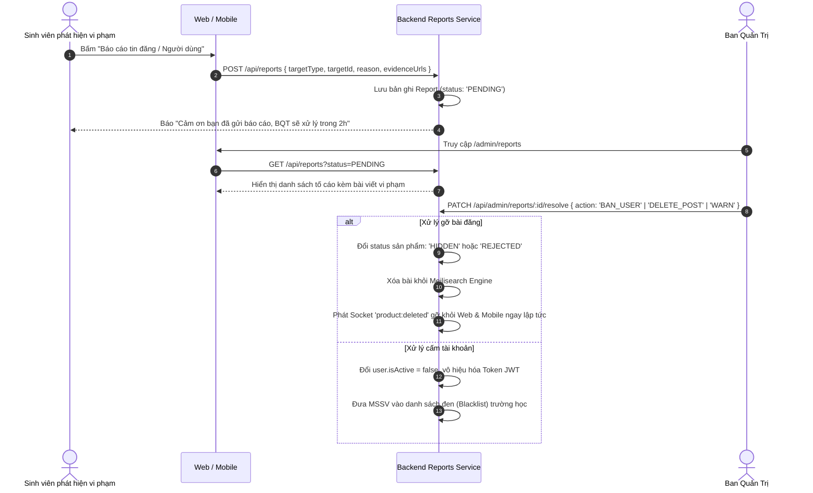

---

## 12. BẢNG MA TRẬN TỔNG HỢP SỰ KIỆN SOCKET.IO & API ENDPOINTS

### 12.1. Danh mục API Endpoints Cốt Lõi

| Phân hệ            | Phương thức | Endpoint                              |      Quyền hạn      | Mô tả chức năng                                     |
| :------------------- | :------------: | :------------------------------------ | :--------------------: | :------------------------------------------------------ |
| **Auth**       |    `POST`    | `/api/auth/register`                |         Public         | Đăng ký tài khoản bằng email FPT                  |
|                      |    `POST`    | `/api/auth/verify-otp`              |         Public         | Xác thực mã OTP 6 số hoàn tất đăng ký          |
|                      |    `POST`    | `/api/auth/login`                   |         Public         | Đăng nhập nhận cặp Dual JWT Tokens                 |
|                      |    `POST`    | `/api/auth/google`                  |         Public         | Đăng nhập một chạm bằng Google SSO                |
| **Products**   |    `GET`    | `/api/products`                     |         Public         | Lấy danh sách sản phẩm (Lọc Campus, Danh mục)     |
|                      |    `POST`    | `/api/products`                     | `SELLER` / `ADMIN` | Đăng tin bán sản phẩm mới                         |
|                      |   `PATCH`   | `/api/products/:id`                 |       Chủ bài       | Chỉnh sửa nội dung bài đăng                       |
|                      |   `DELETE`   | `/api/products/:id`                 |  Chủ bài /`ADMIN`  | Xóa bài đăng khỏi sàn                             |
| **Moderation** |    `GET`    | `/api/products/admin/moderation`    |       `ADMIN`       | Lấy danh sách tin kiểm duyệt (`PENDING_APPROVAL`) |
|                      |   `PATCH`   | `/api/products/admin/:id/approve`   |       `ADMIN`       | Phê duyệt tin đăng & phát sóng Realtime           |
|                      |   `PATCH`   | `/api/products/admin/:id/reject`    |       `ADMIN`       | Từ chối tin đăng kèm lý do cụ thể               |
| **Chats**      |    `GET`    | `/api/chats/conversations`          |     Authenticated     | Lấy danh sách các cuộc trò chuyện                 |
|                      |    `POST`    | `/api/chats/messages`               |     Authenticated     | Gửi tin nhắn văn bản / ảnh / trả giá             |
| **Orders**     |    `POST`    | `/api/orders`                       |       `BUYER`       | Khởi tạo đơn hàng Meetup hoặc Ship COD            |
|                      |   `PATCH`   | `/api/orders/:id/confirm-handshake` |       `SELLER`       | Nhập mã OTP 4 số bàn giao đồ tại Safe-Point      |
|                      |    `POST`    | `/api/orders/:id/dispute`           |       `BUYER`       | Mở khiếu nại tranh chấp trong thời hạn bao test   |
| **Vouchers**   |    `POST`    | `/api/vouchers/daily-checkin`       |     Authenticated     | Điểm danh hằng ngày nhận FPT Coin                  |
|                      |    `POST`    | `/api/vouchers/redeem`              |     Authenticated     | Đổi FPT Coin lấy Voucher căn tin                    |

### 12.2. Danh mục Sự kiện Realtime Socket.IO

| Tên Sự kiện               |  Hướng truyền  |         Kênh / Room         | Payload chính                     | Ý nghĩa nghiệp vụ                                                             |
| :--------------------------- | :---------------: | :--------------------------: | :--------------------------------- | :-------------------------------------------------------------------------------- |
| `product:created`          | Server ➔ Clients | `public_feed` (Toàn sàn) | `{ product: ProductItem }`       | Sản phẩm mới được duyệt; Web & Mobile lập tức hiện tin mới lên đầu. |
| `product:updated`          | Server ➔ Clients | `public_feed` (Toàn sàn) | `{ product: ProductItem }`       | Sản phẩm đổi giá, đổi trạng thái hoặc đã bán.                        |
| `product:deleted`          | Server ➔ Clients | `public_feed` (Toàn sàn) | `{ productId: string }`          | Bài đăng bị xóa/gỡ; client tự động xóa khỏi danh sách.                |
| `join_conversation`        | Client ➔ Server |    `conversation_{id}`    | `{ conversationId: string }`     | Client tham gia phòng chat P2P riêng.                                           |
| `send_message`             | Client ➔ Server |    `conversation_{id}`    | `{ text, offerPrice, mediaUrl }` | Gửi tin nhắn hoặc đề xuất trả giá mới.                                   |
| `receive_message`          | Server ➔ Client |    `conversation_{id}`    | `{ message: MessageItem }`       | Người bên kia nhận tin nhắn tức thời kèm âm thanh.                       |
| `typing` / `stop_typing` | Client ➔ Server |    `conversation_{id}`    | `{ userId, conversationId }`     | Hiển thị trạng thái đang soạn tin nhắn.                                    |
| `order:status_updated`     | Server ➔ Client |      `user_{userId}`      | `{ orderId, status }`            | Cập nhật trạng thái đơn (Đã giữ tiền Escrow, Đã giao hàng).          |
| `notification:new`         | Server ➔ Client |      `user_{userId}`      | `{ title, body, targetUrl }`     | Bắn chuông thông báo In-app đỏ trên góc màn hình.                       |

---

> 📌 **Tài liệu được xây dựng chuẩn mực theo cấu trúc mã nguồn thực tế của dự án MarketFU (Web, Mobile App & Backend Gateway).**
> Mọi thay đổi về kiến trúc nghiệp vụ cần được cập nhật đồng bộ vào tài liệu này.
