# 🗺️ TỔNG HỢP CÁC FLOWS NGHIỆP VỤ HỆ THỐNG MARKETFU

### Hệ thống Sàn Thương Mại Điện Tử & Trao Đổi Đồ Cũ Sinh Viên Đại Học FPT (Web, Mobile & Backend Realtime)

> **Tài liệu đặc tả toàn diện luồng nghiệp vụ (Business Flows)**: Mô tả chi tiết tương tác giữa **Web Portal (Next.js 16)**, **Mobile App (React Native Expo SDK 52)**, **Backend Gateway (Node.js/Express, Prisma ORM, MongoDB Atlas)**, **Realtime Gateway (Socket.IO)**, **Hệ thống AI (Gemini 1.5 Flash)**, **Cổng thanh toán PayOS / VietQR** và **Trạm an toàn Safe-Handoff Hubs**.

---

## 📑 MỤC LỤC TỔNG QUAN CÁC FLOWS

1. [Tổng quan Kiến trúc &amp; Các Tác nhân (Actors)](#1-tổng-quan-kiến-trúc--các-tác-nhân-actors)
2. [Flow 1: Xác thực, Phân quyền &amp; Định danh KYC Sinh viên (Auth &amp; KYC Flow)](#flow-1-xác-thực-phân-quyền--định-danh-kyc-sinh-viên)
3. [Flow 2: Đăng tin, AI Scan &amp; Quy trình Phê duyệt BQT (Post Creation &amp; Admin Moderation)](#flow-2-đăng-tin-ai-scan--quy-trình-phê-duyệt-bqt)
4. [Flow 3: Đồng bộ Sản phẩm Realtime 2 chiều Web ⮂ Mobile (Two-Way Realtime Sync)](#flow-3-đồng-bộ-sản-phẩm-realtime-2-chiều-web--mobile)
5. [Flow 4: Tìm kiếm Thông minh &amp; Bộ lọc Đa Campus (Search &amp; Multi-Campus Filtering)](#flow-4-tìm-kiếm-thông-minh--bộ-lọc-đa-campus)
6. [Flow 5: Trò chuyện P2P, Mặc cả Trả giá &amp; Hẹn điểm Safe-Point (Chat &amp; Negotiation)](#flow-5-trò-chuyện-p2p-mặc-cả-trả-giá--hẹn-điểm-safe-point)
7. [Flow 6: Giao dịch An toàn, Bảo chứng Escrow &amp; Bàn giao Hàng hóa (Escrow &amp; Handshake)](#flow-6-giao-dịch-an-toàn-bảo-chứng-escrow--bàn-giao-hàng-hóa)
8. [Flow 7: Khiếu nại, Tranh chấp &amp; Trọng tài BQT (Dispute &amp; Arbitration)](#flow-7-khiếu-nại-tranh-chấp--trọng-tài-bqt)
9. [Flow 8: Đánh giá Công Khai Tức Thì &amp; Điểm Uy Tín (Review &amp; Reputation Flow)](#flow-8-đánh-giá-công-khai-tức-thì--điểm-uy-tín)
10. [Flow 9: Gamification, Ví Campus Coin &amp; Đổi Voucher (Coin, Rewards &amp; Vouchers)](#flow-9-gamification-ví-campus-coin--đổi-voucher)
11. [Flow 10: Báo cáo Vi phạm &amp; Trạm An Toàn Safe-Handoff (Report &amp; Safe-Handoff Hubs)](#flow-10-báo-cáo-vi-phạm--trạm-an-toàn-safe-handoff)
12. [Flow 11: Hệ Thống Thông Báo Thời Gian Thực &amp; Đa Kênh Trên Web (Realtime Web Notifications)](#flow-11-hệ-thống-thông-báo-thời-gian-thực--đa-kênh-trên-web)
13. [Bảng Ma Trận Tổng Hợp Sự Kiện Socket.IO &amp; API Endpoints](#13-bảng-ma-trận-tổng-hợp-sự-kiện-socketio--api-endpoints)

---

## 1. TỔNG QUAN KIẾN TRÚC & CÁC TÁC NHÂN (ACTORS)

### 1.1. Các tác nhân chính trong hệ thống

* **Khách vãng lai (Guest):** Người dùng chưa đăng nhập; có quyền xem bài đăng, tìm kiếm, xem trang chi tiết và chat thử với trợ lý AI.
* **Sinh viên Người Mua (`BUYER`):** Tài khoản sinh viên FPT đã xác thực email (`@fpt.edu.vn`); có quyền chat, mặc cả giá, hẹn điểm gặp, đặt mua hàng, mở khiếu nại, đánh giá và đổi voucher.
* **Sinh viên Người Bán (`SELLER`):** Sinh viên đã hoàn tất hồ sơ Onboarding (Thẻ SV, CCCD 2 mặt, STK ngân hàng); có quyền đăng bán đồ dùng, nhận đơn hàng, chấp thuận trả giá, bàn giao hàng qua mã QR Handshake và rút tiền về ngân hàng.
* **Ban Quản Trị (`ADMIN`):** Quản trị viên phụ trách duyệt bài đăng mới (`PENDING_APPROVAL`), thẩm định KYC thẻ SV & Onboarding Người Bán, phân xử khiếu nại tranh chấp (Dispute), quản lý trạm Safe-Handoff, kho Voucher và xử lý vi phạm.
* **Trợ lý AI (Google Gemini 1.5 Flash):** Hỗ trợ scan hình ảnh đồ cũ tự điền form trong 3s, chatbot tư vấn tìm đồ theo ngân sách/campus và đối soát OCR thẻ sinh viên on-demand.
* **Cổng Thanh toán (PayOS & VietQR Napas 247):** Cung cấp link thanh toán PayOS cho Web và VietQR động cho Mobile/Meetup, bảo chứng giữ tiền Escrow.
* **Cổng Realtime Gateway (Socket.IO & Firebase FCM):** Đồng bộ dữ liệu tức thời giữa Web và Mobile, bắn thông báo đẩy Push Notification và theo dõi trạng thái Presence.

### 1.2. Sơ đồ tương tác tổng quan

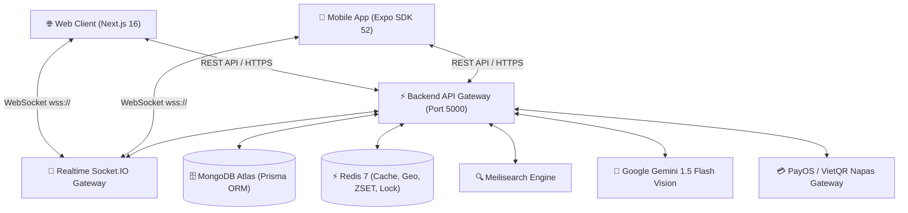

---

## FLOW 1: XÁC THỰC, PHÂN QUYỀN & ĐỊNH DANH KYC SINH VIÊN

### 1.1. Luồng Đăng ký & Xác thực OTP Email FPT

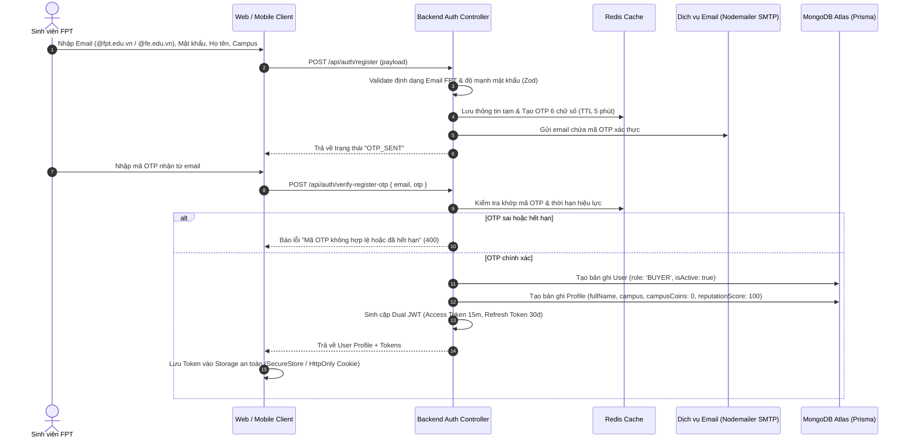

### 1.2. Luồng Nâng cấp Tài khoản Người Bán (KYC Thẻ Sinh Viên & Seller Onboarding)

Sinh viên thông thường chỉ có quyền mua (`BUYER`). Để đăng bán, sinh viên thực hiện Onboarding Người Bán:

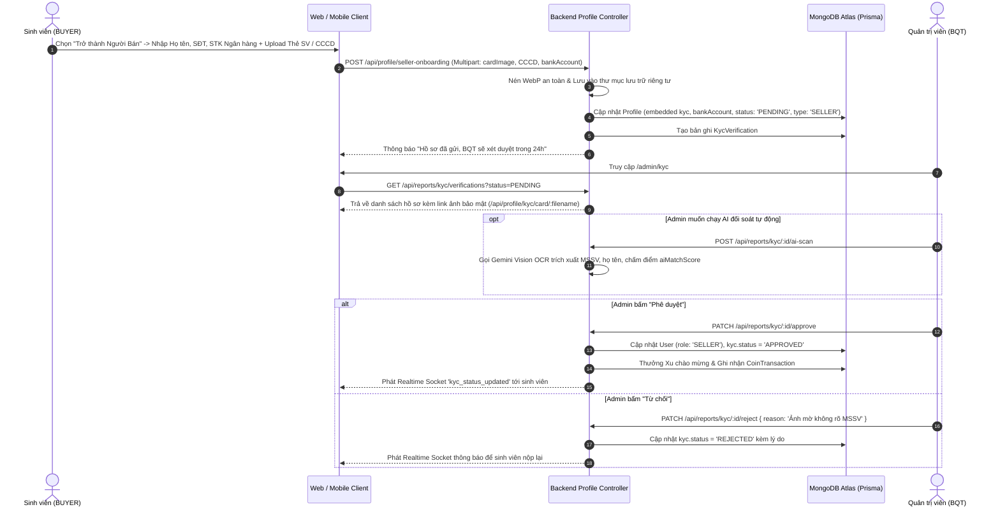

---

## FLOW 2: ĐĂNG TIN, AI SCAN & QUY TRÌNH PHÊ DUYỆT BQT

### 2.1. Đăng tin mới & Kiểm duyệt an toàn

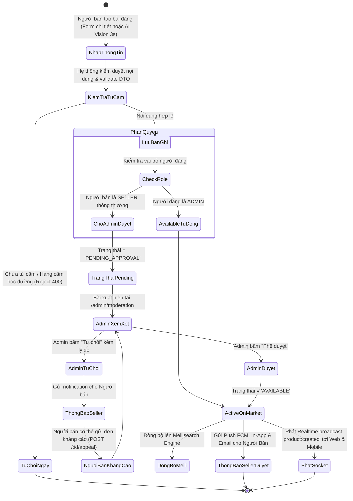

---

## FLOW 3: ĐỒNG BỘ SẢN PHẨM REALTIME 2 CHIỀU WEB ⮂ MOBILE

### 3.1. Mô hình Đồng bộ Sự kiện Realtime

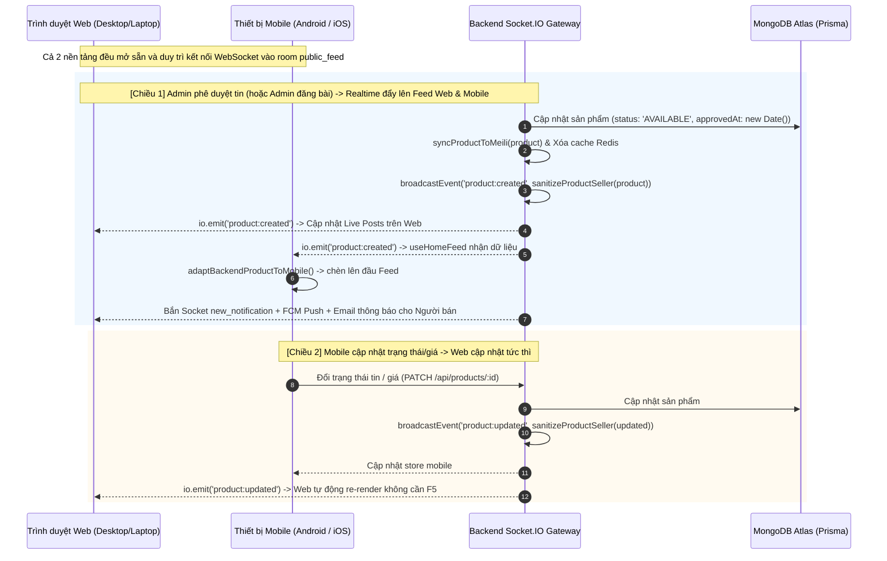

---

## FLOW 4: TÌM KIẾM THÔNG MINH & BỘ LỌC ĐA CAMPUS

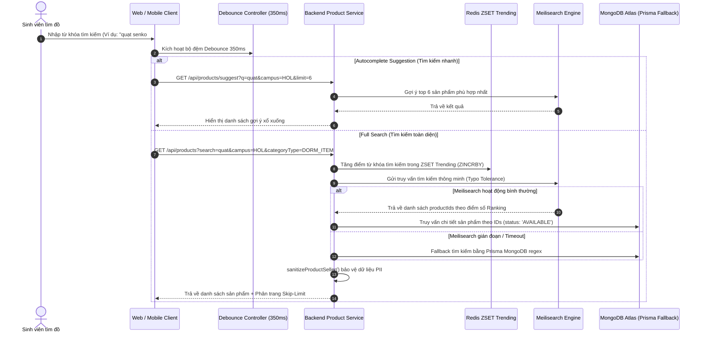

---

## FLOW 5: TRÒ CHUYỆN P2P, MẶC CẢ TRẢ GIÁ & HẸN ĐIỂM SAFE-POINT

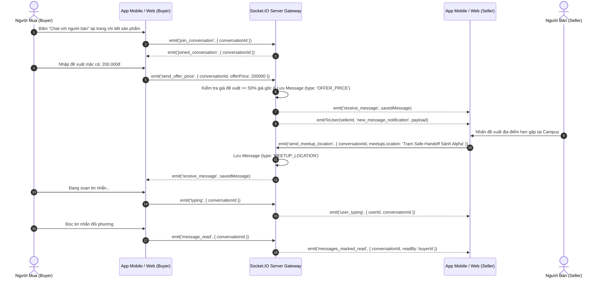

---

## FLOW 6: GIAO DỊCH AN TOÀN, BẢO CHỨNG ESCROW & BÀN GIAO HÀNG HÓA

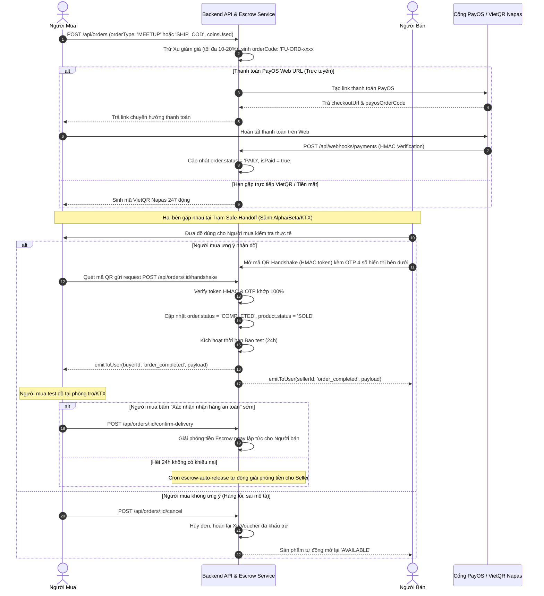

---

## FLOW 7: KHIẾU NẠI, TRANH CHẤP & TRỌNG TÀI BQT

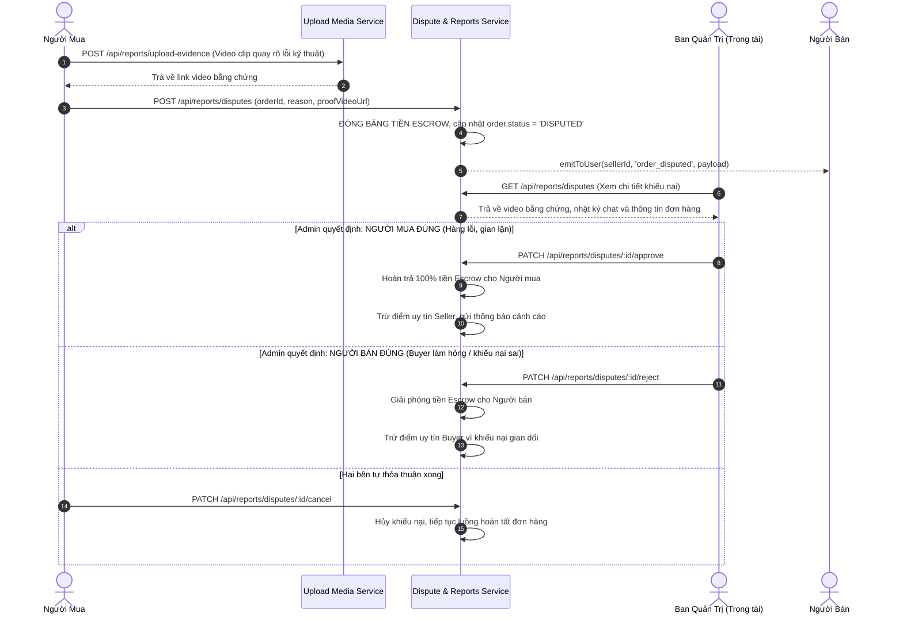

---

## FLOW 8: ĐÁNH GIÁ CÔNG KHAI TỨC THÌ & ĐIỂM UY TÍN

Cơ chế đánh giá trên sàn là **Đánh giá Công Khai Tức Thì (Instant Public Review)**: Khi người mua gửi đánh giá, bài đánh giá được công khai ngay lập tức trên trang cá nhân của người bán, điểm uy tín và Xu thưởng được cộng ngay:

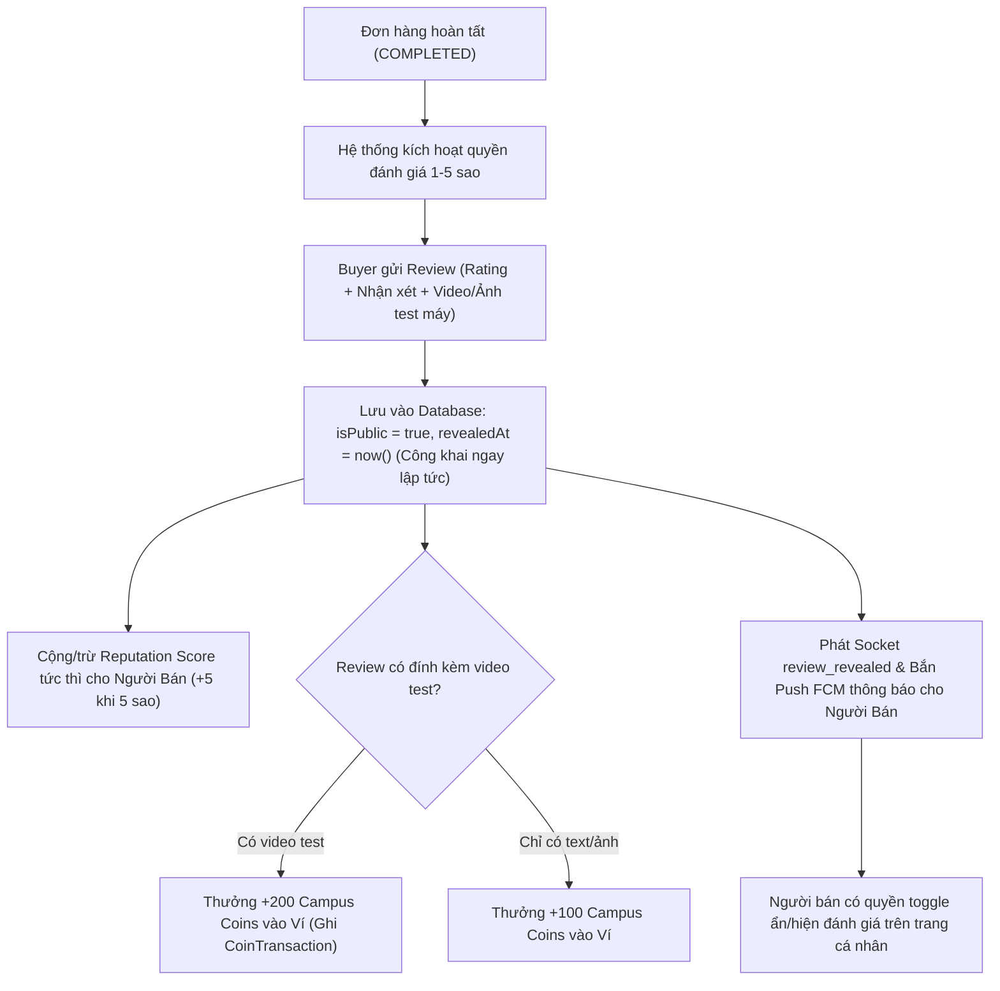

---

## FLOW 9: GAMIFICATION, VÍ CAMPUS COIN & ĐỔI VOUCHER

```mermaid
graph LR
    subgraph KiemXu ["🪙 CÁC KÊNH KIẾM CAMPUS COIN"]
        A1["Điểm danh mỗi ngày: +20 Xu (DailyCheckIn)"]
        A2["Đánh giá kèm video test: +200 Xu (Review)"]
        A3["Đánh giá thường: +100 Xu"]
        A4["Hoàn thành Nhiệm vụ tuần (QuestClaim)"]
        A5["Duyệt Thẻ Sinh Viên KYC thành công"]
    end

    subgraph ViXu ["💰 VÍ CAMPUS COIN (Profile)"]
        B1["Số dư Campus Coins Khả dụng (Sổ cái CoinTransaction)"]
    end

    subgraph TieuXu ["🎁 SỬ DỤNG CAMPUS COIN"]
        C1["Đổi Voucher Căn tin / Passio / 7-Eleven (/api/vouchers/:id/redeem)"]
        C2["Khấu trừ tiền khi đặt đơn hàng (Giảm tối đa 10% - 20%)"]
        C3["Đẩy tin lên đầu trang (Bump Post: -100 Xu)"]
        C4["Ghim tin nổi bật 24h (Pin to Top: -300 Xu)"]
        C5["Mua Huy hiệu Profile: TOP_SELLER, K18_VERIFIED"]
        C6["Rút tiền mặt về tài khoản ngân hàng (/api/profile/withdrawals)"]
    end

    KiemXu --> B1
    B1 --> TieuXu
```

---

## FLOW 10: BÁO CÁO VI PHẠM & TRẠM AN TOÀN SAFE-HANDOFF

### 10.1. Tố cáo tài khoản & tin đăng vi phạm

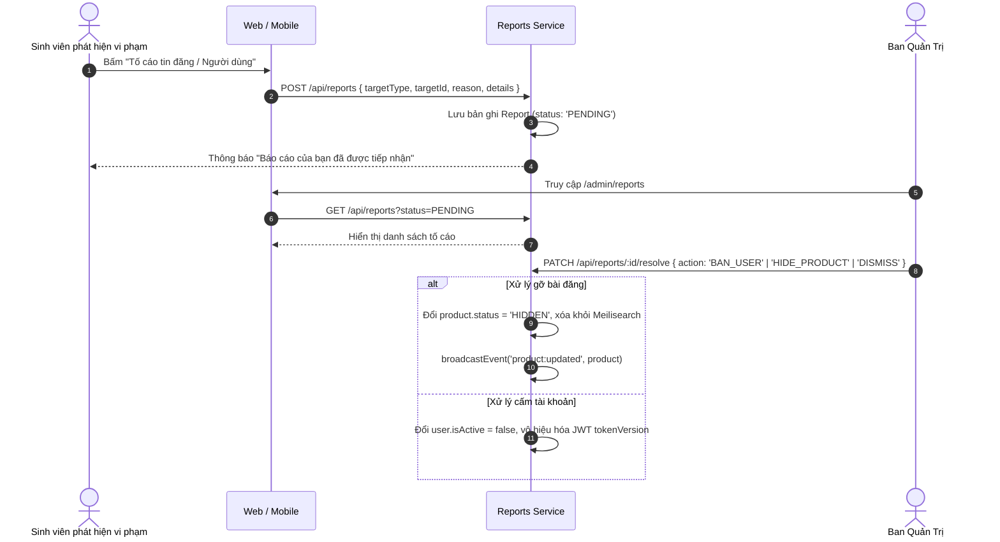

### 10.2. Tìm trạm Safe-Handoff gần nhất

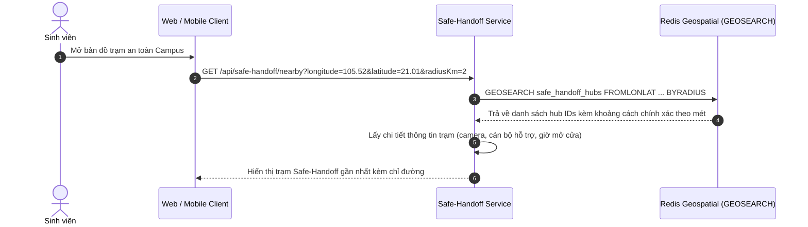

---

## FLOW 11: HỆ THỐNG THÔNG BÁO THỜI GIAN THỰC & ĐA KÊNH TRÊN WEB

Hệ thống thông báo của sàn MarketFU Web kết hợp **4 kênh phân phối (Multi-channel Delivery Architecture)**:
* **Kênh A (In-App Database):** Lưu bản ghi thông báo vào MongoDB Atlas (`Notification` model) với trạng thái `isRead: false`, dùng để hiển thị trên Bell Icon, Badge đỏ và Dropdown lịch sử.
* **Kênh B (Realtime WebSocket Socket.IO):** Bắn tức thời (< 1ms) vào room `user_{userId}`. Khi người dùng đang mở tab Web, icon chuông lập tức nhảy số đỏ, pop Toast nổi và phát chuông âm thanh Web Audio API (`playNotificationChime`).
* **Kênh C (Web Push W3C / VAPID):** Gửi thông báo đẩy chuẩn Native OS (Desktop Banner Windows/macOS) qua Service Worker (`firebase-messaging-sw.js`), tiếp cận được cả khi người dùng thu nhỏ trình duyệt hoặc đang mở tab khác.
* **Kênh D (Email HTML Nodemailer SMTP):** Gửi email cho các biến cố giao dịch quan trọng (`ORDER`, thanh toán Escrow, duyệt `KYC`). Riêng tin nhắn `CHAT` được cách ly hoàn toàn, không gửi email để tránh spam.

### 11.1. Luồng Khởi tạo, Đăng ký Web Push VAPID & Kết nối Socket.IO

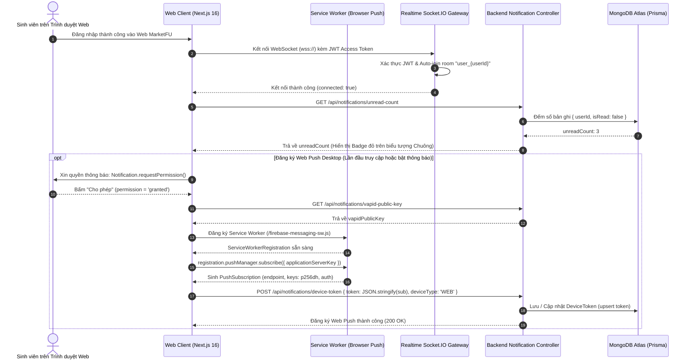

### 11.2. Luồng Bắn Thông Báo Realtime & Điều Phối Đa Kênh Khi Có Sự Kiện

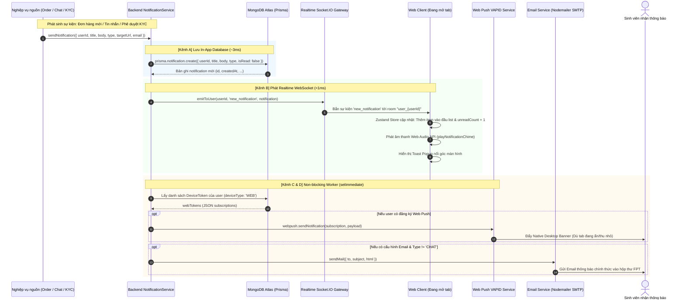

### 11.3. Luồng Tương tác của Người Dùng trên Web: Xem, Đọc Thông Báo & Điều Hướng

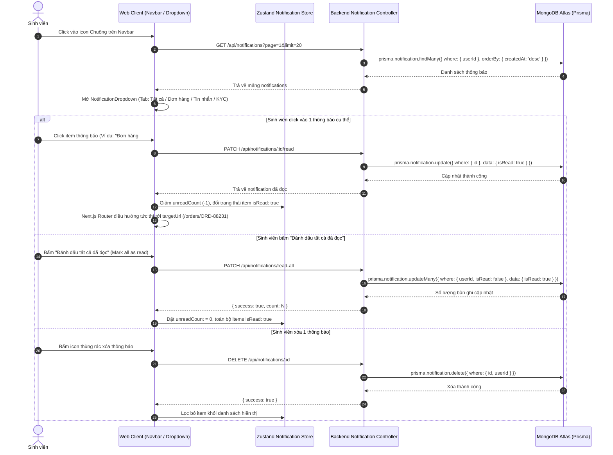

---

## 13. BẢNG MA TRẬN TỔNG HỢP SỰ KIỆN SOCKET.IO & API ENDPOINTS

### 12.1. Danh mục API Endpoints Cốt Lõi (Khớp 100% Codebase)

| Phân hệ | Phương thức | Endpoint | Quyền hạn | Mô tả chức năng |
| :--- | :---: | :--- | :---: | :--- |
| **Auth** | `POST` | `/api/auth/register` | Public | Đăng ký tài khoản bằng email FPT |
| | `POST` | `/api/auth/send-register-otp` | Public | Gửi mã OTP xác thực email đăng ký |
| | `POST` | `/api/auth/verify-register-otp` | Public | Xác thực mã OTP 6 số kích hoạt tài khoản |
| | `POST` | `/api/auth/login` | Public | Đăng nhập nhận cặp Dual JWT Tokens |
| | `POST` | `/api/auth/google` | Public | Đăng nhập nhanh Google SSO |
| | `POST` | `/api/auth/refresh-token` | Public | Cấp lại Access Token mới qua Refresh Token cookie |
| | `POST` | `/api/auth/logout` | Public | Đăng xuất và hủy phiên làm việc |
| | `PATCH` | `/api/auth/change-password` | Authenticated | Đổi mật khẩu tài khoản |
| **Profile** | `GET` | `/api/profile` hoặc `/me` | Authenticated | Lấy hồ sơ cá nhân, số dư Xu, tích xanh |
| | `GET` | `/api/profile/public/:userId` | Public | Xem hồ sơ công khai người bán khác |
| | `PATCH` | `/api/profile/me` | Authenticated | Cập nhật thông tin cá nhân |
| | `POST` | `/api/profile/kyc` | Authenticated | Upload thẻ SV xác thực danh tính |
| | `GET` | `/api/profile/kyc/card/:filename` | Authenticated | Stream ảnh thẻ SV bảo mật (Private Media Streaming) |
| | `POST` | `/api/profile/seller-onboarding` | Authenticated | Nộp hồ sơ Onboarding Người Bán (Thẻ SV, CCCD, STK) |
| | `POST` | `/api/profile/badges/buy` | Authenticated | Mua khung avatar / huy hiệu bằng Xu |
| | `POST` | `/api/profile/withdrawals` | Authenticated | Tạo yêu cầu rút tiền về tài khoản ngân hàng |
| | `GET` | `/api/profile/quests` | Authenticated | Xem danh mục nhiệm vụ tuần |
| | `POST` | `/api/profile/claim-quest` | Authenticated | Nhận thưởng Xu từ nhiệm vụ |
| | `POST` | `/api/profile/check-in` | Authenticated | Điểm danh nhận Xu hàng ngày (+20 Xu) |
| **Products** | `GET` | `/api/products` | Public | Lấy danh sách sản phẩm (Lọc Campus, Danh mục, Giá) |
| | `GET` | `/api/products/suggest` | Public | Gợi ý tìm kiếm autocomplete qua Meilisearch |
| | `GET` | `/api/products/trending/searches` | Public | Top từ khóa hot nhất sàn (Redis ZSET) |
| | `GET` | `/api/products/:id` | Public/Optional | Chi tiết bài đăng + tăng lượt xem |
| | `POST` | `/api/products` | `SELLER`/`ADMIN` | Đăng tin bán sản phẩm mới |
| | `PATCH` | `/api/products/:id` | Chủ bài | Chỉnh sửa nội dung tin đăng |
| | `PATCH` | `/api/products/:id/status` | Chủ bài | Chuyển trạng thái tin (`AVAILABLE`, `RESERVED`, `SOLD`, `HIDDEN`) |
| | `POST` | `/api/products/:id/appeal` | Chủ bài | Gửi kháng cáo khi tin bị BQT từ chối |
| | `PUT` | `/api/products/:id/favorite` | Authenticated | Thêm bài đăng vào danh sách yêu thích (Idempotent) |
| | `DELETE` | `/api/products/:id/favorite` | Authenticated | Bỏ thích bài đăng |
| | `POST` | `/api/products/:id/renew` | Chủ bài | Gia hạn bài đăng thêm 30 ngày |
| | `POST` | `/api/products/:id/boost` | Chủ bài | Đẩy tin (Bump: -100 Xu) hoặc Ghim 24h (Pin: -300 Xu) |
| **Admin Posts** | `GET` | `/api/products/admin/moderation` | `ADMIN` | Xem danh sách tin chờ duyệt (`PENDING_APPROVAL`) |
| | `PATCH` | `/api/products/admin/:id/approve` | `ADMIN` | Phê duyệt tin đăng & phát sóng Realtime |
| | `PATCH` | `/api/products/admin/:id/reject` | `ADMIN` | Từ chối tin đăng kèm lý do cụ thể |
| **Chats** | `GET` | `/api/chats/conversations` | Authenticated | Lấy danh sách cuộc trò chuyện |
| | `POST` | `/api/chats/conversations` | Authenticated | Tạo hoặc mở cuộc trò chuyện theo sản phẩm |
| | `GET` | `/api/chats/conversations/:id/messages` | Authenticated | Lấy lịch sử tin nhắn |
| | `POST` | `/api/chats/conversations/:id/messages` | Authenticated | Gửi tin nhắn qua REST (kèm ảnh) |
| | `PATCH` | `/api/chats/conversations/:id/read` | Authenticated | Đánh dấu đã đọc toàn bộ hội thoại |
| **AI Module** | `POST` | `/api/ai/vision-post` | Authenticated | Quét ảnh tự động điền form bài đăng trong 3s |
| | `POST` | `/api/ai/assistant-chat` | Public/Optional | Chatbot tư vấn tìm đồ phòng trọ theo giá & campus |
| **Categories** | `GET` | `/api/categories` | Public | Danh sách danh mục hàng hóa trên sàn |
| | `GET` | `/api/categories/:slug` | Public | Chi tiết danh mục theo slug |
| | `POST` | `/api/categories/seed` | `ADMIN` | Seed danh mục mặc định chuẩn FU |
| | `POST`/`PATCH`/`DELETE` | `/api/categories/:id` | `ADMIN` | Thêm, sửa, xóa danh mục |
| **Orders** | `POST` | `/api/orders` | Authenticated | Tạo đơn hàng mới (`MEETUP` hoặc `SHIP_COD`) |
| | `GET` | `/api/orders` | Authenticated | Danh sách đơn mua / đơn bán |
| | `GET` | `/api/orders/shipping/estimate` | Authenticated | Dự toán cước phí vận chuyển |
| | `GET` | `/api/orders/seller/analytics` | `SELLER` | Thống kê doanh thu & đơn hàng của người bán |
| | `GET` | `/api/orders/:id` | Authenticated | Chi tiết đơn hàng và tiến trình Escrow |
| | `GET` | `/api/orders/:id/tracking` | Authenticated | Lịch sử timeline hành trình đơn hàng |
| | `POST` | `/api/orders/:id/confirm-order` | `SELLER` | Người bán chấp thuận đơn hàng |
| | `POST` | `/api/orders/:id/seller-confirm-handoff` | `SELLER` | Người bán xác nhận đã bàn giao hàng trực tiếp |
| | `PATCH` | `/api/orders/:id/shipping` | `SELLER` | Cập nhật mã vận đơn & giao hàng COD (`SHIPPING`) |
| | `POST` | `/api/orders/:id/handshake` | Authenticated | Quét mã QR Handshake (HMAC token & OTP 4 số) |
| | `POST` | `/api/orders/:id/confirm-delivery` | Authenticated | Người mua xác nhận nhận hàng an toàn -> Giải phóng Escrow |
| | `POST` | `/api/orders/:id/cancel` | Authenticated | Hủy đơn và hoàn trả Xu/Voucher |
| | `POST` | `/api/orders/:id/dispute` | Authenticated | Mở khiếu nại tranh chấp trực tiếp từ chi tiết đơn hàng |
| **Payments** | `GET` | `/api/payments/order/:orderCode/status` | Authenticated | Tra cứu trạng thái thanh toán theo mã đơn hàng |
| **Webhooks** | `POST` | `/api/webhooks/payments` | Public (HMAC) | Webhook PayOS đối soát thanh toán cọc Escrow |
| | `POST` | `/api/webhooks/shipping` | Public (HMAC) | Webhook GHTK cập nhật trạng thái vận chuyển COD |
| | `POST` | `/api/webhooks/ghn` | Public (HMAC) | Webhook GHN cập nhật trạng thái vận chuyển COD |
| **Reviews** | `POST` | `/api/reviews` | Authenticated | Đánh giá công khai tức thì + tặng Xu |
| | `POST` | `/api/reviews/:id/toggle-public` | Authenticated | Ẩn/hiện bài đánh giá trên trang cá nhân |
| | `GET` | `/api/reviews/user/:userId` | Public | Xem danh sách đánh giá công khai của người dùng |
| **Vouchers** | `GET` | `/api/vouchers` | Public | Danh sách Voucher đang có trên sàn |
| | `POST` | `/api/vouchers/:id/redeem` | Authenticated | Đổi Xu lấy Voucher ưu đãi (sinh voucherCode) |
| | `GET` | `/api/vouchers/me` | Authenticated | Kho Voucher cá nhân |
| | `POST` | `/api/vouchers/use` | Authenticated | Quét mã sử dụng tại quầy đối tác |
| **Disputes & Reports** | `POST` | `/api/reports/upload-evidence` | Authenticated | Upload video / ảnh bằng chứng khiếu nại |
| | `POST` | `/api/reports/disputes` | Authenticated | Mở khiếu nại tranh chấp trong thời hạn bao test |
| | `GET` | `/api/reports/disputes` | `ADMIN` | Admin xem danh sách khiếu nại |
| | `PATCH` | `/api/reports/disputes/:id/approve` | `ADMIN` | Phê duyệt khiếu nại -> Hoàn tiền cho Buyer |
| | `PATCH` | `/api/reports/disputes/:id/reject` | `ADMIN` | Bác bỏ khiếu nại -> Giải phóng tiền cho Seller |
| | `PATCH` | `/api/reports/disputes/:id/cancel` | Authenticated | Người mua tự rút khiếu nại khi đã hòa giải |
| | `POST` | `/api/reports` | Authenticated | Tố cáo tin đăng / người dùng lừa đảo |
| | `GET` | `/api/reports/me` | Authenticated | Xem danh sách các đơn tố cáo của chính mình |
| | `GET` | `/api/reports/analytics/semesters` | `ADMIN` | Thống kê doanh số theo học kỳ & campus |
| | `GET` | `/api/reports/kyc/verifications` | `ADMIN` | Danh sách hồ sơ KYC chờ thẩm định |
| | `POST` | `/api/reports/kyc/:id/ai-scan` | `ADMIN` | Quét AI OCR thẻ SV on-demand |
| | `PATCH` | `/api/reports/kyc/:id/approve` | `ADMIN` | Phê duyệt thẻ SV -> Cấp tích xanh & thưởng Xu |
| **Safe-Handoff** | `GET` | `/api/safe-handoff` | Public | Danh sách trạm giao dịch an toàn |
| | `GET` | `/api/safe-handoff/nearby` | Public | Tìm trạm Safe-Handoff gần nhất (Redis Geo) |
| | `GET` | `/api/safe-handoff/transactions` | `ADMIN` | Danh sách các cuộc hẹn giao dịch tại trạm |
| | `PATCH` | `/api/safe-handoff/:id/toggle` | `ADMIN` | Bật/tắt hoạt động của trạm an toàn |
| **Notifications** | `GET` | `/api/notifications` | Authenticated | Danh sách thông báo cá nhân |
| | `GET` | `/api/notifications/unread-count` | Authenticated | Số lượng thông báo chưa đọc |
| | `PATCH` | `/api/notifications/:id/read` | Authenticated | Đánh dấu một thông báo đã đọc |
| | `PATCH` | `/api/notifications/read-all` | Authenticated | Đánh dấu tất cả thông báo đã đọc |
| | `POST` | `/api/notifications/fcm-token` | Authenticated | Đăng ký Device Token cho Push FCM |
| | `GET` | `/api/notifications/vapid-public-key` | Public | Lấy VAPID Key cho Web Push Notification |
| **Users & Leaderboard** | `GET` | `/api/users/leaderboard/reputation` | Public | BXH sinh viên uy tín nhất (Redis ZSET) |
| | `GET` | `/api/users/:id` | Public | Xem thông tin người dùng công khai |
| | `PATCH` | `/api/users/:id/status` | `ADMIN` | Khóa / mở khóa tài khoản người dùng |
| **Presence** | `GET` | `/api/presence/:userId` | Public/Auth | Lấy trạng thái online/offline của người dùng |
| | `POST` | `/api/presence/batch` | Public/Auth | Kiểm tra trạng thái nhiều người dùng cùng lúc |

---

### 12.2. Danh mục Sự kiện Realtime Socket.IO (Khớp 100% Codebase)

| Tên Sự kiện | Hướng truyền | Kênh / Room | Payload chính | Ý nghĩa nghiệp vụ |
| :--- | :---: | :---: | :--- | :--- |
| `product:created` | Server ➔ Clients | `public_feed` (Toàn sàn) | `{ product: ProductItem }` | Tin mới được BQT duyệt; Web & Mobile cập nhật ngay lên đầu feed |
| `product:updated` | Server ➔ Clients | `public_feed` (Toàn sàn) | `{ product: ProductItem }` | Sản phẩm đổi giá, đổi trạng thái hoặc đã bán |
| `join_conversation` | Client ➔ Server | — | `{ conversationId }` | Tham gia phòng hội thoại P2P |
| `leave_conversation` | Client ➔ Server | — | `{ conversationId }` | Rời phòng hội thoại |
| `joined_conversation` | Server ➔ Client | Socket riêng | `{ conversationId }` | Xác nhận đã tham gia phòng chat |
| `send_message` | Client ➔ Server | `conversation_{id}` | `{ text, messageType, mediaUrl }` | Gửi tin nhắn văn bản hoặc ảnh |
| `send_offer_price` | Client ➔ Server | `conversation_{id}` | `{ conversationId, offerPrice }` | Gửi đề xuất mặc cả giá |
| `send_meetup_location` | Client ➔ Server | `conversation_{id}` | `{ conversationId, meetupLocation }`| Gửi gợi ý điểm hẹn an toàn |
| `receive_message` | Server ➔ Client | `conversation_{id}` | `{ message: MessageItem }` | Nhận tin nhắn mới tức thời trong phòng chat |
| `new_message_notification` | Server ➔ Client | `user_{recipientId}` | `{ conversationId, message, sender }`| Báo tin nhắn mới cho người nhận ngoài phòng chat |
| `typing` / `stop_typing` | Client ➔ Server | `conversation_{id}` | `{ conversationId }` | Báo trạng thái người dùng đang soạn tin |
| `user_typing` | Server ➔ Client | `conversation_{id}` | `{ userId, conversationId }` | Hiển thị chấm ba chấm người bên kia đang gõ |
| `user_stop_typing` | Server ➔ Client | `conversation_{id}` | `{ userId, conversationId }` | Ẩn trạng thái đang gõ |
| `message_read` | Client ➔ Server | `conversation_{id}` | `{ conversationId }` | Đánh dấu đã xem toàn bộ tin trong hội thoại |
| `messages_marked_read` | Server ➔ Client | `conversation_{id}` | `{ conversationId, readBy }` | Cập nhật dấu tích đã đọc cho đối phương |
| `check_presence` | Client ➔ Server | — | `{ userIds: string[] }` (Callback) | Truy vấn tức thì trạng thái online/offline qua Redis |
| `new_notification` | Server ➔ Client | `user_{userId}` | `{ notification: NotificationItem }` | Chuông thông báo đỏ in-app |
| `new_order_received` | Server ➔ Client | `user_{sellerId}` | `{ orderId, orderCode, product }` | Báo người bán có đơn hàng mới được đặt |
| `order_completed` | Server ➔ Client | `user_{buyerId}`, `user_{sellerId}` | `{ orderId, orderCode, status }` | Báo giao dịch hoàn tất sau khi quét Handshake |
| `order_confirmed` | Server ➔ Client | `user_{buyerId}`, `user_{sellerId}` | `{ orderId, orderCode }` | Báo người bán đã chấp thuận đơn hàng |
| `order_cancelled` | Server ➔ Client | `user_{targetId}` | `{ orderId, orderCode }` | Báo đơn hàng đã bị hủy và hoàn trả tiền |
| `order_disputed` | Server ➔ Client | `user_{buyerId}`, `user_{sellerId}` | `{ orderId, orderCode }` | Báo đơn hàng phát sinh khiếu nại tranh chấp |
| `kyc_status_updated` | Server ➔ Client | `user_{userId}` | `{ status: 'APPROVED'/'REJECTED', type }` | Thông báo kết quả BQT duyệt Thẻ SV / Onboarding |
| `profile:coins_updated` | Server ➔ Client | `user_{userId}` | `{ campusCoins, reward }` | Cập nhật số dư Xu tức thì trên Header |
| `withdrawal_updated` | Server ➔ Client | `user_{userId}` | `{ withdrawalId, status }` | Báo trạng thái duyệt lệnh rút tiền mặt |
| `review_revealed` | Server ➔ Client | `user_{reviewerId}`, `user_{revieweeId}` | `{ orderId, orderCode }` | Báo khi có đánh giá mới được gửi và công khai |
