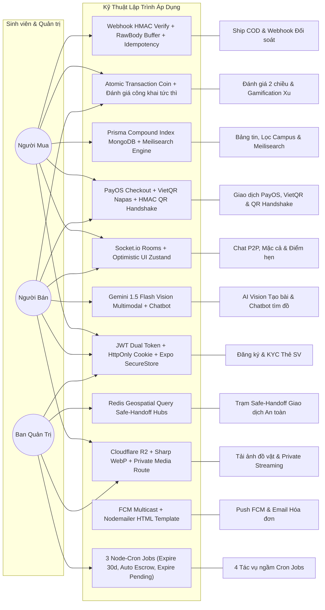

# 📋 TÀI LIỆU ĐẶC TẢ YÊU CẦU & KỸ THUẬT LẬP TRÌNH (REQUIREMENTS.MD)
## Dự án: Campus Marketplace - Sàn Thương Mại Điện Tử & Trao Đổi Đồ Cũ Sinh Viên Đại Học FPT

---

## 📑 MỤC LỤC
1. [Danh sách Tác nhân (Actors)](#1-danh-sách-tác-nhân-actors)
2. [Sơ đồ Tổng quan Use Case & Kỹ thuật Áp dụng](#2-sơ-đồ-tổng-quan-use-case--kỹ-thuật-áp-dụng)
3. [Đặc tả Chi tiết Từng Use Case Kèm Kỹ Thuật Code Cụ Thể](#3-đặc-tả-chi-tiết-từng-use-case-kèm-kỹ-thuật-code-cụ-thể)
4. [Bảng Tra cứu Kỹ thuật & Design Patterns Toàn Dự án](#4-bảng-tra-cứu-kỹ-thuật--design-patterns-toàn-dự-án)
5. [Quy tắc Nghiệp vụ (Business Rules)](#5-quy-tắc-nghiệp-vụ-business-rules)

---

## 1. DANH SÁCH TÁC NHÂN (ACTORS)

| Tác nhân (Actor) | Mô tả vai trò |
| :--- | :--- |
| **1. Khách vãng lai (Guest)** | Người dùng chưa đăng nhập, chỉ được xem danh sách bài đăng công khai và chat thử với trợ lý AI. |
| **2. Người mua (`BUYER`)** | Sinh viên FPT đã xác thực email, tìm đồ gia dụng/sách, chat mặc cả, hẹn gặp test đồ hoặc chọn nhận hàng COD trả tiền sau, quét QR thanh toán & đánh giá nhận Xu. |
| **3. Người bán (`SELLER`)** | Sinh viên đã hoàn tất Onboarding Người Bán (Thẻ SV, CCCD, STK ngân hàng), đăng bài bán đồ bằng AI hoặc Form chuẩn, tạo QR Handshake giao dịch và rút tiền bán về ngân hàng. |
| **4. Ban Quản Trị (`ADMIN`)** | Quản trị viên phụ trách duyệt bài đăng mới (`PENDING_APPROVAL`), thẩm định thẻ SV KYC, phân xử khiếu nại đổi trả và quản lý trạm an toàn Safe-Handoff. |
| **5. Hệ thống / AI Engine** | Tác vụ ngầm tự động (3 Cron Jobs, Push FCM, Email Nodemailer, Gemini AI phân tích ảnh và Chatbot tìm đồ). |
| **6. Cổng Thanh Toán & Vận Chuyển** | PayOS & VietQR Napas 247 xử lý thanh toán Escrow; GHTK / GHN đối soát COD qua Webhooks bảo mật HMAC. |

---

## 2. SƠ ĐỒ TỔNG QUAN USE CASE & KỸ THUẬT ÁP DỤNG

---

## 3. ĐẶC TẢ CHI TIẾT TỪNG USE CASE KÈM KỸ THUẬT CODE CỤ THỂ

### UC-01: Đăng Ký, Đăng Nhập & Quản Lý Phiên (Auth System)
* **Mô tả:** Đăng ký bằng Email FPT kèm mã OTP 6 số, đăng nhập bằng mật khẩu, Google SSO OAuth hoặc Số điện thoại.
* **Kỹ thuật Code cụ thể:**
  * **Backend:** 
    * `POST /api/auth/register` & `POST /api/auth/send-register-otp`: Gửi mã OTP xác thực qua email Nodemailer.
    * `POST /api/auth/verify-register-otp`: Kiểm tra mã OTP trong Redis và tạo tài khoản.
    * `POST /api/auth/login`: Xác thực mật khẩu qua `bcryptjs` (salt 10).
    * `POST /api/auth/google`: `google-auth-library` xác thực `idToken` từ Google Sign-In.
    * `POST /api/auth/refresh-token`: Cấp lại Access Token (15 phút) qua Refresh Token (30 ngày) lưu trong HttpOnly Secure Cookie.
    * `POST /api/auth/logout`: Xóa Refresh Token và hủy phiên.
    * `PATCH /api/auth/change-password` & `POST /api/auth/forgot-password`, `reset-password`: Đổi và khôi phục mật khẩu.
  * **Frontend & Mobile:** Axios Interceptor tự động xử lý mã `401` để làm mới token; Mobile lưu Refresh Token bằng `Expo SecureStore`.

---

### UC-02: Nộp Ảnh Thẻ Sinh Viên Xác Thực & Onboarding Người Bán (KYC & Seller Onboarding)
* **Mô tả:** Sinh viên chụp Thẻ SV và CCCD để nâng cấp quyền Người bán.
* **Kỹ thuật Code cụ thể:**
  * **Backend:** `POST /api/profile/kyc` hoặc `POST /api/profile/seller-onboarding`:
    * Nhận ảnh qua `multer` (`memoryStorage`), nén định dạng WebP bằng thư viện `sharp`.
    * Lưu trữ an toàn trong thư mục upload riêng tư.
    * Chặn truy cập công khai tĩnh; phục vụ qua Route Stream bảo mật: `GET /api/profile/kyc/card/:filename` (chỉ cấp quyền cho Admin hoặc chính chủ sở hữu ảnh).
    * Cập nhật `kyc.status = 'PENDING'`, lưu MSSV, CCCD và STK ngân hàng vào `Profile`.
    * Admin chạy quét OCR tự động theo yêu cầu bằng Gemini 1.5 Flash: `POST /api/reports/kyc/:id/ai-scan`.

---

### UC-03: Bảng Tin Sản Phẩm, Tìm Kiếm & Bộ Lọc Đa Chiều (Feed, Search & Multi-Filter)
* **Mô tả:** Lướt danh sách bài đăng, tìm kiếm có gợi ý tự động, phân trang Skip-Limit, lọc theo Campus và khoảng giá.
* **Kỹ thuật Code cụ thể:**
  * **Database Indexing (Prisma MongoDB):**
    * Compound Index: `@@index([campus, categoryType, status, createdAt(sort: Desc)])`
    * Status Index: `@@index([status, createdAt(sort: Desc)])`
  * **Meilisearch Search Engine:**
    * `GET /api/products/suggest`: Trả về gợi ý từ khóa và sản phẩm theo thời gian thực với cơ chế chịu lỗi chính tả (Typo tolerance).
    * `GET /api/products`: Truy vấn Meilisearch lấy danh sách ID bài đăng phù hợp, sắp xếp theo Ranking Score, fallback về MongoDB regex khi Meilisearch offline.
  * **Redis ZSET Analytics:**
    * `GET /api/products/trending/searches`: Bảng xếp hạng từ khóa tìm kiếm hot trong 24 giờ.
    * `GET /api/products/trending/items`: Top sản phẩm được quan tâm nhiều nhất.
  * **Quản lý Yêu thích Idempotent:** `PUT /api/products/:id/favorite` (thêm) và `DELETE /api/products/:id/favorite` (xóa).

---

### UC-04: Đăng Bài Bán Đồ Bằng AI Vision & Form Chuẩn (AI Quick Post)
* **Mô tả:** Chụp ảnh món đồ gia dụng/sách $\rightarrow$ AI tự trích xuất thông tin điền Form trong 3 giây.
* **Kỹ thuật Code cụ thể:**
  * **Backend:** Endpoint `POST /api/ai/vision-post` sử dụng `@google/generative-ai` với model `gemini-1.5-flash`:
    * Chuyển Buffer ảnh thành Base64 InlineData.
    * Trả về JSON chuẩn schema: Tiêu đề, Danh mục chuẩn (`DORM_ITEM`, `BOOKS`, `ELECTRONICS`...), Tình trạng đồ, Đề xuất mức giá pass hợp lý, Mô tả chi tiết và Hashtags.
  * **Chatbot Tìm Đồ Phòng Trọ:** `POST /api/ai/assistant-chat`: Trợ lý AI tư vấn tìm đồ theo ngân sách và cơ sở Campus.
  * **Kiểm duyệt bài đăng:** Bài đăng mới chuyển sang trạng thái `PENDING_APPROVAL` để BQT duyệt tại `/admin/moderation`. Khi duyệt xong, phát sóng realtime `product:created` tới toàn sàn.
  * **Gia hạn & Đẩy tin:** `POST /api/products/:id/renew` (gia hạn 30 ngày), `POST /api/products/:id/boost` (Bump: -100 Xu, Pin 24h: -300 Xu).

---

### UC-05: Khung Chat P2P Thời Gian Thực & Phím Tắt Mua Bán (P2P Chat)
* **Mô tả:** Nhắn tin 1-1, ghim món đồ đang trao đổi, mặc cả giá và hẹn điểm gặp tại trường.
* **Kỹ thuật Code cụ thể:**
  * **Socket.io Gateway:**
    * Tham gia phòng chat: `socket.emit('join_conversation', { conversationId })`.
    * Gửi tin nhắn: `socket.emit('send_message', payload)`.
    * Phím tắt Mặc cả giá: `socket.emit('send_offer_price', { conversationId, offerPrice })` (chặn nếu mức đề xuất $< 50\%$ giá niêm yết).
    * Phím tắt Điểm hẹn Campus: `socket.emit('send_meetup_location', { conversationId, meetupLocation })`.
    * Trạng thái soạn tin: `socket.emit('typing', ...)` $\rightarrow$ Server phát `user_typing` cho đối phương.
    * Đã đọc tin nhắn: `socket.emit('message_read', ...)` $\rightarrow$ Server phát `messages_marked_read`.
    * Kiểm tra online: `socket.emit('check_presence', { userIds }, callback)`.

---

### UC-06: Giao Dịch PayOS, VietQR Napas & Quét QR Handshake
* **Mô tả:** Đặt mua đồ, thanh toán Escrow qua PayOS hoặc VietQR, gặp mặt test đồ và quét mã QR Handshake chốt đơn.
* **Kỹ thuật Code cụ thể:**
  * **Tạo đơn hàng (`POST /api/orders`):**
    * Khấu trừ Xu tích lũy (tối đa 10% - 20% giá trị món đồ).
    * Áp dụng Voucher cá nhân nếu có (`appliedUserVoucherId`).
  * **Thanh toán Escrow Kép:**
    * Thanh toán trực tuyến: Sinh link thanh toán PayOS (`payosCheckoutUrl`).
    * Giao dịch trực tiếp / VietQR: Sinh mã VietQR Napas 247 động:
      `https://img.vietqr.io/image/${bankId}-${accountNo}-compact2.png?amount=${price}&addInfo=FU_${orderCode}`
  * **Mã Bảo mật QR Handshake (HMAC-SHA256 Token):**
    * Server sinh token bảo mật kèm mã 4 số OTP dự phòng (`1000 - 9999`).
    * Người bán mở mã QR; Người mua quét camera gửi `POST /api/orders/:id/handshake`.
    * Server xác thực mã khớp $\rightarrow$ Chuyển `order.status = 'COMPLETED'`, `product.status = 'SOLD'`, kích hoạt 24h Bao test.
  * **Giải phóng tiền Escrow:** Người mua bấm `POST /api/orders/:id/confirm-delivery` để giải phóng tiền ngay cho người bán, hoặc cron job tự động giải phóng sau 24h.

---

### UC-07: Đơn Hàng Ship COD & Xử Lý Webhooks Vận Chuyển
* **Mô tả:** Mua hàng từ xa qua bưu cục, nhận hàng đồng kiểm tra mới thanh toán.
* **Kỹ thuật Code cụ thể:**
  * **Dự toán cước:** `GET /api/orders/shipping/estimate`.
  * **Tiếp nhận Webhook PayOS (`POST /api/webhooks/payments`):** Xác thực chữ ký HMAC qua `req.rawBody` Buffer, cập nhật đơn `PAID`.
  * **Tiếp nhận Webhook Logistics (`POST /api/webhooks/shipping` & `/ghn`):**
    * Xác thực chữ ký HMAC chống request giả mạo.
    * Kiểm tra Idempotency chống xử lý trùng lặp đơn hàng.
    * Khi trạng thái bưu cục báo `DELIVERED`: Kích hoạt đếm ngược **48h Bao test** và bắn Push FCM cho cả 2 bên.

---

### UC-08: Đánh Giá 2 Chiều & Gamification Xu Thưởng (Campus Coin)
* **Mô tả:** Tích hợp cơ chế điểm thưởng và gamification để sinh viên tích lũy Xu và đổi tiện ích:
* **Cơ chế Kiếm Xu (Earn Coins):**
  * Điểm danh hàng ngày: **+20 Xu** (`POST /api/profile/check-in`).
  * Hoàn thành Nhiệm vụ tuần: Nhận thưởng Xu (`POST /api/profile/claim-quest`).
  * Đánh giá đơn hàng text/ảnh: **+100 Xu**; đính kèm video test: **+200 Xu** + `+2` điểm uy tín.
  * Đánh giá 5 sao cho người bán: **+5** điểm uy tín.
* **Cơ chế Tiêu Xu (Spend Coins):**
  1. Đẩy tin bài đăng (Bump Post): -100 Xu (`POST /api/products/:id/boost`).
  2. Ghim tin nổi bật 24h (Pin to Top): -300 Xu.
  3. Khấu trừ trực tiếp vào đơn hàng (1 Xu = 1 VNĐ, tối đa 10% - 20%).
  4. Mua Khung avatar / Huy hiệu cá nhân (`POST /api/profile/badges/buy`).
  5. Đổi Voucher Căn tin / Passio (`POST /api/vouchers/:id/redeem`).
  6. Rút tiền mặt về tài khoản ngân hàng (`POST /api/profile/withdrawals`).
* **Cơ chế Đánh giá Công khai Tức thì (Instant Public Review):**
  * Đánh giá được lưu với `isPublic = true` và `revealedAt = new Date()` ngay khi người dùng gửi đánh giá đơn hàng (`COMPLETED`).
  * Điểm uy tín (`reputationScore`) được cộng/trừ ngay lập tức vào Profile trong cùng transaction (`applyReputationInsideTx`).
  * Người dùng có thể chủ động ẩn/hiện đánh giá trên trang cá nhân thông qua `POST /api/reviews/:id/toggle-public`.

---

### UC-09: Vận Hành 3 Tác Vụ Ngầm Định Kỳ (Node-Cron Services)
* **Mô tả:** Tác vụ ngầm tự động bảo trì dữ liệu, dọn dẹp tin đăng và giải phóng tiền Escrow.
* **Kỹ thuật Code cụ thể:**
  1. **`expire-products.cron.ts` (00:00:00 hàng ngày):** Quét ngày 27 gửi email/FCM cảnh báo gia hạn; quét ngày 30 tự động chuyển `status = 'EXPIRED'` để gỡ tin quá hạn.
  2. **`escrow-auto-release.cron.ts` (Mỗi 15 phút):** Tự động giải ngân tiền Escrow cho người bán khi hết hạn bao test (24h/48h) mà không phát sinh khiếu nại.
  3. **`expire-pending-orders.cron.ts` (Mỗi 10 phút):** Tự động hủy đơn hàng `PENDING` quá hạn thanh toán và hoàn trả số lượng hàng.

---

### UC-10: Hệ Thống Thông Báo Đa Kênh (Multi-Channel Notifications)
* **Kỹ thuật Code cụ thể:**
  * **Push FCM:** `firebase-admin.messaging().sendEachForMulticast` bắn thông báo đẩy tức thì đến thiết bị di động.
  * **Web Push VAPID:** Cung cấp public key qua `GET /api/notifications/vapid-public-key` cho Service Worker trình duyệt.
  * **Email Nodemailer SMTP:** Render giao diện HTML inline gửi mã OTP xác thực, biên lai thanh toán và cảnh báo hết hạn tin.
  * **In-App Notification:** Quản lý lịch sử thông báo cá nhân, đánh dấu đã đọc (`PATCH /:id/read`, `PATCH /read-all`).

---

### UC-11: Trạm An Toàn Safe-Handoff & Điểm Hẹn An Toàn
* **Mô tả:** Cung cấp danh sách các trạm giao dịch chính thức tại khuôn viên trường kèm camera giám sát và cán bộ hỗ trợ.
* **Kỹ thuật Code cụ thể:**
  * `GET /api/safe-handoff`: Danh sách các trạm an toàn tại các Campus.
  * `GET /api/safe-handoff/nearby`: Sử dụng **Redis Geospatial (`GEOSEARCH`)** để tính toán khoảng cách và trả về trạm gần nhất kèm định vị GPS.
  * Admin quản lý trạm: Tạo mới, cập nhật giờ hoạt động, bật/tắt trạng thái trạm.

---

### UC-12: Tranh Chấp Khiếu Nại (Disputes) & Báo Cáo Vi Phạm
* **Mô tả:** Xử lý khiếu nại trong thời hạn bao test và tố cáo tài khoản/sản phẩm gian lận.
* **Kỹ thuật Code cụ thể:**
  * `POST /api/reports/upload-evidence`: Upload video khui hộp kiểm tra lỗi kỹ thuật.
  * `POST /api/reports/disputes`: Mở khiếu nại $\rightarrow$ Đóng băng tiền Escrow, chuyển `order.status = 'DISPUTED'`.
  * `PATCH /api/reports/disputes/:id/approve` & `/reject`: Admin phán quyết hoàn tiền cho Buyer hoặc chuyển tiền cho Seller.
  * `POST /api/reports` & `PATCH /api/reports/:id/resolve`: Tố cáo vi phạm và admin xử lý cấm tài khoản (`isActive = false`) hoặc ẩn bài đăng (`status = 'HIDDEN'`).

---

## 4. BẢNG TRA CỨU KỸ THUẬT & DESIGN PATTERNS TOÀN DỰ ÁN

| Phân hệ nghiệp vụ | Design Pattern / Kỹ thuật chính | Thư viện / Công nghệ cốt lõi |
| :--- | :--- | :--- |
| **Kiến trúc Tổng thể** | Clean 3-Tier Layered Architecture / Modular Monolith | Node.js + Express + Prisma ORM + TypeScript |
| **Quản lý Dữ liệu** | MongoDB Atlas Document Store + Prisma Client | `@prisma/client`, `prisma/schema.prisma` |
| **Bộ nhớ đệm & Khóa** | Cache-Aside, Redlock Distributed Lock, Redis ZSET | `ioredis`, Redis 7 |
| **Tìm kiếm Thông minh** | Autocomplete Suggestion + Typo Tolerance Search | `meilisearch`, Meilisearch Engine v1.12 |
| **Bảo mật & Phiên** | JWT Dual Token + Hash Salt 10 + Expo SecureStore | `jsonwebtoken`, `bcryptjs`, `expo-secure-store` |
| **Hình ảnh & Media** | Cloudflare R2 Storage + Sharp WebP + Private KYC Route | `@aws-sdk/client-s3`, `sharp`, `multer` |
| **Giao tiếp Realtime** | WebSocket Room Pattern + Handshake JWT Verification | `socket.io`, `socket.io-client` |
| **Trí tuệ Nhân tạo** | Multimodal Vision AI + Conversational Room Assistant | `@google/generative-ai` (Gemini 1.5 Flash) |
| **Thanh toán & Escrow** | PayOS Web Checkout + VietQR Napas 247 + HMAC Handshake | `payos`, `crypto`, `expo-camera` |
| **Vận chuyển & Webhook** | Webhook Receiver + RawBody HMAC Signature + Idempotency | `crypto`, GHTK / GHN Webhooks |
| **Tác vụ Ngầm** | 3 Automated Node-Cron Schedulers | `node-cron` |
| **Thông báo Đa kênh** | Event-Driven Push FCM + VAPID Web Push + SMTP Email | `firebase-admin`, `nodemailer` |
| **Điểm Hẹn An Toàn** | Geospatial Proximity Search | Redis Geospatial (`GEOADD`, `GEOSEARCH`) |

---

## 5. QUY TẮC NGHIỆP VỤ (BUSINESS RULES)

1. **BR-01 (Phương thức Thanh toán Escrow & COD):** Mọi giao dịch qua sàn đều được bảo đảm bằng cơ chế giữ tiền Escrow (đối với PayOS/VietQR) hoặc đồng kiểm tra nhận hàng mới trả tiền (đối với Ship COD).
2. **BR-02 (Phân quyền Người bán):** Người dùng thông thường (`BUYER`) chỉ được mua hàng. Để đăng bán không giới hạn, người dùng phải hoàn tất Onboarding Người Bán (`SELLER`) và được Ban Quản Trị phê duyệt.
3. **BR-03 (Bảo vệ Người mua - Thời hạn Bao test):** Giao dịch gặp mặt trực tiếp tại trường được bao test 24 giờ; giao dịch Ship COD bưu cục được bao test 48 giờ. Hết hạn bảo hành, tiền Escrow tự động chuyển về tài khoản người bán.
4. **BR-04 (Bằng chứng Video Khiếu nại):** Khiếu nại hàng lỗi bắt buộc phải có video clip quay rõ lỗi kỹ thuật hoặc quá trình khui hộp đồng kiểm.
5. **BR-05 (Quy tắc Đánh giá Công khai Tức thì & Điểm Uy tín):** Sau khi đơn hàng hoàn tất (`COMPLETED`), mỗi bên có thể gửi đánh giá độc lập; đánh giá được công khai ngay lập tức, thưởng Campus Coin và cập nhật điểm uy tín theo thời gian thực.
6. **BR-06 (Bảo vệ Trữ lượng & Chống Spam):** Bài đăng quá hạn 30 ngày tự động được chuyển sang trạng thái `EXPIRED` để giữ sàn luôn tươi mới; người bán được gửi thông báo nhắc gia hạn vào ngày thứ 27.
