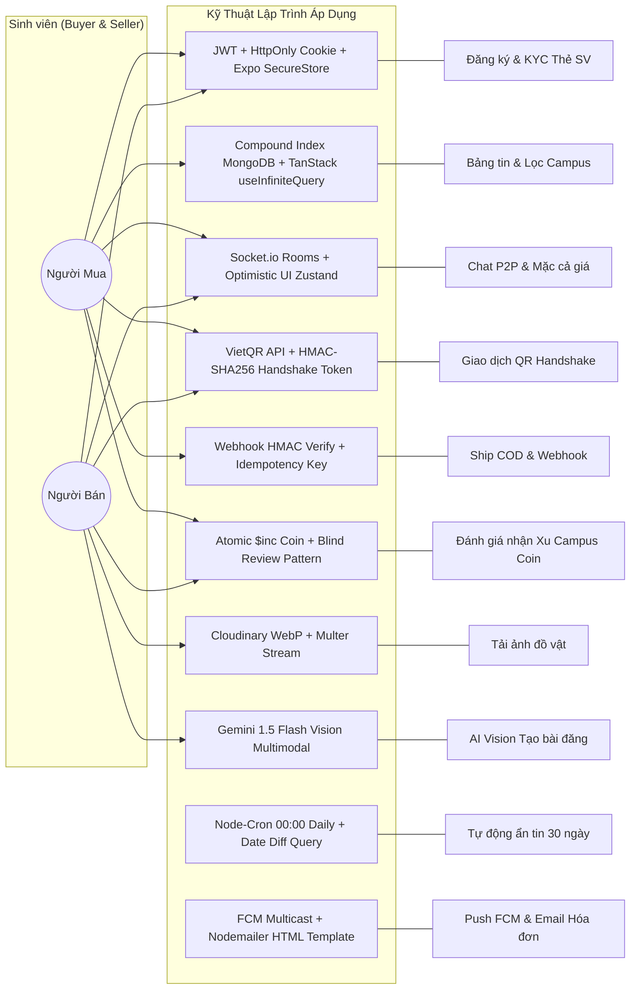

# 📋 TÀI LIỆU ĐẶC TẢ YÊU CẦU & KỸ THUẬT LẬP TRÌNH (REQUIREMENTS.MD)
## Dự án: Campus Marketplace - Sàn Thương Mại Điện Tử & Trao Đổi Đồ Cũ Sinh Viên

---

## 📑 MỤC LỤC
1. [Danh sách Tác nhân (Actors)](#1-danh-sách-tác-nhân-actors)
2. [Sơ đồ Tổng quan Use Case & Kỹ thuật Áp dụng](#2-sơ-đồ-tổng-quan-use-case--kỹ-thuật-áp-dụng)
3. [Đặc tả Chi tiết Từng Use Case Kèm Kỹ Thuật Code Cụ Thể](#3-đặc-tả-chi-tiết-từng-use-case-kèm-kỹ-thuật-code-cụ-thể)
4. [Bảng Tra cứu Kỹ thuật & Design Patterns Toàn Dự án](#4-bảng-tra-cứu-kỹ-thuật--design-patterns-toàn-dự-án)
5. [Quy tắc Nghiệp vụ (Business Rules)](#5-quy-tắc-nghiệp-vụ-business-rules)

---

## 1. DANH SÁCH TÁC NHÂN (ACTORS)

| Tác nhân (Actor) | Mô tả vai trò |
| :--- | :--- |
| **1. Khách vãng lai (Guest)** | Người dùng chưa đăng nhập, chỉ được xem danh sách bài đăng công khai. |
| **2. Người mua (Buyer)** | Sinh viên đã đăng nhập (Cấp 1 hoặc Cấp 2), tìm đồ gia dụng/sách, chat mặc cả, hẹn gặp test đồ hoặc chọn nhận hàng COD trả tiền sau, quét QR thanh toán & đánh giá nhận Xu. |
| **3. Người bán (Seller)** | Sinh viên đã nộp Thẻ SV (Tích Xanh Cấp 2), đăng bài đồ gia dụng/sách bằng AI hoặc Form 5 bước, tạo QR Handshake hoặc gửi hàng COD qua bưu cục. |
| **4. Mod Campus / Admin** | Ban quản trị từng cơ sở (Hòa Lạc, HCM, ĐN, QN, CT...), duyệt ảnh Thẻ SV, phân xử khiếu nại đổi trả và khóa tài khoản lừa đảo. |
| **5. Hệ thống / AI Engine** | Tác vụ ngầm tự động (Cron 30 ngày, Push FCM, Email Nodemailer, Gemini AI phân tích ảnh, Xử lý Webhook giao hàng). |
| **6. Đơn vị Vận chuyển (3rd-party Logistics)** | GHTK / GHN / ViettelPost kết nối qua API, thu hộ tiền COD & bắn Webhook cập nhật tiến trình giao hàng. |

---

## 2. SƠ ĐỒ TỔNG QUAN USE CASE & KỸ THUẬT ÁP DỤNG



---

## 3. ĐẶC TẢ CHI TIẾT TỪNG USE CASE KÈM KỸ THUẬT CODE CỤ THỂ

### UC-01: Đăng Ký, Đăng Nhập & Quản Lý Phiên (Auth System)
* **Mô tả:** Đăng nhập bằng Google OAuth, Email/Mật khẩu hoặc Số điện thoại.
* **Kỹ thuật Code cụ thể:**
  * **Backend:** 
    * `google-auth-library` xác thực idToken từ Google client.
    * `bcryptjs` mã hóa mật khẩu (Salt round = 10).
    * `jsonwebtoken`: Tạo **Access Token** (15 phút) và **Refresh Token** (30 ngày).
    * Web Cookie: `res.cookie('refreshToken', token, { httpOnly: true, secure: true, sameSite: 'strict' })`.
  * **Frontend Web:** Axios Interceptor tự động bắt mã `401` để gọi `POST /api/auth/refresh-token` cấp lại Access Token trong suốt.
  * **Mobile App:** Lưu trữ Refresh Token vào `Expo SecureStore` (mã hóa cấp độ phần cứng Keychain / Keystore).

---

### UC-02: Nộp Ảnh Thẻ Sinh Viên Xác Thực (KYC Student ID)
* **Mô tả:** Sinh viên chụp ảnh Thẻ SV / FAP gửi lên hệ thống để cấp Tích Xanh.
* **Kỹ thuật Code cụ thể:**
  * **Mobile:** `expo-image-picker` gọi camera, cấu hình `allowsEditing: true, quality: 0.8`.
  * **Backend:** `multer` (bộ nhớ tạm `memoryStorage`) $\rightarrow$ truyền stream qua `cloudinary.v2.uploader.upload_stream({ folder: 'kyc_cards', format: 'webp' })`.
  * **MongoDB:** Lưu `studentVerification.status = 'PENDING'`, lưu link ảnh Cloudinary, MSSV và Campus.

---

### UC-03: Bảng Tin Sản Phẩm & Bộ Lọc Đa Chiều (Feed & Multi-Filter)
* **Mô tả:** Lướt danh sách đồ gia dụng/sách, phân trang 20 món/lần, lọc theo Campus và khoảng giá.
* **Kỹ thuật Code cụ thể:**
  * **Database Indexing:** 
    * Compound Index: `PostSchema.index({ campus: 1, category: 1, status: 1, createdAt: -1 })`.
    * Text Search Index: `PostSchema.index({ title: 'text', description: 'text' })`.
  * **Backend Pagination:** Sử dụng Skip-Limit kết hợp `$match` và `$sort`.
  * **Frontend Web:** `useInfiniteQuery` của TanStack Query v5 + Intersection Observer (cuộn đến đáy tự tải trang tiếp).
  * **Mobile App:** React Native `FlatList` với `onEndReached`, `expo-image` hỗ trợ thuộc tính `placeholder` (blurhash) và cache đĩa tự động.

---

### UC-04: Đăng Bài Bán Đồ Siêu Tốc Bằng AI Vision (AI Quick Post)
* **Mô tả:** Chụp 1 bức ảnh cái quạt/nồi cơm/bàn $\rightarrow$ AI tự điền Form trong 3 giây.
* **Kỹ thuật Code cụ thể:**
  * **Backend:** Dùng `@google/generative-ai` với model `gemini-1.5-flash`.
  * **Prompt Engineering:**
    ```typescript
    const prompt = `Bạn là trợ lý sàn đồ cũ sinh viên FPT. Hãy phân tích ảnh này và trả về định dạng JSON thuần túy theo schema:
    { "title": string, "category": "DORM_ITEM"|"BOOKS"|"ELECTRONICS"|"VEHICLE"|"CLOTHING"|"OTHER", "condition": "NEW_100"|"LIKE_NEW_99"|"USED_GOOD"|"USED_FAIR", "suggestedPrice": number, "description": string }`;
    ```
  * Chuyển Buffer ảnh thành `inlineData (base64, mimeType)` gửi qua Gemini API $\rightarrow$ Parse JSON trả về cho Frontend tự động điền vào Form.

---

### UC-05: Khung Chat P2P Thời Gian Thực & Phím Tắt Mặc Cả
* **Mô tả:** Nhắn tin 1-1, ghim món đồ đang trao đổi, mặc cả giá và hẹn điểm gặp trong trường.
* **Kỹ thuật Code cụ thể:**
  * **Socket.io Pattern:**
    * Client join room: `socket.emit('join_conversation', conversationId)`.
    * Room name: `room_${conversationId}`.
    * Gửi tin: `socket.emit('send_message', payload)`.
    * Server broadcast: `io.to(room).emit('receive_message', newMessage)`.
  * **State Management (Frontend):** **Optimistic UI Update** — Khi bấm gửi, tin nhắn hiển thị ngay lập tức trên UI với icon đồng hồ 🕒 (Pending). Khi Socket phản hồi thành công $\rightarrow$ Đổi thành dấu tích xanh ✅.
  * **Mặc cả giá:** Giới hạn mức đề xuất `offerPrice >= post.price * 0.5`.

---

### UC-06: Giao Dịch Gặp Mặt Trực Tiếp & Quét QR Handshake
* **Mô tả:** Test đồ tại Căn tin/KTX $\rightarrow$ Quét VietQR trả tiền $\rightarrow$ Quét mã QR Handshake chốt đơn.
* **Kỹ thuật Code cụ thể:**
  * **Tạo VietQR động:** Định dạng chuẩn Napas 247:
    `https://img.vietqr.io/image/${bankId}-${accountNo}-compact2.png?amount=${price}&addInfo=FU_${orderCode}`
  * **Sinh mã QR Handshake (HMAC-SHA256 Token):**
    * Server sinh mã token bảo mật: `crypto.createHmac('sha256', SECRET_KEY).update(orderId + timestamp).digest('hex')`.
    * Người bán mở mã QR chứa token này (kèm mã 4 số OTP hiển thị bên dưới làm phương án dự phòng khi camera đối phương bị lỗi).
  * **Scanner:** Mobile dùng `expo-camera` / `CameraView` quét mã QR $\rightarrow$ Gửi API `POST /api/orders/:id/handshake`.
  * **Xử lý hoàn tất:** Chuyển `post.status = 'SOLD'`, cộng `+5` điểm uy tín cho 2 bên, kích hoạt 24h Bao test.

---

### UC-07: Đơn Hàng Ship COD & Xử Lý Webhook Bên Thứ 3
* **Mô tả:** Mua hàng từ xa (Quy Nhơn $\rightarrow$ Sài Gòn), shipper giao tận nơi mới thu tiền COD.
* **Kỹ thuật Code cụ thể:**
  * **Tạo vận đơn:** Gọi API tạo đơn sang bưu cục (GHTK/GHN Sandbox) $\rightarrow$ Lưu `trackingCode`.
  * **Xử lý Webhook (`POST /api/webhooks/shipping`):**
    * **Kiểm tra chữ ký (Signature Verification):**
      `const signature = crypto.createHmac('sha256', GHTK_SECRET).update(req.rawBody).digest('hex');`
      So sánh `signature === req.headers['x-ghtk-signature']` để chống tấn công giả mạo Webhook.
    * **Chống lặp đơn (Idempotency):** Kiểm tra `order.shippingStatus === 'DELIVERED'` trước khi xử lý để tránh nhận 2 lần webhook trùng.
    * Khi `status == 'DELIVERED'`: Kích hoạt đếm ngược **48h Bao test** và bắn Push FCM cho người mua.

---

### UC-08: Đánh Giá 2 Chiều & Hệ Thống Gamification Xu (Campus Coins)
* **Mô tả:** Tích hợp cơ chế điểm thưởng và gamification để sinh viên tích lũy Xu và sử dụng thuần nội bộ 100% trong hệ thống:
* **Cơ chế Kiếm Xu (Earn Coins):**
  * Viết đánh giá đơn hàng có tâm $\ge 20$ từ + 1 ảnh: **+100 Xu** (kèm video: **+200 Xu**) + `+2 điểm uy tín`.
  * Xác thực Thẻ Sinh Viên (KYC) thành công: **+500 Xu**.
* **Cơ chế Tiêu Xu (Spend Coins - Thuần Nội Bộ 100%):**
  1. **Đẩy tin lên đầu trang (Bump Post) — 100 Xu:** Cập nhật `product.boostedAt = now()` để bài đăng vượt lên trên các tin cũ.
  2. **Ghim tin nổi bật 24h (Pin to Top) — 300 Xu:** Đặt `product.isPinned = true`, `product.pinnedUntil = now() + 24h` hiển thị viền cam nổi bật ở đầu trang chủ.
  3. **Khấu trừ tiền Đơn hàng Online:** Chỉ áp dụng cho đơn thanh toán qua sàn (VietQR/Napas/PayOS). Giảm tối đa 10% - 20% giá trị đơn (1 Xu = 1 VNĐ).
  4. **Mở khóa Huy hiệu & Khung Avatar:** Đổi Xu lấy huy hiệu Profile *"Top Seller 5 Sao"*, *"Sinh viên K18 Uy Tín"*.
* **Kỹ thuật Code cụ thể:**
  * **Database Transaction & Audit Log:** Mọi thao tác cộng/trừ Xu đều phải thực hiện trong `prisma.$transaction` đồng thời ghi bản ghi vào bảng `CoinTransaction`.
  * **Blind Review Pattern:** Trong bảng `Review`, đặt `isPublic = false`. Khi cả 2 tài khoản đã nộp đánh giá (hoặc sau 7 ngày) $\rightarrow$ Chuyển `isPublic = true` để công khai cùng lúc, chống việc trả đũa vote 1 sao.

---

### UC-09: Tự Động Ẩn Tin Quá Hạn 30 Ngày (Cron Job)
* **Mô tả:** Tự động dọn dẹp các bài đăng cũ quá 30 ngày không có giao dịch.
* **Kỹ thuật Code cụ thể:**
  * **Node-Cron:** Lập lịch chạy lúc `00:00:00` hàng ngày (`cron.schedule('0 0 * * *', ...)`).
  * **Truy vấn ngày 27:** Tìm các bài có `status: 'AVAILABLE'` và `createdAt` trong khoảng $[27, 28]$ ngày $\rightarrow$ Bắn FCM + gửi Email nhắc gia hạn.
  * **Truy vấn ngày 30:** `PostModel.updateMany({ status: 'AVAILABLE', createdAt: { $lte: date30DaysAgo } }, { $set: { status: 'EXPIRED' } })`.

---

### UC-10: Hệ Thống Thông Báo Đa Kênh (Multi-Channel Notifications)
* **Kỹ thuật Code cụ thể:**
  * **Push FCM:** `firebase-admin.messaging().sendEachForMulticast({ tokens: fcmTokens, notification: { title, body }, data: { link: '/orders/123' } })`.
  * **Email Nodemailer:** Cấu hình SMTP Gmail / Resend, render file HTML template với CSS inline gửi hóa đơn và kết quả duyệt Thẻ SV.

---

## 4. BẢNG TRA CỨU KỸ THUẬT & DESIGN PATTERNS TOÀN DỰ ÁN

| Phân hệ nghiệp vụ | Design Pattern / Kỹ thuật chính | Thư viện / Công nghệ cốt lõi |
| :--- | :--- | :--- |
| **Kiến trúc Tổng thể** | Headless Architecture / Modular Monolith | Node.js + Express + Next.js + React Native |
| **Quản lý State & Cache** | Server State Cache + Global State Store | TanStack Query v5 + Zustand |
| **Xác thực & Bảo mật** | JWT Dual Token + Hash Salt 10 + SecureStore | `jsonwebtoken`, `bcryptjs`, `expo-secure-store` |
| **Hình ảnh & Media** | Streaming Upload + Auto WebP + Blurhash | `multer`, `cloudinary`, `expo-image` |
| **Giao tiếp Realtime** | WebSocket Room Pattern + Optimistic UI | `socket.io`, `socket.io-client` |
| **Trí tuệ Nhân tạo (AI)** | Multimodal Vision AI + Function Calling | `@google/generative-ai` (Gemini 1.5 Flash) |
| **Thanh toán & Giao dịch** | VietQR Standard + HMAC Signature + QR Scanner | `vietqr.io`, `crypto`, `expo-camera` |
| **Vận chuyển & Webhook** | Webhook Receiver + Signature HMAC Verification | `crypto`, GHTK / GHN APIs |
| **Tác vụ Ngầm định kỳ** | Daily Cron Job Scheduler | `node-cron` |
| **Thông báo Đa kênh** | Event-Driven Notification Dispatcher | `firebase-admin`, `nodemailer` |

---

## 5. QUY TẮC NGHIỆP VỤ (BUSINESS RULES)

1. **BR-01 (Phương thức Nhận hàng rồi mới trả tiền - COD):** Áp dụng cho cả Gặp mặt trực tiếp tại Campus (Test đồ ưng ý mới quét VietQR) và Ship COD bên thứ 3 (Kiểm tra gói hàng rồi mới trả tiền cho Shipper).
2. **BR-02 (Giới hạn đăng bài Cấp 1):** Người dùng chưa nộp Thẻ SV chỉ được đăng tối đa 3 bài/tháng, giá trị mỗi món $< 500.000$ VNĐ.
3. **BR-03 (Đặc quyền Cấp 2 Tích Xanh):** Sinh viên đã duyệt Thẻ SV được đăng không giới hạn số lượng và giá trị bài đăng.
4. **BR-04 (Bằng chứng Video Khui Hộp):** Khiếu nại hàng ship từ xa bắt buộc phải có video quay liền mạch từ lúc mở gói hàng đến lúc cắm điện test lỗi.
5. **BR-05 (Chống Vote Bẩn & Farming Xu):** Chỉ được đánh giá khi đơn hàng đã `COMPLETED`. Mỗi người dùng chỉ được nhận thưởng Xu tối đa 1 lần/tuần từ cùng 1 người bán.
