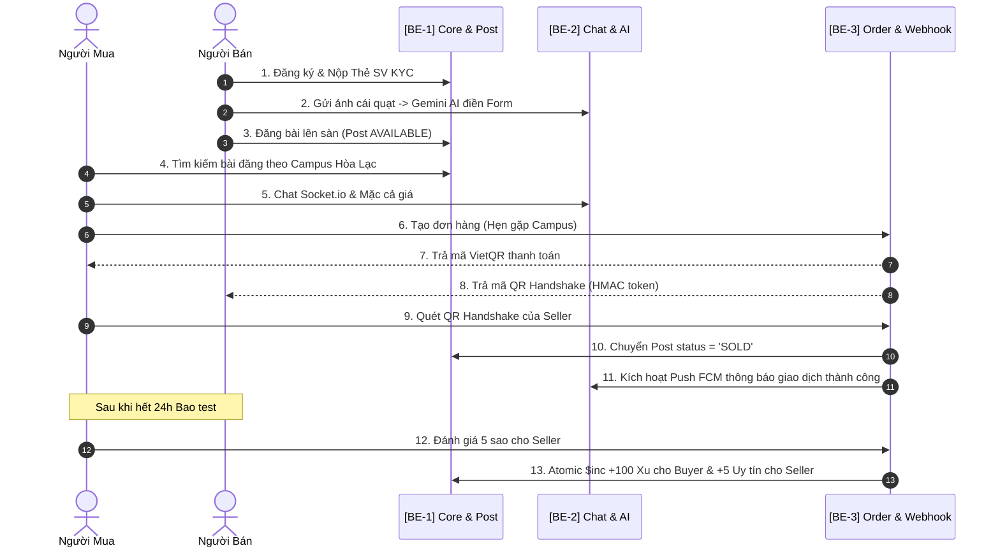

# 📋 BẢNG PHÂN CHIA NHIỆM VỤ DỰ ÁN & KỸ THUẬT LẬP TRÌNH (TASK.MD)
## Dự án: Campus Marketplace - Sàn Đồ Cũ Sinh Viên (Phân chia chuyên sâu Backend cho 3 Lập trình viên)

---

## 👥 PHÂN CHIA TRÁCH NHIỆM CHUYÊN BIỆT THEO 3 BACKEND DEVELOPERS

Hệ thống Backend được module hóa độc lập, chia thành 3 phân hệ nghiệp vụ chính để 3 Lập trình viên Backend có thể code song song không bị xung đột (conflict) mã nguồn:

| Backend Dev | Nhánh phụ trách (Sub-system) | Các Modules & Nghiệp vụ phụ trách | Thư mục & File chính |
| :--- | :--- | :--- | :--- |
| **👨‍💻 BE-DEV 1** | **Core Foundation, Auth & Product Catalog** | • Database Configs, Schemas (User, Post, Category)<br>• Auth JWT Dual Token + Google OAuth + Password Bcrypt<br>• KYC Xác thực Thẻ Sinh Viên + Upload Stream Cloudinary<br>• CRUD Bài đăng, Lọc đa chiều Campus/Category, Phân trang Skip-Limit | `src/config/`<br>`src/modules/auth/`<br>`src/modules/users/`<br>`src/modules/posts/` |
| **👨‍💻 BE-DEV 2** | **Realtime Communication, AI Assistant & Notifications** | • Socket.io Gateway (Rooms `conversation_${id}`, Mặc cả giá, Điểm hẹn)<br>• Gemini 1.5 Flash Multimodal Vision (Phân tích ảnh tạo bài đăng 3s)<br>• Gemini Function Calling Chatbot tìm đồ phòng trọ theo giá<br>• Multi-Channel Notifications (Push FCM Multicast + Nodemailer HTML) | `src/modules/chats/`<br>`src/modules/ai/`<br>`src/modules/notifications/`<br>`src/utils/socket.ts` |
| **👨‍💻 BE-DEV 3** | **Transactions, Ship COD, Webhook, Reviews & Auto-Expire** | • Quản lý Đơn hàng (Hẹn gặp trực tiếp & Ship COD)<br>• VietQR động Napas + HMAC-SHA256 Token QR Handshake (OTP 4 số)<br>• GHTK/GHN Webhook Receiver (HMAC Signature Verify + Idempotency)<br>• Đánh giá 2 chiều (Blind Review Pattern) + Tặng Xu Campus Coin<br>• Khiếu nại (Dispute), Admin Phê duyệt & Cron Job 30 ngày dọn tin | `src/modules/orders/`<br>`src/modules/reviews/`<br>`src/modules/reports/`<br>`src/cron/` |

---

## 🚀 LỘ TRÌNH TRIỂN KHAI BACKEND QUA 3 SPRINTS

```text
┌────────────────────────────────────────────────────────────────────────────────────────┐
│ SPRINT 1: DỮ LIỆU CỐT LÕI, ĐĂNG NHẬP, ĐĂNG BÁN & NỀN TẢNG REALTIME                     │
│ - BE 1: Base Config + Schema DB + Auth (JWT/Google) + KYC Thẻ SV + CRUD Bài đăng      │
│ - BE 2: Cài đặt Socket.io Gateway Server + Schemas Chat (Conversation, Message)        │
│ - BE 3: Cài đặt Order Schemas + VietQR Napas Generator + HMAC-SHA256 Token Generator   │
└───────────────────────────────────────────┬────────────────────────────────────────────┘
                                            │
                                            ▼
┌────────────────────────────────────────────────────────────────────────────────────────┐
│ SPRINT 2: REALTIME MẶC CẢ, GEMINI AI VISION & SHIP COD WEBHOOK                          │
│ - BE 1: Bộ lọc bài viết đa chiều (Campus, Category, Khoảng giá, Text Search) + View Cnt│
│ - BE 2: Gemini AI Flash (Vision Scan ảnh tạo bài + Chatbot tìm đồ) + Push FCM Noti     │
│ - BE 3: Xử lý Webhook GHTK (HMAC Signature + Chống lặp) + Luồng Bao test 24h/48h        │
└───────────────────────────────────────────┬────────────────────────────────────────────┘
                                            │
                                            ▼
┌────────────────────────────────────────────────────────────────────────────────────────┐
│ SPRINT 3: GAMIFICATION COIN, ĐÁNH GIÁ 2 CHIỀU, DISPUTE & CRON JOB                      │
│ - BE 1: Hoàn thiện Profile, Lịch sử tin đăng, API Gia hạn bài viết (Renew 30d)         │
│ - BE 2: Template Email Nodemailer (Duyệt thẻ SV, Biên lai, Cảnh báo tin sắp hết hạn)  │
│ - BE 3: Blind Review (Atomic $inc Coin) + Xử lý Khiếu nại Dispute + Cron dọn tin 00:00 │
└────────────────────────────────────────────────────────────────────────────────────────┘
```

---

## 👨‍💻 CHI TIẾT TỪNG TASK CHO BE-DEV 1: CORE AUTH, KYC & POST CATALOG

### Nhiệm vụ: Xây dựng nền móng cơ sở dữ liệu, phân quyền xác thực và toàn bộ vòng đời tin đăng bán đồ.

- [x] **Task 1.1: Thiết lập Database Connection & Shared Models**
  - Cấu hình kết nối Mongoose / Prisma Atlas (`src/config/prisma.ts`).
  - Viết `User.model.ts`: Quản lý thông tin tài khoản, `role` (BUYER, SELLER, ADMIN), `campus` (HOL, HCM, DAD, QN, CT), `studentVerification` (status: NONE, PENDING, APPROVED, REJECTED; studentId, cardImageUrl), `campusCoins`, `reputationScore`.
  - Viết `Post.model.ts`: Quản lý bài đăng, `title`, `description`, `price`, `category` (DORM_ITEM, BOOKS, ELECTRONICS, VEHICLE, CLOTHING, OTHER), `condition` (NEW_100, LIKE_NEW_99, USED_GOOD, USED_FAIR), `images` (WebP Cloudflare URLs), `location`, `status` (AVAILABLE, RESERVED, SOLD, HIDDEN, EXPIRED), `viewsCount`, `createdAt`, `expiredAt`.
  - Đánh chỉ mục hiệu năng (Compound Indexing):
    `PostSchema.index({ campus: 1, category: 1, status: 1, createdAt: -1 })`
    `PostSchema.index({ title: 'text', description: 'text' })`

- [x] **Task 1.2: Phân hệ Xác thực & Quản lý Phiên (Auth Module)**
  - *File:* `src/modules/auth/`
  - `POST /api/auth/register`: Đăng ký tài khoản mới bằng Email/Mật khẩu (mã hóa `bcryptjs` salt 10).
  - `POST /api/auth/login`: Đăng nhập cấp **Access Token (15m)** và **Refresh Token (30d)** lưu trong HttpOnly Secure Cookie.
  - `POST /api/auth/google`: Tích hợp `google-auth-library` xác thực `idToken` từ Google Sign-In.
  - `POST /api/auth/refresh-token`: Cấp lại Access Token mới khi token cũ hết hạn.
  - `POST /api/auth/logout`: Xóa Refresh Token.
  - Viết Middleware `auth.middleware.ts` & `checkRole.middleware.ts`.

- [x] **Task 1.3: Nộp Thẻ Sinh Viên Xác Thực KYC (Upload Module)**
  - *File:* `src/modules/users/`, `src/modules/profile/`
  - Cấu hình `multer` bộ nhớ tạm `memoryStorage` + kết nối Cloudflare R2 / Local WebP Storage.
  - `POST /api/users/kyc/student-card`: Nhận file ảnh từ client $\rightarrow$ upload stream định dạng auto WebP $\rightarrow$ lưu link vào user, đặt `studentVerification.status = 'PENDING'`, lưu MSSV và Campus.
  - `GET /api/users/me`: Lấy thông tin tài khoản hiện tại kèm số dư Xu và cấp độ Tích Xanh.
  - `PATCH /api/users/me`: Cập nhật tên, SĐT, số tài khoản ngân hàng nhận tiền.

- [x] **Task 1.4: Quản lý Bài Đăng & Bộ Lọc Đa Chiều (Products Module)**
  - *File:* `src/modules/products/`
  - `POST /api/products`: Đăng bài mới kèm kiểm tra Business Rule:
    - User chưa duyệt thẻ SV (Cấp 1): Cho phép tối đa 3 bài/tháng, giá trị $< 500.000$ VNĐ.
    - User đã có Tích Xanh (Cấp 2): Đăng không giới hạn.
  - `GET /api/products`: Lọc bài viết với phân trang Skip-Limit (20 bài/trang) & Meilisearch thông minh:
    - Hỗ trợ Query params: `campus`, `categoryId`, `categoryType`, `condition`, `minPrice`, `maxPrice`, `search` (Fulltext search), `sortBy` (newest, price_asc, price_desc).
  - `GET /api/products/:id`: Lấy chi tiết bài đăng + Atomic `$inc: { viewsCount: 1 }`.
  - `PATCH /api/products/:id`: Chỉnh sửa thông tin bài viết.
  - `PATCH /api/products/:id/status`: Chuyển trạng thái bài (`AVAILABLE`, `RESERVED`, `SOLD`, `HIDDEN`).
  - `POST /api/products/:id/renew`: Gia hạn thêm 30 ngày (cập nhật `expiredAt = now + 30 days`).
  - `POST /api/products/:id/favorite`: Lưu/bỏ lưu tin vào Wishlist cá nhân.
  - `POST /api/products/:id/boost`: Đẩy tin / Ghim nổi bật 24h bằng Xu nội bộ.

---

## 👨‍💻 CHI TIẾT TỪNG TASK CHO BE-DEV 2: REALTIME CHAT, AI & NOTIFICATIONS

### Nhiệm vụ: Xây dựng hạ tầng giao tiếp thời gian thực Socket.io, tích hợp Trợ lý Gemini AI Vision/Chatbot và động cơ thông báo đa kênh.

- [x] **Task 2.1: Hạ tầng Chat Thời Gian Thực (Socket.io Realtime Gateway)**
  - *File:* `src/modules/chats/`, `src/utils/socket.ts`
  - Khởi tạo Socket.io Server gắn cùng HTTP Server, áp dụng xác thực JWT handshake.
  - Lắng nghe các sự kiện:
    - `join_conversation`: Đưa socket vào phòng `conversation_${conversationId}`.
    - `send_message`: Lưu tin nhắn vào MongoDB $\rightarrow$ Broadcast tới phòng qua `receive_message`.
    - `send_offer_price`: Gửi đề xuất mặc cả (Chặn nếu giá đề xuất $< 50\%$ giá gốc món đồ).
    - `send_meetup_location`: Gửi đề xuất địa điểm gặp (Căn tin, KTX, Thư viện...).
    - `typing` / `stop_typing`: Trạng thái đối phương đang gõ tin nhắn.
    - `message_read`: Đánh dấu đã đọc tin nhắn trong phòng.
  - REST APIs kèm theo:
    - `GET /api/chats/conversations`: Danh sách các cuộc trò chuyện của user (kèm unread count).
    - `GET /api/chats/conversations/:id/messages`: Lấy lịch sử tin nhắn (phân trang).
    - `POST /api/chats/conversations`: Tạo hoặc mở cuộc trò chuyện dựa trên `productId`.
    - `POST /api/chats/conversations/:id/messages`: Gửi tin nhắn qua REST (hỗ trợ kèm ảnh Multer).
    - `PATCH /api/chats/conversations/:id/read`: Đánh dấu đã đọc tất cả tin nhắn trong hội thoại.

- [x] **Task 2.2: Trí Tuệ Nhân Tạo AI Vision & Tìm Kiếm Đồ (Gemini AI Module)**
  - *File:* `src/modules/ai/`
  - Cài đặt `@google/generative-ai` với model `gemini-1.5-flash`.
  - `POST /api/ai/vision-post`:
    - Nhận ảnh từ request (Multer buffer) $\rightarrow$ chuyển đổi sang Base64 InlineData.
    - Prompt Engineering ép kiểu JSON schema: Nhận diện món đồ, danh mục chuẩn, độ mới, đề xuất giá pass, mô tả gợi ý.
    - Trả kết quả JSON về cho client tự động điền form trong 3 giây.
  - `POST /api/ai/assistant-chat`:
    - Chatbot hỗ trợ sinh viên tìm đồ trọ: Người dùng hỏi *"Tìm cho mình cái quạt với ấm đun nước dưới 300k ở Hòa Lạc"*.
    - Truy vấn trực tiếp vào Database các món đồ có sẵn thỏa mãn tiêu chí và trả lời kèm danh sách link bài viết phù hợp.
  - REST APIs:
    - `GET /api/ai/sessions`: Danh sách phiên chat với AI.
    - `GET /api/ai/sessions/:id`: Chi tiết lịch sử phiên chat AI.

- [x] **Task 2.3: Động Cơ Thông Báo Đa Kênh (Notification Engine)**
  - *File:* `src/modules/notifications/`
  - Cấu hình `firebase-admin` (FCM) & WebSocket Gateway:
    - Gửi Push Notification qua FCM Multicast đến các thiết bị di động khi có:
      - Tin nhắn chat mới / Lời đề xuất mặc cả mới.
      - Đơn hàng mới / Mã QR Handshake được quét thành công.
      - Kết quả duyệt Thẻ SV (Tích Xanh).
    - Phát thông báo thời gian thực qua socket event `new_notification` vào room `user_${userId}`.
  - REST APIs:
    - `GET /api/notifications`: Lấy danh sách thông báo.
    - `GET /api/notifications/unread-count`: Đếm số thông báo chưa đọc.
    - `PATCH /api/notifications/:id/read`: Đánh dấu đã đọc.
    - `PATCH /api/notifications/read-all`: Đánh dấu đã đọc tất cả.

---

## 👨‍💻 CHI TIẾT TỪNG TASK CHO BE-DEV 3: GIAO DỊCH, SHIP COD, REVIEWS & CRON

### Nhiệm vụ: Xây dựng quy trình luân chuyển đơn hàng, tích hợp VietQR, quét QR Handshake bảo mật, xử lý Webhook COD, đánh giá 2 chiều và tự động dọn dẹp tin.

- [x] **Task 3.1: Phân Hệ Đơn Hàng & Sinh Mã QR Giao Dịch (Orders Module)**
  - *File:* `src/modules/orders/`
  - Viết `order.service.ts`:
    - Nếu `MEETUP`: Sinh mã VietQR động Napas 247 (`img.vietqr.io/image/...`) để người mua quét trả tiền khi gặp.
    - Sinh mã bảo mật **QR Handshake**:
      HMAC-SHA256 update orderCode + sellerId + secret, sinh kèm mã 4 số OTP fallback (`1000 - 9999`) lưu vào DB.
    - Nếu `SHIP_COD`: Khấu trừ Xu (tối đa 10% giá trị món đồ) $\rightarrow$ tạo mã vận đơn `trackingCode`.
  - `POST /api/orders/:id/handshake`: Người mua quét mã QR của người bán $\rightarrow$ Server verify token/OTP $\rightarrow$ Chuyển `order.status = 'COMPLETED'`, cập nhật `product.status = 'SOLD'`, cộng `+5` điểm uy tín cho cả 2 bên $\rightarrow$ Kích hoạt 24h Bao test.
  - `GET /api/orders`: Lấy danh sách đơn mua / đơn bán.
  - `GET /api/orders/:id`: Lấy chi tiết tiến trình đơn hàng.
  - `POST /api/orders/:id/dispute`: Người mua mở khiếu nại trong thời hạn bao test (kèm link video bằng chứng).

- [x] **Task 3.2: Xử Lý Webhook Vận Chuyển Bên Thứ 3 (Ship COD Webhook)**
  - *File:* `src/modules/orders/webhook.service.ts`, `src/modules/orders/webhook.routes.ts`
  - `POST /api/webhooks/shipping`: Nhận Webhook từ đối tác giao hàng (GHTK/GHN):
    - **Xác thực Chữ ký bảo mật (HMAC Signature Verification):** Chống request giả mạo.
    - **Chống nhận lặp Webhook (Idempotency):** Kiểm tra `order.status` trước khi cập nhật.
    - Khi shipper thu tiền COD và phát hàng thành công (`status == 'DELIVERED'`):
      - Cập nhật đơn hàng `DELIVERED`, sản phẩm `SOLD`.
      - Kích hoạt thời gian **48h Bao test**.
      - Bắn thông báo Realtime & Push FCM cho người mua và người bán.

- [x] **Task 3.3: Hệ Thống Đánh Giá 2 Chiều & Gamification Xu Thưởng (Reviews & Coins)**
  - *File:* `src/modules/reviews/`, `src/modules/products/`
  - Viết `Review.model.ts`: `orderId`, `reviewerId`, `revieweeId`, `rating` (1-5), `comment`, `images`, `isPublic` (boolean).
  - `POST /api/reviews`: Gửi đánh giá cho đối phương (Chỉ cho phép khi đơn đã `COMPLETED` và hết thời gian bao test).
  - **Kỹ thuật Blind Review Pattern:** Đánh giá ban đầu lưu `isPublic = false`. Khi cả 2 bên cùng đánh giá xong (hoặc sau 7 ngày) $\rightarrow$ Hệ thống chuyển `isPublic = true` để công khai đồng thời, chống trả đũa 1 sao.
  - **Cộng thưởng Atomic & Ghi sổ cái CoinTransaction:**
    - Người mua: Tặng `+100 Xu` (kèm video test: `+200 Xu`) + `+2 điểm uy tín`.
    - Người bán: Đánh giá 5 sao được `+5 điểm uy tín`.
  - **4 Ứng Dụng Tiêu Dùng Xu (100% Tự Chủ Nội Bộ):**
    1. `POST /api/products/:id/boost`: Đẩy tin lên đầu trang (`BUMP`: -100 Xu) hoặc Ghim nổi bật 24h (`PIN_24H`: -300 Xu).
    2. Khấu trừ trực tiếp vào Đơn hàng Online (VietQR/PayOS): Giảm tối đa 10% - 20% giá trị đơn hàng.
    3. Đổi Huy hiệu & Khung Avatar trang cá nhân: *"Top Seller 5 Sao"*, *"K18 Verified"*.
    4. Rút tiền về tài khoản ngân hàng khi số dư tích lũy lớn qua `WithdrawalRequest`.
  - `GET /api/reviews/user/:userId`: Lấy danh sách đánh giá công khai của người dùng.

- [x] **Task 3.4: Khiếu Nại Đổi Trả & Phân Quản Trị Admin (Dispute & Admin Module)**
  - *File:* `src/modules/reports/`, `src/modules/orders/`
  - `POST /api/orders/:id/dispute`: Người mua gửi khiếu nại trong thời hạn 24h-48h bao test (Bắt buộc kèm link video quay khui hộp test lỗi).
  - `GET /api/admin/kyc-requests`: Danh sách sinh viên chờ duyệt thẻ $\rightarrow$ `PATCH /api/admin/kyc/:id/approve` & `reject`.
  - `GET /api/admin/disputes`: Danh sách khiếu nại $\rightarrow$ `POST /api/admin/disputes/:id/resolve` (Quyết định Hoàn tiền cho Người mua hoặc Chuyển tiền cho Người bán).
  - `POST /api/reports`: Tố cáo tài khoản lừa đảo $\rightarrow$ Admin khóa tài khoản (`status = 'BANNED'`).

- [x] **Task 3.5: Lập Lịch Tự Động Dọn Dẹp Bài Đăng 30 Ngày (Node-Cron Service)**
  - *File:* `src/cron/expirePosts.cron.ts`
  - Thiết lập cron job chạy vào `00:00:00` hàng ngày (`cron.schedule('0 0 * * *', ...)`):
    - **Quét ngày 27:** Tìm các bài đăng có `status = 'AVAILABLE'` tạo cách đây 27 ngày $\rightarrow$ Kích hoạt Notification & Email nhắc người bán bấm nút "Gia hạn thêm 30 ngày".
    - **Quét ngày 30:** `PostModel.updateMany({ status: 'AVAILABLE', createdAt: { $lte: date30DaysAgo } }, { $set: { status: 'EXPIRED' } })` $\rightarrow$ Tự động ẩn tin quá hạn khỏi sàn.

---

## 🛠️ QUY TRÌNH PHỐI HỢP & TEST TÍCH HỢP GIỮA 3 BACKEND DEVS



### 📌 Các Hằng Số & Quy Chuẩn Chung:
1. **Base URL:** `http://localhost:5000/api`
2. **Standard Response Format:**
   ```json
   {
     "success": true,
     "message": "Thao tác thành công",
     "data": { ... }
   }
   ```
3. **Error Response Format:**
   ```json
   {
     "success": false,
     "message": "Chi tiết lỗi",
     "error": { "code": "AUTH_REQUIRED", "details": ... }
   }
   ```
4. **Git Branching cho Backend Team:**
   - Dev 1: `be/feature/core-auth-post`
   - Dev 2: `be/feature/chat-ai-notification`
   - Dev 3: `be/feature/order-webhook-review`
