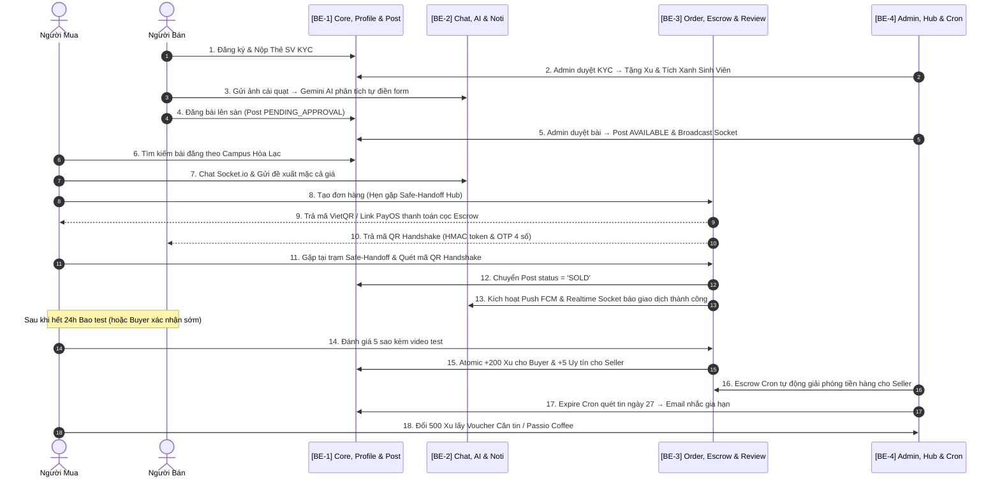

# 📋 BẢNG PHÂN CHIA NHIỆM VỤ DỰ ÁN & KỸ THUẬT LẬP TRÌNH (TASK.MD)
### Dự án: Campus Marketplace - Sàn Đồ Cũ Sinh Viên (Phân chia chuyên sâu Backend cho 4 Lập trình viên)

---

## 👥 PHÂN CHIA TRÁCH NHIỆM CHUYÊN BIỆT THEO 4 BACKEND DEVELOPERS

Hệ thống Backend được thiết kế theo kiến trúc Modular Monolith (Node.js, Express, TypeScript, Prisma ORM với MongoDB Atlas, Redis 7, Meilisearch), chia thành 4 phân hệ nghiệp vụ độc lập:

| Backend Dev | Nhánh phụ trách (Sub-system) | Các Modules & Nghiệp vụ phụ trách | Thư mục & File chính |
| :--- | :--- | :--- | :--- |
| **👨‍💻 BE-DEV 1** | **Core Foundation, Auth, Profile & Product Catalog** | • Database Configs, Prisma Schemas (`User`, `Profile`, `Product`, `Category`)<br>• Auth JWT Dual Token + Google SSO + Phone Auth + OTP Email (`register`, `verify-register-otp`, `forgot/reset-password`)<br>• Profile & KYC: Sinh viên & Người bán (CCCD + STK), Private Media Streaming `/api/profile/kyc/card/:filename`<br>• Gamification Profile: Quests, Nhiệm vụ tuần, Check-in nhận Xu, Mua huy hiệu, Yêu cầu rút tiền<br>• CRUD Bài đăng, Lọc đa chiều, Meilisearch Suggest, Redis ZSET Top Trending, Đẩy tin Bump/Pin | `src/config/prisma.ts`<br>`src/modules/auth/`<br>`src/modules/profile/`<br>`src/modules/users/`<br>`src/modules/products/`<br>`src/modules/categories/` |
| **👨‍💻 BE-DEV 2** | **Realtime Communication, AI Assistant & Notifications** | • Socket.io Gateway: Rooms `conversation_${id}`, `user_${userId}`, `public_feed`<br>• Chat realtime, Mặc cả giá (`send_offer_price`), Hẹn điểm gặp (`send_meetup_location`), Typing, Read receipt<br>• Gemini 1.5 Flash Multimodal Vision: Scan ảnh tự động điền form bài đăng 3s (`/api/ai/vision-post`)<br>• Gemini Chatbot: Tư vấn tìm đồ phòng trọ theo giá & Campus (`/api/ai/assistant-chat`)<br>• Multi-Channel Notifications: Push FCM Multicast + Web Push VAPID + Nodemailer SMTP + In-app | `src/modules/chats/`<br>`src/modules/ai/`<br>`src/modules/notifications/`<br>`src/utils/socket.ts` |
| **👨‍💻 BE-DEV 3** | **Transactions, Escrow, PayOS/VietQR, Webhook & Reviews** | • Quản lý Đơn hàng (Hẹn gặp `MEETUP` & Giao hàng `SHIP_COD`), Khấu trừ Xu (tối đa 10-20%)<br>• Cổng thanh toán Kép: PayOS Checkout Web URL + VietQR Napas 247 động<br>• QR Handshake bảo mật HMAC-SHA256 Token (kèm mã 4 số OTP dự phòng)<br>• Webhook Receivers (HMAC Signature Verify + Idempotency): PayOS (`/api/webhooks/payments`), GHTK/GHN (`/api/webhooks/shipping`, `/api/webhooks/ghn`)<br>• Xác nhận nhận hàng & Giải phóng Escrow (`/api/orders/:id/confirm-delivery`)<br>• Đánh giá công khai tức thì (Instant Public Review) + Tặng Xu Atomic (`CoinTransaction`) | `src/modules/orders/`<br>`src/modules/payments/`<br>`src/modules/reviews/`<br>`src/config/payos.ts`<br>`src/config/redis.ts` |
| **👨‍💻 BE-DEV 4** | **Admin Moderation, Vouchers, Safe-Handoff, Presence & Cron Jobs** | • Quản trị Admin: Duyệt bài (`/admin/moderation`), Duyệt KYC thẻ SV (`/reports/kyc/verifications`), Quét AI Vision On-Demand<br>• Xử lý Khiếu nại (Disputes) đổi trả bao test 24h-48h & Tố cáo tài khoản lừa đảo (`/api/reports`)<br>• Trạm giao dịch an toàn Safe-Handoff Hubs (`/api/safe-handoff`) + Tìm trạm gần nhất qua Redis Geospatial<br>• Hệ thống trạng thái Presence (`/api/presence`) theo dõi online/offline<br>• Kho Voucher Campus Coin (Đổi Xu lấy voucher Căn tin, Passio Coffee, 7-Eleven...)<br>• Tác vụ ngầm định kỳ (Node-Cron): Expire bài đăng 30d, Quét dọn review, Escrow Auto-Release, Expire Pending Orders | `src/modules/reports/`<br>`src/modules/vouchers/`<br>`src/modules/safehandoff/`<br>`src/modules/presence/`<br>`src/cron/`<br>`src/config/mail.ts` |

---

## 🚀 LỘ TRÌNH TRIỂN KHAI BACKEND QUA 3 SPRINTS

```text
┌────────────────────────────────────────────────────────────────────────────────────────┐
│ SPRINT 1: DỮ LIỆU CỐT LÕI, ĐĂNG NHẬP, PROFILE & NỀN TẢNG REALTIME                       │
│ - BE 1: Prisma Config + Schemas MongoDB + Auth (JWT Dual Token/Google/OTP Email) + KYC │
│ - BE 2: Socket.io Gateway Server + Schemas Conversation, Message + Presence Engine     │
│ - BE 3: Order Schemas + VietQR Napas + PayOS Integration + HMAC-SHA256 Token Generator │
│ - BE 4: Admin Hub Safe-Handoff + Schema Report, Dispute & Voucher                      │
└───────────────────────────────────────────┬────────────────────────────────────────────┘
                                            │
                                            ▼
┌────────────────────────────────────────────────────────────────────────────────────────┐
│ SPRINT 2: REALTIME MẶC CẢ, GEMINI AI VISION & SHIP COD WEBHOOK                          │
│ - BE 1: Bộ lọc bài viết đa chiều (Campus, Category, Khoảng giá) + Meilisearch + Views  │
│ - BE 2: Gemini AI Flash (Vision Scan ảnh tạo bài + Chatbot tìm đồ) + Push FCM Noti     │
│ - BE 3: Xử lý Webhook PayOS & GHTK/GHN (HMAC Verify + Chống lặp) + Bao test 24h/48h    │
│ - BE 4: Quét AI OCR Duyệt thẻ SV on-demand + API đổi Voucher Căn tin/Passio           │
└───────────────────────────────────────────┬────────────────────────────────────────────┘
                                            │
                                            ▼
┌────────────────────────────────────────────────────────────────────────────────────────┐
│ SPRINT 3: GAMIFICATION COIN, ĐÁNH GIÁ CÔNG KHAI, ESCROW & 3 CRON JOBS                    │
│ - BE 1: Quests, Nhiệm vụ tuần, Check-in hàng ngày, Đẩy tin Bump/Pin, Rút tiền ví Xu   │
│ - BE 2: Templates Email Nodemailer (Duyệt KYC, Hóa đơn, Cảnh báo tin hết hạn ngày 27)  │
│ - BE 3: Đánh giá công khai tức thì + Xác nhận giao hàng giải phóng Escrow + Ghi sổ cái Coin│
│ - BE 4: Vận hành 3 Cron Jobs (Expire 30d, Auto Escrow, Expire Pending Order)           │
└────────────────────────────────────────────────────────────────────────────────────────┘
```

---

## 👨‍💻 CHI TIẾT TỪNG TASK CHO BE-DEV 1: CORE AUTH, PROFILE & PRODUCT CATALOG

### Nhiệm vụ: Xây dựng nền móng cơ sở dữ liệu Prisma MongoDB, phân quyền xác thực, hồ sơ cá nhân và toàn bộ vòng đời tin đăng bán đồ.

- [x] **Task 1.1: Thiết lập Database Connection & Prisma Schemas**
  - Cấu hình kết nối Prisma Atlas (`src/config/prisma.ts`).
  - Viết `schema.prisma`:
    - `User`: Quản lý tài khoản, `role` (`UNVERIFIED`, `BUYER`, `SELLER`, `ADMIN`), `isActive`, `tokenVersion`.
    - `Profile`: Thông tin 1-1 với User (`fullName`, `campus`, `campusCoins`, `reputationScore`, `avatarBadge`, `cohort`, `major`, `bio`, `dorm`, embedded `kyc`, `bankAccount`).
    - `Product`: Quản lý bài đăng, `title`, `description`, `price`, `originalPrice`, `categoryType` (`DORM_ITEM`, `BOOKS`, `ELECTRONICS`, `VEHICLE`, `CLOTHING`, `OTHER`), `condition` (`NEW_100`, `LIKE_NEW_99`, `USED_GOOD`, `USED_FAIR`), `images` (WebP), `videoUrl`, `status` (`PENDING_APPROVAL`, `AVAILABLE`, `RESERVED`, `SOLD`, `HIDDEN`, `EXPIRED`, `REJECTED`), `moderatedBy`, `appealReason`, `viewsCount`, `expiredAt`.
    - `Category`: Danh mục chuẩn hoá, hỗ trợ seed mặc định.
  - Đánh chỉ mục hiệu năng MongoDB (Compound Indexes):
    `@@index([campus, categoryType, status, createdAt(sort: Desc)])`
    `@@index([status, createdAt(sort: Desc)])`
    `@@index([sellerId, status])`

- [x] **Task 1.2: Phân hệ Xác thực & Quản lý Phiên (Auth Module)**
  - *File:* `src/modules/auth/`
  - `POST /api/auth/register`: Đăng ký tài khoản mới bằng Email FPT & Mật khẩu (`bcryptjs` salt 10).
  - `POST /api/auth/send-register-otp`: Gửi mã OTP 6 số xác thực đăng ký tài khoản.
  - `POST /api/auth/verify-register-otp`: Xác thực mã OTP để kích hoạt tài khoản.
  - `POST /api/auth/resend-register-otp`: Gửi lại mã OTP.
  - `POST /api/auth/login`: Đăng nhập cấp **Access Token (15m)** và **Refresh Token (30d)** lưu trong HttpOnly Secure Cookie.
  - `POST /api/auth/google`: Tích hợp `google-auth-library` xác thực `idToken` từ Google Sign-In.
  - `POST /api/auth/phone`: Xác thực đăng nhập nhanh qua số điện thoại.
  - `POST /api/auth/refresh-token`: Cấp lại Access Token mới khi token cũ hết hạn.
  - `POST /api/auth/logout`: Xóa Refresh Token và hủy phiên.
  - `PATCH /api/auth/change-password`: Đổi mật khẩu (yêu cầu đăng nhập).
  - `POST /api/auth/forgot-password` & `POST /api/auth/reset-password`: Quy trình đặt lại mật khẩu qua email OTP.
  - Middlewares: `auth.middleware.ts` (`authenticate`, `authenticateOptional`, `authorize`).

- [x] **Task 1.3: Quản lý Hồ Sơ, Nộp Thẻ SV KYC & Gamification Profile (Profile & User Module)**
  - *File:* `src/modules/profile/`, `src/modules/users/`
  - `GET /api/profile` hoặc `GET /api/profile/me`: Lấy hồ sơ cá nhân kèm số dư Xu và tích xanh.
  - `GET /api/profile/public/:userId`: Xem hồ sơ công khai của người bán khác.
  - `PATCH /api/profile/me`: Cập nhật thông tin cá nhân (họ tên, SĐT, bio, chuyên ngành, KTX).
  - `PATCH /api/profile/bank-account`: Cập nhật STK ngân hàng nhận tiền.
  - `POST /api/profile/kyc`: Nộp ảnh Thẻ Sinh Viên xác thực (`multer` + `sharp` nén WebP) $\rightarrow$ `kyc.status = 'PENDING'`.
  - `GET /api/profile/kyc/card/:filename`: Stream ảnh thẻ SV riêng tư (Private Media Streaming, chặn truy cập trái phép).
  - `POST /api/profile/seller-onboarding`: Nộp hồ sơ trở thành Người bán (Thẻ SV, CCCD 2 mặt, STK ngân hàng).
  - `POST /api/profile/badges/buy`: Mua huy hiệu/khung avatar bằng Xu (`TOP_SELLER`, `K18_VERIFIED`).
  - `POST /api/profile/withdrawals` & `GET /api/profile/withdrawals`: Tạo yêu cầu và xem lịch sử rút tiền mặt về STK.
  - `GET /api/profile/coins/history`: Xem sổ cái biến động `CoinTransaction`.
  - `GET /api/profile/quests` & `POST /api/profile/claim-quest`: Xem và nhận thưởng nhiệm vụ tuần.
  - `GET /api/profile/check-in-status` & `POST /api/profile/check-in`: Điểm danh nhận Xu hàng ngày (+20 Xu).
  - `GET /api/users/leaderboard/reputation`: Bảng xếp hạng sinh viên uy tín nhất (Redis ZSET).

- [x] **Task 1.4: Quản lý Bài Đăng & Bộ Lọc Đa Chiều (Products Module)**
  - *File:* `src/modules/products/`, `src/modules/categories/`
  - `POST /api/products`: Đăng bài mới kèm kiểm tra quyền:
    - User chưa duyệt thẻ SV: Bị chặn hoặc giới hạn bài đăng (đảm bảo chống spam tin ảo).
    - User đã duyệt thẻ SV / Seller: Đăng tin không giới hạn.
    - Tin đăng mới vào trạng thái `PENDING_APPROVAL` để BQT duyệt.
  - `GET /api/products`: Lọc bài viết với phân trang Skip-Limit & Bộ lọc đa chiều:
    - Params: `campus`, `categoryId`, `categoryType`, `condition`, `minPrice`, `maxPrice`, `search`, `sortBy` (newest, price_asc, price_desc).
  - `GET /api/products/suggest`: Tự động hoàn thành từ khóa tìm kiếm qua Meilisearch.
  - `GET /api/products/trending/searches` & `trending/items`: Top từ khóa và sản phẩm hot trên sàn (Redis ZSET).
  - `GET /api/products/:id`: Chi tiết bài đăng + Atomic `$inc: { viewsCount: 1 }`.
  - `GET /api/products/me`: Lấy danh sách tin của chính mình.
  - `PATCH /api/products/:id`: Sửa tin đăng.
  - `PATCH /api/products/:id/status`: Đổi trạng thái (`AVAILABLE`, `RESERVED`, `SOLD`, `HIDDEN`).
  - `POST /api/products/:id/appeal`: Người bán gửi đơn kháng cáo khi tin bị BQT từ chối.
  - `PUT /api/products/:id/favorite` & `DELETE /api/products/:id/favorite`: Quản lý yêu thích Idempotent.
  - `POST /api/products/:id/renew`: Gia hạn thêm 30 ngày (`expiredAt = now + 30 days`).
  - `POST /api/products/:id/boost`: Đẩy tin (`BUMP`: -100 Xu) hoặc Ghim nổi bật 24h (`PIN_24H`: -300 Xu).

---

## 👨‍💻 CHI TIẾT TỪNG TASK CHO BE-DEV 2: REALTIME CHAT, AI & NOTIFICATIONS

### Nhiệm vụ: Xây dựng hạ tầng giao tiếp thời gian thực Socket.io, trợ lý Gemini AI Vision/Chatbot và động cơ thông báo đa kênh.

- [x] **Task 2.1: Hạ tầng Chat Thời Gian Thực (Socket.io Realtime Gateway)**
  - *File:* `src/modules/chats/`, `src/utils/socket.ts`
  - Khởi tạo Socket.io Server gắn cùng HTTP Server, áp dụng xác thực JWT handshake.
  - Tham gia các phòng: `public_feed` (toàn sàn), `user_${userId}` (thông báo cá nhân), `conversation_${conversationId}` (hội thoại P2P).
  - Lắng nghe các sự kiện:
    - `join_conversation` / `leave_conversation`: Vào/rời phòng chat.
    - `send_message`: Lưu tin nhắn vào MongoDB $\rightarrow$ Broadcast tới phòng qua `receive_message`.
    - `send_offer_price`: Gửi đề xuất mặc cả (Chặn nếu giá đề xuất $< 50\%$ giá gốc món đồ).
    - `send_meetup_location`: Gửi đề xuất địa điểm gặp (Căn tin, KTX, Thư viện, Trạm Safe-Point...).
    - `typing` / `stop_typing`: Phát sự kiện `user_typing` / `user_stop_typing` cho đối phương trong phòng.
    - `message_read`: Đánh dấu đã đọc trong DB $\rightarrow$ phát `messages_marked_read`.
    - `check_presence`: Kiểm tra trạng thái online/offline theo mảng userIds qua callback.
  - REST APIs kèm theo:
    - `GET /api/chats/conversations`: Danh sách các cuộc trò chuyện của user (kèm tin nhắn cuối và unread).
    - `GET /api/chats/conversations/:id/messages`: Lấy lịch sử tin nhắn (phân trang).
    - `POST /api/chats/conversations`: Tạo hoặc mở cuộc trò chuyện dựa trên `productId`.
    - `POST /api/chats/conversations/:id/messages`: Gửi tin nhắn qua REST (hỗ trợ đính kèm ảnh Multer).
    - `PATCH /api/chats/conversations/:id/read`: Đánh dấu đã đọc tất cả tin nhắn trong hội thoại.
    - `DELETE /api/chats/conversations/:id`: Xóa cuộc trò chuyện.

- [x] **Task 2.2: Trí Tuệ Nhân Tạo AI Vision & Tìm Kiếm Đồ (Gemini AI Module)**
  - *File:* `src/modules/ai/`
  - Cài đặt `@google/generative-ai` với model `gemini-1.5-flash` và Rate Limiting chống spam.
  - `POST /api/ai/vision-post`:
    - Nhận ảnh từ request (Multer buffer) $\rightarrow$ chuyển đổi sang Base64 InlineData.
    - Prompt Engineering ép kiểu JSON schema: Nhận diện món đồ, danh mục chuẩn, tình trạng, đề xuất giá pass hợp lý, mô tả gợi ý và hashtags.
    - Trả kết quả JSON về cho client tự động điền form trong 3 giây.
  - `POST /api/ai/assistant-chat` (Hỗ trợ cả khách vãng lai và user đăng nhập):
    - Chatbot hỗ trợ sinh viên tìm đồ phòng trọ: Truy vấn database tìm các món đồ có sẵn theo giá và cơ sở Campus.
    - Trả lời kèm danh sách ID món đồ phù hợp (`suggestedProductIds`).
  - REST APIs:
    - `GET /api/ai/sessions`: Danh sách các phiên chat AI.
    - `GET /api/ai/sessions/:id`: Chi tiết lịch sử phiên chat AI.

- [x] **Task 2.3: Động Cơ Thông Báo Đa Kênh (Notification Engine)**
  - *File:* `src/modules/notifications/`
  - `GET /api/notifications/vapid-public-key`: Cấp VAPID Public Key cho Web Push Service Worker.
  - Cấu hình `firebase-admin` (FCM Multicast):
    - Bắn Push Notification đến thiết bị di động khi có tin nhắn mới, đơn hàng mới, duyệt thẻ SV, cập nhật trạng thái đơn.
  - Phát thông báo thời gian thực qua socket event `new_notification` vào room `user_${userId}`.
  - Cấu hình `src/config/mail.ts` gửi email giao dịch, hóa đơn và mã OTP.
  - REST APIs:
    - `GET /api/notifications`: Lấy danh sách thông báo.
    - `GET /api/notifications/unread-count`: Đếm số thông báo chưa đọc.
    - `PATCH /api/notifications/:id/read`: Đánh dấu đã đọc 1 thông báo.
    - `PATCH /api/notifications/read-all`: Đánh dấu đã đọc tất cả.
    - `POST /api/notifications/device-token`: Đăng ký Device Token FCM.
    - `DELETE /api/notifications/device-token`: Hủy đăng ký token thiết bị.
    - `DELETE /api/notifications/:id` & `DELETE /api/notifications`: Xóa thông báo.

---

## 👨‍💻 CHI TIẾT TỪNG TASK CHO BE-DEV 3: GIAO DỊCH, ESCROW, PAYOS & REVIEWS

### Nhiệm vụ: Xây dựng quy trình luân chuyển đơn hàng, tích hợp cổng thanh toán Kép (PayOS + VietQR), quét QR Handshake bảo mật, xử lý Webhooks và hệ thống đánh giá uy tín.

- [x] **Task 3.1: Phân Hệ Đơn Hàng & Sinh Mã QR Giao Dịch (Orders Module)**
  - *File:* `src/modules/orders/`
  - `POST /api/orders`: Tạo đơn hàng mới (`MEETUP` hoặc `SHIP_COD`):
    - Áp dụng giảm giá bằng Xu (tối đa 10% - 20% giá trị món đồ).
    - Áp dụng Voucher cá nhân nếu có (`appliedUserVoucherId`).
    - Nếu `MEETUP`: Sinh mã VietQR Napas 247 động + Mã bảo mật **QR Handshake** (HMAC-SHA256 update orderCode + sellerId + secret) kèm mã OTP 4 số dự phòng (`1000 - 9999`).
    - Nếu thanh toán PayOS (Web): Sinh `payosCheckoutUrl` và `payosOrderCode`.
  - `GET /api/orders`: Danh sách đơn mua / đơn bán.
  - `GET /api/orders/shipping/estimate`: Dự toán phí giao hàng trước khi đặt.
  - `GET /api/orders/seller/analytics`: Thống kê doanh thu, đơn hàng hoàn tất của người bán.
  - `GET /api/orders/:id`: Chi tiết đơn hàng và tiến trình Escrow.
  - `GET /api/orders/:id/tracking`: Theo dõi trạng thái vận chuyển.
  - `POST /api/orders/:id/handshake`: Người mua quét mã QR của người bán $\rightarrow$ Server verify token/OTP $\rightarrow$ Chuyển `order.status = 'COMPLETED'`, cập nhật `product.status = 'SOLD'`, kích hoạt 24h Bao test.
  - `POST /api/orders/:id/seller-confirm-handoff`: Người bán xác nhận đã bàn giao hàng trực tiếp.
  - `POST /api/orders/:id/confirm-order`: Người bán xác nhận nhận đơn hàng.
  - `PATCH /api/orders/:id/shipping`: Cập nhật mã vận đơn và trạng thái giao hàng.
  - `POST /api/orders/:id/cancel`: Hủy đơn hàng và tự động hoàn trả Xu/Voucher đã dùng.
  - `POST /api/orders/:id/dispute`: Người mua mở khiếu nại trong thời hạn bao test (kèm link video bằng chứng).
  - `POST /api/orders/:id/confirm-delivery`: Người mua xác nhận đã nhận hàng an toàn $\rightarrow$ Giải phóng tiền Escrow cho người bán.

- [x] **Task 3.2: Cổng Thanh Toán PayOS & Xử Lý Webhooks Vận Chuyển (Payments & Webhooks)**
  - *File:* `src/modules/payments/`, `src/modules/orders/webhook.service.ts`
  - `GET /api/payments/order/:orderCode/status`: Kiểm tra trạng thái thanh toán đơn hàng.
  - `POST /api/webhooks/payments`: Tiếp nhận Webhook từ cổng PayOS:
    - **Xác thực chữ ký HMAC:** Kiểm tra tính toàn vẹn gói tin qua `req.rawBody` Buffer.
    - Cập nhật `order.status = 'PAID'`, cập nhật thanh toán và ghi nhận `PaymentTransaction`.
  - `POST /api/webhooks/shipping` & `POST /api/webhooks/ghn`: Tiếp nhận Webhook từ bưu cục GHTK / GHN:
    - **Xác thực HMAC Signature & Chống lặp (Idempotency):** Kiểm tra trạng thái đơn trước khi ghi đè.
    - Khi shipper giao hàng thành công (`DELIVERED`): Kích hoạt **48h Bao test**, bắn thông báo Realtime & Push FCM cho cả hai bên.

- [x] **Task 3.3: Hệ Thống Đánh Giá Công Khai Trực Tiếp & Gamification Xu Thưởng (Reviews & Coins)**
  - *File:* `src/modules/reviews/`
  - Viết `Review` schema: `orderId`, `reviewerId`, `revieweeId`, `rating` (1-5), `comment`, `images`, `proofVideoUrl`, `isPublic`, `revealedAt`.
  - `POST /api/reviews`: Gửi đánh giá cho đối phương (Chặn double-submit: `@@unique([orderId, reviewerId])`).
  - **Cơ chế Đánh giá Công khai Tức thì (Instant Public Review):**
    - Đánh giá được lưu và **công khai ngay lập tức** (`isPublic = true`, `revealedAt = new Date()`), hiển thị ngay trên trang Profile của người bán.
    - Điểm uy tín `reputationScore` được tính toán và áp dụng tức thì cho người bán (+5 uy tín khi nhận 5 sao).
    - Người bán có thể chủ động ẩn/hiện đánh giá trên trang cá nhân nếu cần qua endpoint `POST /api/reviews/:id/toggle-public`.
  - **Cộng thưởng Atomic & Ghi sổ cái `CoinTransaction`:**
    - Người mua: Đánh giá text/ảnh tặng `+100 Xu` (kèm video test: `+200 Xu`) + `+2 điểm uy tín`.
    - Người bán: Nhận đánh giá 5 sao được `+5 điểm uy tín`.
  - `GET /api/reviews/user/:userId`: Lấy danh sách đánh giá công khai của người dùng.
  - `GET /api/reviews/order/:orderId`: Lấy đánh giá của đơn hàng.
  - `PATCH /api/reviews/:id`: Chỉnh sửa nhận xét.
  - `POST /api/reviews/:id/toggle-public`: Người dùng chủ động ẩn/hiện đánh giá trên trang cá nhân.

---

## 👨‍💻 CHI TIẾT TỪNG TASK CHO BE-DEV 4: ADMIN, VOUCHERS, SAFE-HANDOFF & 3 CRON JOBS

### Nhiệm vụ: Xây dựng hệ thống quản trị admin, kho voucher, trạm an toàn Safe-Handoff, theo dõi presence và 3 tác vụ ngầm định kỳ.

- [x] **Task 4.1: Quản Trị Phê Duyệt, Khiếu Nại Đổi Trả & Báo Cáo Vi Phạm (Reports & Disputes Module)**
  - *File:* `src/modules/reports/`
  - `POST /api/reports/upload-evidence`: Upload video / ảnh bằng chứng khiếu nại.
  - `POST /api/reports/disputes`: Người mua gửi khiếu nại trong thời hạn bao test (kèm link video bằng chứng).
  - `GET /api/reports/disputes`: Admin xem danh sách khiếu nại $\rightarrow$ `PATCH /disputes/:id/resolve`, `/approve` (hoàn tiền người mua), `/reject` (chuyển tiền người bán).
  - `PATCH /api/reports/disputes/:id/cancel`: Người mua tự rút khiếu nại nếu hai bên tự thỏa thuận.
  - `GET /api/reports/kyc/verifications`: Admin xem danh sách hồ sơ xác thực Thẻ SV.
  - `POST /api/reports/kyc/:id/ai-scan`: Admin chạy quét AI Vision đối soát MSSV theo yêu cầu (On-Demand).
  - `PATCH /api/reports/kyc/:id/approve` & `reject`: Phê duyệt (cấp Tích Xanh + thưởng Xu) hoặc từ chối Thẻ SV.
  - `POST /api/reports`: Báo cáo vi phạm sản phẩm hoặc tài khoản người dùng lừa đảo.
  - `GET /api/reports/me`: Xem lịch sử các báo cáo của chính mình.
  - `GET /api/reports`: Admin xem danh sách báo cáo vi phạm $\rightarrow$ `PATCH /:id/resolve` (`BAN_USER`, `HIDE_PRODUCT`, `DISMISS`).
  - `GET /api/reports/analytics/semesters`: Thống kê doanh số theo học kỳ và campus.

- [x] **Task 4.2: Kho Voucher Campus Coin & Trạm Giao Dịch Safe-Handoff (Vouchers & Safe-Handoff)**
  - *File:* `src/modules/vouchers/`, `src/modules/safehandoff/`
  - **Vouchers Module:**
    - `GET /api/vouchers`: Danh sách Voucher đang mở đổi (Căn tin, Passio Coffee, 7-Eleven...).
    - `POST /api/vouchers/:id/redeem`: Đổi Xu lấy Voucher $\rightarrow$ Sinh mã `voucherCode` độc nhất dùng 1 lần, ghi sổ cái `CoinTransaction`.
    - `GET /api/vouchers/me` hoặc `/my-vouchers`: Kho Voucher cá nhân của sinh viên.
    - `POST /api/vouchers/use`: Quét mã tại quầy căn tin/quán cà phê $\rightarrow$ Chuyển `status = 'USED'`.
    - Admin: `POST /api/vouchers`, `PATCH /api/vouchers/:id`, `DELETE /api/vouchers/:id`.
  - **Safe-Handoff Module:**
    - `GET /api/safe-handoff`: Xem danh sách các trạm giao dịch an toàn (có camera giám sát, cán bộ hỗ trợ).
    - `GET /api/safe-handoff/nearby`: Tìm trạm Safe-Handoff gần nhất dựa trên tọa độ GPS (Redis Geospatial).
    - `GET /api/safe-handoff/transactions`: Admin xem lịch sử giao dịch tại trạm.
    - Admin: `POST /`, `PATCH /:id`, `PATCH /:id/toggle`, `DELETE /:id`.

- [x] **Task 4.3: Hạ Tầng Trạng Thái Presence (Presence Module)**
  - *File:* `src/modules/presence/`
  - `GET /api/presence/:userId`: Lấy trạng thái online/offline và thời điểm hoạt động cuối cùng của người dùng.
  - `POST /api/presence/batch`: Truy vấn trạng thái hoạt động của một danh sách người dùng (Batch Presence).

- [x] **Task 4.4: Vận Hành 3 Tác Vụ Ngầm Định Kỳ (Node-Cron Services)**
  - *File:* `src/cron/`
  - **1. `expire-products.cron.ts` (00:00:00 hàng ngày):**
    - Quét ngày 27: Tìm các bài đăng sắp hết hạn sau 3 ngày $\rightarrow$ Gửi Notification & Email nhắc người bán gia hạn thêm 30 ngày.
    - Quét ngày 30: Cập nhật `status = 'EXPIRED'` cho bài đăng quá 30 ngày để tự động ẩn khỏi sàn.
  - **2. `escrow-auto-release.cron.ts` (Mỗi 15 phút):**
    - Tự động giải ngân tiền Escrow cho người bán khi hết hạn bảo hành/bao test (24h/48h) mà người mua không mở khiếu nại.
  - **3. `expire-pending-orders.cron.ts` (Mỗi 10 phút):**
    - Tự động hủy các đơn hàng ở trạng thái `PENDING` quá thời hạn thanh toán và hoàn trả tồn kho sản phẩm.

---

## 🛠️ QUY TRÌNH PHỐI HỢP & TEST TÍCH HỢP GIỮA 4 BACKEND DEVS



### 📌 Các Hằng Số & Quy Chuẩn Chung:
1. **Base URL:** `http://localhost:5000/api`
2. **Standard Response Format:**
   ```json
   {
     "success": true,
     "message": "Thao tác thành công",
     "data": { ... }
   }
   ```
3. **Error Response Format:**
   ```json
   {
     "success": false,
     "error": {
       "code": "AUTH_REQUIRED",
       "message": "Chi tiết lỗi",
       "details": []
     }
   }
   ```
